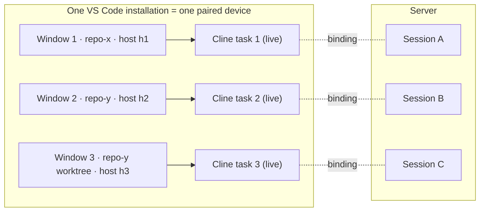

# Multiple VS Code instances and concurrent chats

**Status (2026-11-14):** MI-01 and MI-02 are Done; MI-03 is Done for the explicitly
selected **two-to-three-window, six-case runbook subset** on the exact candidate in
[verification](../../evidence/MI03/verification.json). Broader qualification remains open
as listed in §7.3. MI-04 is Done for the recorded S6/S7/N1 subset (§7.4); MI-06 is Not started. Sections 1–6 and the inspection
inventory describe the original 2026-11-04 research baseline; dated results below
supersede their historical "today" and "unqualified" statements only within that subset.

**Scope decision (user, 2026-11-04):** one live chat per VS Code window. Tiers A and B
are in scope. Tier C, several live chats inside one window, is out of scope.

**Historical source-only checkpoint (2026-11-05):** MI-01 (server, §7.1) and MI-02 (bridge, companion
and generic host, §7.2) are done in source and tests. L9 and L11 are fixed and the
pending-count part of L10 is fixed. For L6, sign-ins are serialized across windows (the
port stays fixed); for L7, windows still share one device but no longer share an inbox. No package was built or installed and the
running local deployment was not rebuilt, so nothing is accepted in real VS Code yet
(MI-03). This was the 2026-11-05 source-only checkpoint. The subsequently approved
candidate server and companion 0.8.0 were deployed/installed on November 5, followed
by the bounded real-native acceptance on November 12 (§7.3).

**Question:** Today one VS Code window holds one connected Cline chat. Can several
VS Code instances, on different workspaces and on the same workspace, be connected
and running at the same time? If so, what has to change?

## 1. Answer

Yes for "many windows, one live chat in each", including several windows on the same
project. Not for "several live chats inside one window" unless the maintained Cline
build changes.

| Target | Feasible? | What it takes |
|---|---|---|
| **A.** Several windows on different workspaces, each with its own connected Cline task | Yes. The server and bridge already model many sessions per device | Companion and small server changes, then real multi-window acceptance |
| **B.** Several live chats on the same workspace | Yes, one chat per window: a duplicated-workspace window, a git worktree or a second isolated installation | Everything in A, plus same-task exclusivity and workspace-overlap warnings. Concurrent edits to the same files remain the user's responsibility |
| **C.** Several live chats in one VS Code window | No, not with Cline 4.1.22. **Out of scope** by the 2026-11-04 decision | Would need a maintained-Cline change to multiple controllers/panels, each with its own SDK session. Large native change and full requalification |

Most "only one" behavior is enforced locally, by the Cline patch and the companion,
not by the server. The five findings that matter most:

1. **Cline 4.1.22 allows exactly one live task per window.** Its webview provider is a
   per-window singleton, and its session controller keeps a single `activeSession`;
   opening or starting another task ends the current session (§2, L1).
2. **Nothing prevents the same Cline task being bound from two windows.** Cline 4 keeps
   tasks in `~/.cline/data`, which every window shares, and so does every isolated
   VS Code installation on the same macOS account. The server only enforces one active
   binding per *server session* (L9).
3. **Bindings on one device serialize behind each other's dispatch permits.** The
   permit transaction holds the shared device and credential rows for up to 10 s; every
   other binding of that device needs those rows for output upload, acknowledgements,
   prompt admission and lease renewal (L11).
4. **Concurrent sign-ins collide.** The OIDC callback is fixed at `127.0.0.1:15945`,
   and the server accepts only exact redirect URIs (L6).
5. **Windows of one installation silently share one device credential and one SQLite
   inbox file.** This cross-process path works on paper but is untested. It also carries
   version-skew and file-deletion hazards (L7).

**What probably works today (unqualified inference from code reading, not run):**
every limit above applies per window. Two windows of the same isolated installation,
on different workspaces, therefore appear able to each connect one task with the
current packages. The second window reuses the saved device and needs no new sign-in.
This has never been executed or accepted, and L6, L7 and L9–L11 apply. If a second
connection failed, the likely causes are:

- trying to bind a second task in the same window;
- switching tasks in the Cline sidebar, which drops the binding;
- two windows pairing at the same moment (port 15945);
- a second *installation*, which needs its own pairing.

## 2. Where the limits come from

| # | Limit | Layer | Evidence | Nature |
|---|---|---|---|---|
| L1 | One Cline sidebar controller per window. One active SDK session. Opening or starting a task ends the current one | Cline 4.1.2204 (upstream 4.1.22) | Installed bundle: singleton `WebviewProvider.getInstance()`, a single `registerWebviewViewProvider(…SIDEBAR_ID…)`, no `createWebviewPanel`; `startNewSession(){ this.activeSession && await this.endActiveSession("startNewSession") … }` | Hard native limit; blocks C |
| L2 | Only the sidebar controller is exported to SDC | SDC Cline patch | [patch:12](../../extensions/vscode/patches/cline-v4.1.22-sdc-m21.3.patch) `createPinnedClineApi(sidebarController)` | Mirrors L1 |
| L3 | One binding per extension host. Any `controller.task` change invalidates every binding. Each operation requires the bound task to still be the visible one | SDC Cline patch | [native-patch.ts:85-86](../../adapters/cline/src/native-patch.ts:85), [:89](../../adapters/cline/src/native-patch.ts:89), [:198](../../adapters/cline/src/native-patch.ts:198) | Deliberate: never send to "whatever task is visible" |
| L4 | One connection per window. A second Connect is rejected | Companion 0.7.3 | [index.ts:12](../../extensions/vscode/src/index.ts:12), [connect.ts:43](../../extensions/vscode/src/connect.ts:43), [connect.ts:76-78](../../extensions/vscode/src/connect.ts:76) | Per window. Other windows are not blocked |
| L5 | The experimental generic host also keeps one active binding | MB-03 host | [host.ts:93](../../adapters/core/src/host.ts:93), [:125](../../adapters/core/src/host.ts:125), [:149](../../adapters/core/src/host.ts:149) | Same per-window model |
| L6 | Fixed OIDC loopback callback `127.0.0.1:15945`. The server accepts exact redirect URIs only | Companion, generic host, server | [connect-ui.ts:12](../../extensions/vscode/src/connect-ui.ts:12), [:63](../../extensions/vscode/src/connect-ui.ts:63); [vscode-host connect-ui.ts:12](../../extensions/vscode-host/src/connect-ui.ts:12); [auth/index.ts:202](../../server/src/auth/index.ts:202) | A second concurrent interactive sign-in fails with port in use. Both extensions in one instance would also collide |
| L7 | Device credential stored per server profile in SecretStorage. Inbox SQLite stored in `globalStorageUri`. Both are shared by all windows of one installation | Companion | [connect-ui.ts:86](../../extensions/vscode/src/connect-ui.ts:86), [:137](../../extensions/vscode/src/connect-ui.ts:137) | Windows share one device and one SQLite file. Untested across processes |
| L8 | Every Connect creates a new random session and binding. Registration accepts only revision 1 and never rebinds a session | Adapter, server | [adapters/cline/src/index.ts:154](../../adapters/cline/src/index.ts:154); [auth/index.ts:367](../../server/src/auth/index.ts:367), [:376-383](../../server/src/auth/index.ts:376) | Sessions accumulate. API aliases `sdc.<bindingId>` change on every reconnect |
| L9 | No server rule limits a native task to one active binding | Server | Only `one_active_binding_per_session`: [001_initial.sql:34](../../server/migrations/001_initial.sql:34) | Gap: the same task could be controlled from two windows |
| L10 | Device-wide caps: 100 pending prompts per device lane; 50,000 commands or 32 MiB retained per device lane, with no archival. Pending counts include commands of detached sessions | Server | [http/index.ts:56](../../server/src/http/index.ts:56); [storage/index.ts:24](../../server/src/storage/index.ts:24), [:246-254](../../server/src/storage/index.ts:246) | All sessions on a device share them. Stale pending entries can leak |
| L11 | Device and credential rows locked for the whole dispatch permit, up to 10 s | Server | [storage/index.ts:111](../../server/src/storage/index.ts:111), [:114](../../server/src/storage/index.ts:114); [http/index.ts:267-285](../../server/src/http/index.ts:267); [public-api/index.ts:25](../../server/src/public-api/index.ts:25); [leases/index.ts:21](../../server/src/leases/index.ts:21) | Latency coupling between bindings of one device |
| L12 | 128 SSE connections server-wide. Each stream polls PostgreSQL every 350 ms. Each bridge runtime opens its own two device-lane streams | Server, bridge | [http/index.ts:20](../../server/src/http/index.ts:20), [:22](../../server/src/http/index.ts:22); [runtime/index.ts:139-146](../../bridge/src/runtime/index.ts:139) | Cost grows linearly with windows |
| L13 | Qualified with one real Cline task. Two-binding isolation tested only with simulated native bindings | Evidence | [IMPLEMENTATION_TRACKER.md:428](../../IMPLEMENTATION_TRACKER.md:428); AGENTS.md M30 entry | Support boundary, not code |

The window's identity already distinguishes hosts. The patch derives `hostId` as a
random UUID per extension-host activation, `windowId` from `vscode.env.sessionId`,
and `workspaceId` as a hash of the workspace folder URIs
([patch:643-648](../../extensions/vscode/patches/cline-v4.1.22-sdc-m21.3.patch)).
Two windows on the same folders therefore share `workspaceId` but never `hostId`.

Under the scope decision, L1–L5 stay as they are. One live binding per window is the
intended model, so the work targets L6–L13.

## 3. What already supports many instances

Keep these; most of the work is already done.

- **Data model.** A user can have many devices and sessions, and a device many
  bindings. Each session has at most one active binding. Commands travel on device
  lanes but carry their `sessionId`. Events, interactions, approvals and leases are
  per session.
- **Bridge.** "Multiple bindings run as separate runtime instances sharing one
  device-scoped `BridgeStore`" ([bridge-runtime.md](../bridge-runtime.md)). Dispatch,
  acknowledgements, outbox and restart recovery are scoped to a session
  ([runtime/index.ts:188](../../bridge/src/runtime/index.ts:188)). Store transactions
  use `BEGIN IMMEDIATE`.
- **Tests.** [repair-integration.test.mjs:11](../../tests/repair-integration.test.mjs:11)
  runs two runtimes on one device and one store against real HTTP/PostgreSQL, with the
  fake adapter. [m30-isolation.test.mjs:9](../../tests/m30-isolation.test.mjs:9) covers
  key and command isolation between two devices and owners.
- **Public API.** `GET /sessions`, `GET /models` with `sdc.<bindingId>` aliases, and
  keys scoped to one session and binding ([public-rest-api.md](../public-rest-api.md)).
- **Control UI.** It already lists sessions with an online indicator, and loads the
  snapshot and event stream of the selected one
  ([main.tsx:233-237](../../control-ui/src/main.tsx:233)).
- **Cline across windows.** Each window runs its own extension host, Cline controller
  and SDK session. Cline's own session database (`~/.cline/data/db/sessions.db`) opens
  with WAL and a busy timeout, so Cline expects multi-process access.

## 4. Proposed model

| Identity | Rule |
|---|---|
| Device | One per VS Code installation (user-data directory) and server profile. Unchanged: pairing stays a one-time human action |
| Host | One per window or extension host. Tiers A and B allow one live binding per host, matching Cline's one active session |
| Native conversation key | `(nativeScopeId, taskId)`. At most one active binding per key, enforced by the server |
| Session | One server conversation per binding today. Phase 2 option: keep the session when the same native conversation is reattached |
| Workspace | `workspaceId`, a hash of folder URIs. Used only to warn about overlap, never for authorization |

## 5. Required changes

### 5.1 Server

**S1: Native conversation exclusivity (required).**

- Add an opaque `nativeScopeId` to the initial binding: the namespace in which
  `nativeConversationId` is unique. For Cline it identifies the resolved Cline data
  directory on that machine, for example a hash of the machine ID and the directory
  chosen by `CLINE_DATA_DIR`, else `CLINE_DIR`, else `~/.cline` (plus `data`).
  The installation ID is the wrong scope: two isolated VS Code installations share
  `~/.cline/data` unless a launcher sets `CLINE_DIR`.
- Under an advisory lock on `(owner, appId, nativeScopeId, nativeConversationId)`, and
  with a partial unique index, refuse a second active binding with
  `409 CONVERSATION_BOUND_ELSEWHERE` and a safe label for the current holder.
- This is an additive protocol field, so it needs a protocol schema revision.
  Registration currently rejects unknown binding fields
  ([auth/index.ts:368](../../server/src/auth/index.ts:368)).
- Takeover stays explicit. Either the holder disconnects, or the new window requests
  takeover with fresh local consent and the server detaches the old binding before
  activating the new one.

**S2: Stop serializing bindings on the shared device row (required while windows share
a device).**

- `lockBindingFence` takes `FOR NO KEY UPDATE` on the binding *and device* rows and
  `FOR UPDATE` on the credential row. `/dispatch` keeps that transaction open until the
  permit closes, up to 10 s. Lease renewal takes `FOR UPDATE OF b,d`.
- While window A holds a permit, window B's output upload, acknowledgements, prompt
  admission, dispatch and lease renewal for the same device wait. B's bridge requests
  time out after 10 s, which is the permit maximum.
- Proposal: keep the binding row exclusive, but take `FOR SHARE` on the device and
  credential rows. Revocation and rotation `UPDATE` those rows, and an update conflicts
  with `FOR SHARE`, so revocation still linearizes against admitted mutations. This
  needs a reviewed lock-order analysis and regression tests: the repair suites plus a
  new two-binding latency test with a held permit.
- Each open permit also holds a pool connection (pool size 20 by default,
  [main.ts:43](../../server/src/main.ts:43)). Budget concurrent permits per user or device.

**S3: Per-session admission and retention.**

- Count only pending commands of *active* bindings toward the device limit, and add a
  per-session pending limit. Commands acknowledged `received`, `unknown` or
  `reconciliation_required` for a detached session currently count forever. Done in
  MI-01.
- Expire or tombstone undelivered and unapplied commands when their binding ends. Not
  needed after MI-01: such commands no longer count, and undelivered ones are still
  tombstoned when streamed.
- Implement archival of fully acknowledged commands. Storage currently refuses new
  commands once a device lane reaches its retained limit. Moved to MI-06.

**S4: Connection budget (should).** Replace the single 128-connection ceiling with
per-user and per-device quotas under a global maximum. Consider PostgreSQL
`LISTEN/NOTIFY` wake-ups instead of polling every 350 ms per stream. Size the pool for
N windows.

**S5: Display metadata (should).** Accept optional, bounded, non-authoritative labels
beside the binding: workspace folder name, window label, Cline task title and device
label. Show them in the control UI and `GET /sessions`. Never use them for
authorization, and let the user turn them off for privacy.

**S6: Session lifecycle and UI (should).**

- Group sessions by device, window and workspace.
- Hide or archive offline sessions. The schema has a `closed` state, but no code sets it.
- Warn when two active bindings share a `workspaceId`.

**S7: Session continuity (phase 2, needs a decision).**

- Allow binding revision *n+1* of an existing session for the same native conversation
  key, for example after a reload or when the task moves to another window. Require
  local consent, and fence the old binding: the revision bump turns its queued commands
  into obsolete tombstones.
- Existing keys stay frozen, consistent with "A key cannot follow a replacement
  binding", until the owner issues new ones.
- Result: stable server history and stable API routing for multi-window users. The
  current design deliberately creates a new session per Connect, so this is a policy
  change.

### 5.2 Bridge

- **B1: Receipt-only intake for other sessions.** Each runtime receives the whole
  device lane. Add a receipt that advances the contiguous cursor without queuing,
  similar to `acceptSkip`. Commands for sessions this store does not own then never
  occupy dispatch or pending capacity.
- **B2: Start at the registration watermark.** Registration returns the device-lane
  watermarks read in its own transaction. Commands for the new session can only be
  recorded after the binding commits, so all of them have a later sequence number. A
  new store can start there instead of replaying the device history from zero.
- **B3: Shared intake (tier C only; not planned).** One pair of device-lane streams per
  host feeding several binding schedulers. Unnecessary with one binding per window.
- **B4: Server-side session filter (optional).** A `sessionId` filter on device lanes,
  with sequence-only `command.filtered` markers that preserve contiguity. This reduces
  bandwidth and keeps each window's store free of other windows' prompt payloads.

### 5.3 Companion and generic host

- **C1: Inbox topology.** Use one SQLite inbox per binding, with the path keyed by
  profile, device and session, instead of one file shared by all windows. Reasons:
  - A window keeps running the extension version it loaded until its extension host
    restarts. During an upgrade, two windows can therefore run different companion
    versions against one file and its migrations.
  - "Revoke and forget" deletes the shared file while other windows still have it open.
  - `node:sqlite` is synchronous with a 5 s busy timeout. Cross-window lock waits block
    the extension host, which also runs Cline.
  - Commands that were received but never dispatched before a binding ended stay
    `queued` forever in today's shared file.

  Per-binding inboxes need B1, B2 and deletion after reconciliation. The alternative is
  to keep the shared file, add two-process tests, define a migration compatibility rule
  and coordinate maintenance.
- **C2: Single-flight sign-in, refresh and pairing across windows.** User tokens and the
  device already live in SecretStorage, which all windows share. Add a cross-window
  lock, for example a short secret-backed lease naming the owning host, or a lock file
  in global storage. One window then signs in, refreshes or pairs while the others wait
  and reuse the result. Treat `EADDRINUSE` on 15945 as "sign-in in progress in another
  window". An ephemeral loopback port (RFC 8252) is a later option; it needs a server
  matching rule and verification of the pinned Keycloak 26.4.7 behavior.
- **C3: Maintenance coordination.** "Revoke and forget" announces itself through a
  SecretStorage change event. Other windows disconnect and close their inboxes before
  credentials and files are removed. Server-side device revocation already moves every
  window to `authentication_required`.
- **C4: Same-task guard.** Show the server's `CONVERSATION_BOUND_ELSEWHERE` refusal
  with the holder's label. Offer takeover only with explicit local consent.
- **C5: Visibility.** Keep the per-window status bar, and add a command that lists this
  user's sessions and their windows from `GET /v2/sessions`.
- **C6: Generic host.** Keep one active binding per `BackendHost`. This already fits
  MB-08's requirement of "at least two simultaneous bindings" across windows, so no map
  of active bindings is needed.

### 5.4 Maintained Cline patch

- **N1: Expose `nativeScopeId`** from `context()` in the next maintained build. Until
  then, the companion runs in Cline's extension-host process and can derive the same
  directory from the same environment rules. That is acceptable only for the exact
  pinned 4.1.22 behavior, verified in acceptance.
- **N2: Park instead of invalidate (phase 2).** When the user switches tasks, suspend the
  binding: no dispatch, and the lease lapses so the server holds or refuses work.
  Resume when the same task reopens in that window, after a transcript-prefix check and
  with a new lease generation. This reduces reconnect churn but keeps one live chat per
  window.
- **N3: One bridge per controller (tier C; not planned).** Would require multi-panel
  support with a panel ID in the identity tuple. Cline 4.1.22 has a singleton webview
  provider and a single active session, so this would diverge substantially from upstream.

### 5.5 Same workspace

VS Code normally focuses the existing window when a folder that is already open is
opened again. Practical routes, in order of preference:

1. **One git worktree per concurrent chat.** Separate folders mean separate windows, no
   shared working tree and distinct `workspaceId`s.
2. **VS Code's "Duplicate As Workspace in New Window".** The same folders in a new
   window and extension host, with the same `workspaceId`. Verify on VS Code 1.140.0.
3. **A second isolated installation** with separate user-data and extension directories.
   It needs its own pairing, and it still shares `~/.cline/data` unless it is launched
   with its own `CLINE_DIR`. Only the [isolated launcher](../../deploy/m24/provision-local.py)
   sets environment variables today, and it does not set `CLINE_DIR`.

SDC cannot remove these hazards on a shared workspace: concurrent edits to the same
files, shared terminals, dev servers and ports, git index operations, and shared
`.clinerules` or MCP configuration. Cline 4 stores checkpoints as per-session refs
(`refs/cline/checkpoints/<sessionId>/…`) in the project repository, so checkpoint refs
do not collide, but working-tree edits do. Test this before claiming it. SDC's part is
to refuse a double binding of one task (S1), warn about overlap (S6) and keep each
binding's questions and approvals addressed to its own task, which is already enforced.

## 6. Alternatives not recommended

| Alternative | Why not |
|---|---|
| Start hidden background Cline sessions without a visible task | Violates the app-only and visible-conversation constraints. Questions, approvals and local takeover would be invisible. AGENTS.md forbids headless executors |
| Remote prompts switch the Cline sidebar to their target task | Disrupts the local user and races with local input. Conflicts with "never overwrite the user's composer" and with pausing on local conversation changes |
| Pair each window as its own device | A fresh pairing and consent for every window, and devices multiply. Only worth it if S2 cannot be made safe |
| Per-session command lanes in the wire protocol | An invasive change to acknowledgements and tombstones keyed by device lane. B1 and B2 give the same isolation |
| VS Code profiles for isolation | Profiles do not isolate extension binaries (existing guidance) |

## 7. Phased plan

Proposed IDs, appended without renumbering.

| Milestone | Scope | Exit | Status |
|---|---|---|---|
| MI-00: Decisions | Tier scope (decided), session-continuity policy, inbox topology, `CLINE_DIR` policy; a decision record | Recorded decisions | Tier scope decided; the rest use the §9 proposed defaults |
| MI-01: Server multi-binding hardening | S1, S2, S3 pending limits, minimal S5, the registration watermark (B2's server half); a new migration and the additive protocol field | Repair and regression suites, plus new tests: same-task refusal, two-binding latency under a held permit, per-session limits | Done 2026-11-04 (§7.1) |
| MI-02: Bridge and companion multi-window | B1, B2, C1–C5, generic-host parity | Two-process inbox tests, simulated windows, companion unit tests | Done 2026-11-05 (§7.2) |
| MI-03: Real multi-window acceptance | Exact candidate pair; two and three windows on different workspaces | User-selected six-case runbook gate (2026-11-12); broader §8 coverage and performance remain explicitly unqualified | Done for this bounded subset, 2026-11-12 ([verification](../../evidence/MI03/verification.json), §7.3) |
| MI-04: Same workspace and continuity | S6, S7, N1; N2 excluded | Worktree and duplicate-window acceptance; continuity tests | Done for the recorded subset, 2026-11-14 ([verification](../../evidence/MI04/verification.json), §7.4) |
| MI-06: Command retention | S3 archival of fully acknowledged commands, with `410 CURSOR_EXPIRED` resynchronization | Retention, replay and resynchronization tests | Not started |

In-window concurrency, formerly MI-05, is dropped by the scope decision. MB-08 already
requires at least two simultaneous bindings, so MI-01 and MI-02 could precede it.
Sequencing against MB-05 to MB-09 is the user's call.

### 7.1 MI-01 result

Implemented in the TypeScript server, protocol package and control UI:

- **S1.** Optional `Binding.nativeScopeId`; migration 010 and a unique index over active
  native-conversation keys; `409 CONVERSATION_BOUND_ELSEWHERE` with the holder's labels
  for its owner only; same-owner explicit `takeover`, which waits for the holder's
  admitted dispatch; expired holders marked stale; audit records; guarded rollback.
- **S2.** Device and credential rows are shared-locked by fences, lease renewal,
  registration and detach. Before the change, a second binding's event upload waited
  10,020 ms behind another binding's held permit. After it, upload, lease renewal and
  prompt admission all finished within the 2 s test bound, and device revocation still
  waited for the permit.
- **S3.** One pending-capacity check for the v2 API, approval engine and public API.
  It counts only sessions with an active binding and adds per-session limits. Device
  defaults are now 1000 prompts and 2000 controls, per-session defaults 100 and 1000.
- **B2 (server half).** Registration returns and stores `laneWatermarks`.
- **S5 (minimal).** Bounded `display` labels, returned by `GET /v2/sessions` and shown in
  the control UI session list.

Behavior for existing clients: registration responses gain fields, and a device's
lane-wide pending defaults rise, but each session keeps the earlier limit. Companion
0.7.3 sends no native scope, so it stays unconstrained. See
[server-http-api.md](../server-http-api.md#multiple-bindings-mi-01).

### 7.2 MI-02 result

- **B1, B2.** `BridgeStore` can be scoped to one session. Other sessions' commands on the
  shared device lane become sequence-only receipts, pruned once passed, so they never
  queue, fill capacity or store payloads. `initializeCursors` starts a fresh inbox at the
  registration watermark.
- **C1.** The companion opens one inbox per binding, holds a shared lock on its directory
  while connected, and deletes it after a clean close unless a native outcome is
  uncertain or the server detach failed.
- **C2.** Sign-in, refresh and pairing take one cross-process lock shared by every SDC
  extension and installation, because they share port 15945. Other windows wait and
  reuse the saved result; a port held elsewhere gives a clear message. The locks use
  SQLite file locks, which the operating system releases when a window dies.
- **C3.** "Revoke and forget" signals other windows through SecretStorage, waits up to 30 s
  for their inboxes to close, and keeps the files with a clear message if one stays open.
- **C4.** The companion sends optional fields only when `GET /v2/health` lists them: the
  Cline native scope (machine ID plus Cline's own data-directory rules), display labels
  (switchable with the application-scoped `sdcCline.shareDisplayLabels`) and, after an
  explicit local "Move connection here", `takeover`.
- **C5.** "Cline Bridge: Show Connections for This Account" lists sessions read-only, live
  ones first.
- **Generic host parity.** Single-flight sign-in and pairing, labels, capability
  negotiation and per-binding scoped inboxes. A real multi-window bug is fixed: recovery
  records in shared global state used to block every other window from connecting and
  let "Detach retained bindings" detach other windows' live bindings. Records now name
  their host, which holds a liveness lock. The host's per-connection devices make C3
  unnecessary there. Its Cline driver accepts a native scope but the driver package does
  not pass one yet, and the host refuses a scoped binding against a server without
  `binding.nativeScope`.
- **Shared rules.** Display-label rules moved into `protocol`, where both the server and
  clients use them; the server advertises its features on `/v2/health`.

### 7.3 MI-03 bounded native result — 2026-11-12

The user explicitly selected **"Accept the exact 2–3-window six-case subset;
explicitly track broader gaps"** after the mismatch between the six-case runbook
and the larger matrix below was explained. This is a bounded completion decision,
not evidence that all matrix rows passed.

The existing local deployment retained `sdc-server:mi03-candidate`, migration 010,
and the unchanged gateway. The exact isolated VS Code 1.140.0/macOS arm64 pair was
Cline 4.1.2204/API 1.3 plus unsigned companion 0.8.0. Package/bundle hashes match
the candidate. No product build, reinstall, signing or deployment occurred during
this acceptance session.

The six runbook cases passed with real native windows: two-workspace routing
through the control UI and first-party API; three simultaneous scoped bindings
on one device; duplicate-task refusal/Cancel and an explicitly consented move;
reload isolation; the native read-only connections list; and cross-window revoke/
forget followed by fresh sign-in/pairing. Thirteen API text operations completed
with identical same-key retries, binding-specific model aliases and no cross-session
marker leakage. Multi-binding checks refused cross-session key access with HTTP 403.
Seven temporary API keys were revoked and rejected with HTTP 401.

Fresh focused regressions passed 9 unit and 12 HTTP/PostgreSQL tests on Node 24.22.1,
with no failures/skips. Full root/build/lint/gateway/SDK/Swift and restart/restore
suites were not rerun; November 5 results remain historical. Small admission and
model-inclusive timings were recorded, without claiming the M26 control p95 gate.

Native setup, passwords and every local consent were performed by the user.
Computer-use AX/screenshot inspection and supported actions were combined with
human steps when mouse/keyboard dispatch was unreliable. This is human-assisted
native acceptance. Retained attempts include an invalid saved refresh token,
a retired free model, denied workspace tools, a pre-resume prompt rejection, and
an immediate post-reload count that still included the old unexpired lease.
After reopening a task from history, perform native **Resume Task** before relying
on remote execution. Reconnect still creates a new server session.

Final state: all test bindings disconnected, no inbox SQLite files/open handles,
zero unrevoked MI-03 test API keys, five persistent services running. The old paired
device was revoked; fresh paired-device credentials remain in the companion after
the re-pairing check, with its bridge disconnected. Native history and the ordinary
editor remain intact. See [runbook/report](../../evidence/MI03/README.md),
[detailed observations](../../evidence/MI03/acceptance-2026-11-12.json),
[API results](../../evidence/MI03/api-native-2026-11-12.json), and
[cleanup](../../evidence/MI03/credential-cleanup-2026-11-12.json).

**Broader gaps, explicitly unqualified:** native held-permit/control latency and
backlog against M26; simultaneous interactive sign-ins (sequential shared-device
reuse passed); server-only revocation without the maintenance broadcast; old/new
companion skew; five-to-ten-window load/resource limits; queued-old-binding tombstones
beyond new-admission refusal; and approval routing with approvals enabled. Generic
host/other-installation/native-version/platform or vendor SDK/client support is not
inferred. Same-workspace overlap/continuity remains MI-04; archival remains MI-06.
Any extension of these claims needs a new bounded instruction and affected acceptance.

### 7.4 MI-04 worktree, duplicate-workspace and continuity result — 2026-11-14

**Done for S6/S7/N1 at the exact isolated candidate.** N2 park/resume is excluded; switching tasks still invalidates the binding. See [final native evidence](../../evidence/MI04/native-final10.json), [verification](../../evidence/MI04/verification.json) and [artifact hashes](../../evidence/MI04/artifact-manifest.json).

The accepted runtime is official VS Code1.140.0 arm64, maintained Cline4.1.2206/API1.3, companion0.9.0-mi04.10 and server image8d54282b63035ba283c2e371e82f5d4ad144a4e870f8edf5b170ec13eea4cf1c. This is an unsigned isolated candidate, not a new M24/M26 signed release.

| Gate | Observed result |
|---|---|
| S6: lifecycle/UI | Grouping, hide-offline and workspace warning observed in the unchanged UI; final three-window API reports overlap only for B/C sharing a workspace. Archival remains MI-06. |
| S7: continuity | Final A reload2→3 and explicit original B-task Move13→14 preserve each server session, one initial prompt and earlier answers. Old-key reads/prompts return403; new keys drive actual native replies. Cancel leaves the original holder unchanged. |
| N1: native scope | All real test bindings carry nativeScopeId; concurrent windows share one paired device while native hosts/tasks remain distinct. |
| Shared workspace | Two worktrees plus a supported Duplicate As Workspace window pass three simultaneous native/API turns with isolated histories/keys/aliases. Actual B/C checkpoint refs retain the fixture independently. |
| Safe completion | All test keys revoked, all native bindings disconnected, no liveMI04 bindings or open/unlinked inbox handles; histories/pairing/rollback retained. |

Build/lint, focused13 and full root289 passed; one optional dump/restore check skipped. Earlier failed imports, status-reconciliation refusals, provider retirement and native readiness failures are retained with the passing reruns. The final bounded repair reconciles changed request metadata only in an anchored status-only gap; material history matching remains strict.

The old A-FINAL native generation failure remains unresolved; healthy A-RECOVERY was the peer, while original B-REINDEX stayed the continuity target. Final tests used explicitly approved Solar Mini4 after Nemotron promotion requests failed. An online bridge alone does not establish that a native task is active/resumed. §7.3's broader performance/load/skew/revocation/approval-routing gaps remain unqualified. MI-06 was not started; work stopped after MI-04.

## 8. Broader acceptance matrix

This original matrix is retained as the broader coverage inventory. MI-03's
November 12 completion is limited to the six-case gate and exclusions in §7.3;
the unexecuted rows/subcases below must not be presented as passing results.

1. Two windows on different workspaces, both connected. Interleaved prompts through
   the UI and the API; each output appears only in its own session.
2. Window A holds a permit (slow submit or attachment staging) while B uploads output and
   renews its lease. B's p95 stays within the M26 baseline (control p95 under 119 ms)
   after S2.
3. Opening the same Cline task in a second window: Connect is refused with the holder's
   label. After explicit takeover, the old binding is fenced and its queued commands
   are tombstoned.
4. Two windows need sign-in at once: one browser flow, both windows connect.
5. Reloading one window reconciles only that binding; the other continues.
6. "Revoke and forget" in one window stops the others cleanly, and no inbox is deleted
   under an open handle.
7. Revoking the device on the server moves every window to `authentication_required`.
8. A duplicate-workspace window and a worktree run two chats on one repository. The UI
   warns about overlap, and checkpoint refs stay per session.
9. Upgrade skew: one window on the old companion and one on the new, with no inbox
   migration conflict.
10. Load with 5 to 10 windows: SSE count, database queries per second, pool use and
    latency p95.
11. Public API with at least two active bindings: per-session keys, `sdc.<bindingId>`
    aliases and cross-session refusal (extends the M30 test).
12. If approvals are enabled, decisions reach the correct binding and device for each
    session.

## 9. Decisions

1. **Decided 2026-11-04:** one live chat per window. Tier C is out of scope.
2. **MI-04 implementation choice, 2026-11-12:** scoped tasks preserve the owner's
   latest server session on locally consented Connect, incrementing the binding
   revision. The client explicitly negotiates `binding.continuity`; older clients
   retain new-session-per-Connect behavior. Existing keys remain frozen. Historical
   sessions are not merged. Native acceptance completed for the recorded subset
   on 2026-11-14; see §7.4 and [MI-04 evidence](../../evidence/MI04/README.md).
3. One inbox per binding, or one shared inbox per installation? Proposed default: one
   inbox per binding (C1).
4. Should each isolated installation get its own `CLINE_DIR`, which splits task
   history, or keep sharing `~/.cline/data`? Proposed default: keep sharing. S1's
   `nativeScopeId` prevents double binding without changing how Cline is launched.
5. Where does this sequence relative to MB-05 to MB-09? Open.
6. **Decided 2026-11-12:** MI-03 closes for the exact two-to-three-window, six-case
   runbook subset, with the broader gaps in §7.3 retained explicitly. This does not
   close MI-04/MI-06 or change the three-backend completion gate.

## 10. Original research inspection inventory — 2026-11-04

- Repository sources and documents linked above: server storage, auth, HTTP, leases and
  migrations; bridge runtime and storage; the Cline adapter, native patch and M21.3
  patch; the companion; the generic host; the control UI; existing tests and evidence.
- The installed maintained Cline bundle at
  `~/Library/Application Support/ServerDrivenChat/M24/vscode-extensions/saoudrizwan.claude-dev-4.1.2204/dist/extension.js`,
  searched read-only. It is minified, so the evidence is quoted strings rather than line
  numbers.
- File names only in `~/.cline/data` (`db/sessions.db`, `sessions/`, `globalState.json`,
  `secrets.json`, `workspaces/`). File contents and credentials were not read.
- **Not done:** no real multi-window run, no new tests, no check of Keycloak's
  loopback-port matching and no check of VS Code 1.140.0's duplicate-window command.
