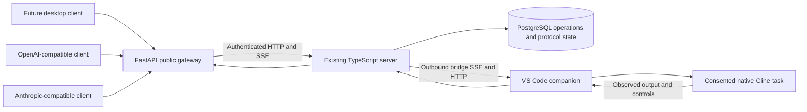

# Public API research and release design

> **Current architecture:** [DECISION-010](../decisions/010-server-owned-api-semantics.md) and the [server-owned plan](server-owned-api-plan.md) supersede the native-provider-equivalence gate in this historical research. The user permits server-defined aliases and explicitly labeled token estimates. Backend I/O/permissions/context isolation remain real acceptance concerns; provider-shaped server policy does not require blanket native SDK expansion.

**Recorded:** 2026-10-08 (Asia/Dhaka). **Scope:** research and plan amendment only. **Implementation:** Not started. **Decision:** [DECISION-009](../decisions/009-fastapi-public-api.md). **Requirements:** specification 2.3 / FR-19–FR-28; bridge wire protocol remains 2.0 pending explicit contract review.

The user requires a FastAPI REST gateway in the first Cline release. It must support programmatic conversation control for a future desktop client, plus OpenAI-compatible and Anthropic-compatible interfaces for other coding assistants. The gateway calls the existing server; the server addresses the installed, consented Cline task through its VS Code companion. The latest instruction authorizes research/documentation only, not implementation, native package changes, dependency installation, deployment or publication. A new desktop frontend itself is future work.

## 1. Conclusion and current evidence

The proposed path is feasible for existing-task prompt/control operations. Provider compatibility requires additional semantic contracts and native capability work; matching endpoint names and JSON alone does not establish a model-provider replacement.

| Observation in this checkout | Evidence | Consequence |
|---|---|---|
| HTML Send already posts a protocol command | [Control UI](../../control-ui/src/main.tsx), `submitPrompt` | Public callers can share its admission path; no DOM typing/clicking is needed |
| `POST /v2/sessions/{id}/turns` returns durable command metadata, not an answer | [HTTP boundary](../../server/src/http/index.ts) | Add simple submission, operation status and correlated result contracts |
| Server deduplication compares `commandId` and complete immutable payload | [Server storage](../../server/src/storage/index.ts), `recordCommand` | A public retry key must map atomically to the original command; generating another command is not an exact retry |
| Protocol carries `promptId`; this route does not independently index it as a public idempotency key | [Contracts](../../protocol/src/contracts.ts), HTTP/storage sources above | Do not infer a caller-key ledger from the presence of an ID field |
| Cline submission verifies exact task, readiness, revision and dispatch authority, and produces a native user-message echo | [Maintained native boundary](../../adapters/cline/src/native-patch.ts), `submit` | The existing native execution path can serve API prompts while retaining app ownership |
| Bridge serializes normal turns; the native API still requires exact `expectedConversationRevision` | [Runtime](../../bridge/src/runtime/index.ts), native boundary above | Two queued prompts prepared against one revision can conflict; a public scheduler must explicitly resolve admission/order semantics |
| Output is versioned; native phases establish completion separately | [Cline adapter](../../adapters/cline/src/index.ts), [projector](../../protocol/src/projection.ts) | Collect by turn/item/revision and terminal evidence, not last text or a silence timeout |
| Assistant text and completion-result categories currently share `assistant_message` | Cline adapter above | Preserve native category/final-answer metadata if the API promises a distinct final summary |
| API 1.2 does not declare arbitrary caller tools, per-request system/developer instructions, sampling/token-limit controls or token usage | [Native API](../../adapters/cline/src/native-api.ts) | These are unresolved compatibility requirements, not already-supported features |
| M23 validates the adopted local pin and synthetic loopback deployment | [M23 evidence](../../evidence/M23/verification.json) | It does not prove a public gateway, stock Cline, provider fidelity or production identity |

The inspected stock Cline export declares task/message/button methods returning `Promise<void>` and no correlated result subscription. This is insufficient by itself for this gateway's result/control guarantees. [Published Cline interface](https://raw.githubusercontent.com/cline/cline/main/apps/vscode/src/exports/cline.d.ts)

## 2. Architecture and ownership



- **FastAPI:** validate typed public requests, expose OpenAPI, normalize provider formats, translate authentication headers, relay authorized control calls, bound request waits, and encode provider-specific responses/SSE. A planned `api-gateway/` Python package is separate from the existing server; its exact runtime/dependencies are selected and locked during M27.
- **Existing TypeScript server:** remain authoritative for principal/session authorization, API-key/service-principal delegation, operation identity/idempotency, command admission, scheduler reservations, durable result state, audit, attachments and signed decisions. Add reviewed internal HTTP operations/status APIs as needed. The gateway has no direct database access and does not manipulate existing tables.
- **Bridge and Cline:** preserve exact task/window/workspace fences, native input receipt, permissions, questions/cancel, app-owned model configuration and execution. Provider-required native additions belong here, with source review and fresh pin acceptance.
- **Desktop client:** consume REST and SSE; first-use browser sign-in, pairing and local task consent remain explicit. A new client is not this release's implementation deliverable.

FastAPI is the user-selected public boundary; it does not replace `node:http`, move model execution to Python, or launch an app-server/headless executor. Shared bridge contracts remain vendor-neutral. Provider formats terminate at the gateway.

FastAPI supports generated OpenAPI/docs and streaming response classes. Its lifecycle API is suitable for owning/closing a bounded asynchronous HTTP client pool; neither framework supplies durable operation state. [OpenAPI metadata](https://fastapi.tiangolo.com/tutorial/metadata/), [streaming responses](https://fastapi.tiangolo.com/advanced/custom-response/), [lifespan](https://fastapi.tiangolo.com/advanced/events/)

## 3. Planned first-party REST surface

The following is a **target catalog**, not implemented routes. M27 freezes exact schemas, methods, errors and authorization scopes before code. Endpoint families cover current supported functions and separately identify required server extensions.

| Public route under `/api/v1` | Purpose | Existing server seam / required extension |
|---|---|---|
| `GET /health`, `GET /capabilities` | Minimal health; authenticated capability/limit/version discovery | Health exists; aggregate advertised capabilities and gateway version are new |
| `POST /auth/oidc/start`, `/exchange`, `/refresh` | Future desktop human sign-in | Existing server-mediated OIDC; exact redirect allowlist/PKCE and secure client storage |
| `POST /api-keys`, `GET /api-keys`, `DELETE /api-keys/{id}` | Owner-managed scoped integration credentials; one-time secret reveal and revoke/rotation | New server-owned principal/key ledger; management requires human authority, no owner-wide fallback key |
| `POST /pairings`, `POST /pairings/{id}/confirm` | Start and confirm server side of pairing | Existing pairing services; paired-device activation/local consent remains local |
| `GET /sessions`, `GET /sessions/{id}` | Authorized session/task identity and binding/connection state | Session list/snapshot exist |
| `GET /sessions/{id}/capabilities` | Supported operations/content, actual binding and limits | Existing binding capability metadata; public schema is new |
| `GET /sessions/{id}/transcript` | Ordered stable items, revisions and watermark | Existing same-cut projection/snapshot |
| `GET /sessions/{id}/events?after=N` | Replay/live state, output, approvals and questions | Existing authenticated SSE; bounded relay and reauthorization |
| `POST /sessions/{id}/prompts` | Text/committed image references; durable submit-and-wait | Existing turn admission plus new operation/idempotency facade |
| `GET /operations/{id}`, `GET /operations/{id}/result` | Correlated command/turn/interaction state and terminal result | New authorized server operation/status projection, including rejected/unknown acknowledgements |
| `GET /operations/{id}/events?after=N` | Operation-specific resumable progress | New filtered server view with defined cursor scope; no cross-session leakage |
| `POST /operations/{id}/cancel` | Request addressed cancellation | Existing `turn.cancel`; confirmation is a separate native outcome |
| `GET /sessions/{id}/interactions` | Pending exact approvals/questions and lifecycle | Existing snapshot/events, with public cards/schema |
| `POST /sessions/{id}/questions/{requestId}/answers` | Answer the exact current question revision | Existing `input.respond`; stale revision must fail |
| `POST /sessions/{id}/approvals/{requestId}/decisions` | Exact action allow-once/deny | Existing signed approval engine; authorized reviewer, action digest, revision and expiry |
| `POST /sessions/{id}/disable` | Server request to disable remote delivery | Existing `session.disable`; response must not claim immediate local enforcement |
| `DELETE /devices/{id}/authorization` | Revoke an owned paired device | Existing authorization service needs an authorized public/server route; lease-bounded effects |
| `POST /attachments`, `POST /attachments/{id}/commit`, `GET /attachments/{id}` | Bounded binary upload/commit/download and integrity metadata | Existing services; capability-check references before prompt admission |
| `GET /models`, `GET /models/{alias}` | Authorized aliases and their native capability profiles | New alias registry to explicitly consented bindings; no API switch of native model inferred |
| `POST /model-bindings`, `DELETE /model-bindings/{alias}` | Owner registers/removes an integration alias for an already consented binding and delegated profile | New server-owned registry/authorization; cannot attach tasks, change native models or broaden local delegation |

Public session discovery/aliases do not create or silently attach arbitrary Cline tasks. Remote task creation, fresh-task pools and task selection need a reviewed native contract plus local consent if required by compatibility. Do not expose device event/ack/lease/dispatch endpoints as user-control shortcuts. Narrow/persistent grants, revocation of unsupported native grants, general files/artifacts and active steering stay accurately unsupported on the current pin; required new capabilities remain named implementation gates.

### Prompt and result contract

Illustrative target request:

```http
POST /api/v1/sessions/session-123/prompts
Authorization: Bearer <SDC credential>
Idempotency-Key: caller-request-456
Prefer: wait=30
Content-Type: application/json
```

```json
{
  "content": [{ "type": "text", "text": "Explain this project's authentication." }],
  "delivery": "queue"
}
```

Native admission returns durable `operationId`, `commandId`, `promptId`, `turnId`, addressed binding/task identity and status URLs. `200` may carry a verified terminal result within the wait; otherwise `202` carries current state and `Location`. Wait is capped by configured limits. Result representation contains ordered completed assistant items, partial items separately, observed tool activity separately, terminal/error evidence and a transcript watermark. Convenience `answer` has a defined selection policy; authoritative items remain available. Never include previous-turn history as this turn's answer.

HTTP 202 does not establish execution completion. A bounded wait with later status retrieval follows HTTP semantics; `Prefer: wait` is a client preference, subject to the service's bound. [HTTP 202](https://www.rfc-editor.org/rfc/rfc9110.html#section-15.3.3), [Prefer wait](https://www.rfc-editor.org/rfc/rfc7240.html#section-4.3)

States include queued, dispatching, running, waiting_for_approval, waiting_for_input, completed, failed, cancelled, rejected and reconciliation_required. Model completion, bridge connectivity and command admission are separate fields. Client timeout/disconnect stops waiting, not native work; explicit cancel must await app evidence. An authenticated result remains retrievable after gateway/server restart within published retention limits. Expired records require explicit expiry/resynchronization responses, not fabricated empty success.

## 4. OpenAI-compatible target

Provide a configurable base URL, proposed `/openai/v1`, with standard relative paths. The caller uses an **SDC** credential in `Authorization: Bearer`, not an OpenAI account key. Its `model` selects a published SDC alias to an authorized native binding/capability profile.

| Relative path | Release target |
|---|---|
| `GET /models`, `GET /models/{id}` | OpenAI-format model discovery for allowed SDC aliases |
| `POST /chat/completions` | Validated messages/roles/content, nonstreaming answer and streaming chunks |
| `POST /responses` | Validated input/instructions and response object or typed stream |
| `GET /responses/{id}` | Authorized retrieval of stored local response ID mapped to operation |
| `POST /responses/{id}/cancel` | Only where the declared background/lifecycle profile supports it; otherwise explicit unsupported error |

Chat Completions returns choices with message/finish reason; streaming uses `chat.completion.chunk` deltas and a `[DONE]` marker. Responses uses typed events; it is a separate encoder/contract, not a renamed Chat Completions response. [Chat Completions reference](https://developers.openai.com/api/reference/resources/chat/subresources/completions/methods/create), [Responses streaming](https://developers.openai.com/api/docs/guides/streaming-responses)

The gateway must define local `previous_response_id` ownership, retention and exact task continuity. It must never forward these IDs to OpenAI. Full-history Chat Completions requests and Responses chains require different reconciliation. [Conversation state](https://developers.openai.com/api/docs/guides/conversation-state)

Client-defined function tools require structured invocation IDs/arguments, a pause before execution, and subsequent caller-produced outputs. Observed Cline file/shell activity does not provide that contract. [Function calling](https://developers.openai.com/api/docs/guides/function-calling)

Provider-format success responses must follow the frozen profile; do not return the first-party 202 operation body where an SDK expects a completed model object. For unfinished/blocked work, use a documented provider error with operation correlation, supported background status, or a still-open bounded stream. No successful finish marker before verified completion. Avoid injecting custom question/approval events into a standard stream unless explicitly negotiated outside the compatibility profile.

Out of scope for the baseline provider profile: OpenAI account authentication/billing, embeddings, audio, image generation, Realtime/WebSocket parity, fine-tuning, batches, Assistants and provider-hosted tools. Their absence does not waive required text/stream/history or selected coding-client gates. Returning arbitrary upstream model names would falsely imply direct provider access.

## 5. Anthropic-compatible target

Provide a separate configurable base URL, proposed `/anthropic`, with standard SDK paths under `/v1`. Accept SDC credentials through `x-api-key`, validate the declared `anthropic-version`, and define supported beta headers rather than silently enabling them. [API overview and headers](https://platform.claude.com/docs/en/api/overview)

| Relative path | Release target |
|---|---|
| `GET /v1/models`, `GET /v1/models/{id}` | Anthropic-format alias discovery/pagination |
| `POST /v1/messages` | Validated Messages request, response/error envelopes, streaming |
| `POST /v1/messages/count_tokens` | Real native/model-specific counting capability or explicit unsupported profile; never invent Claude tokenization |

Messages accepts user/assistant history, a top-level system input, content blocks, and a maximum output-token parameter. It supports caller tools/tool-result blocks. Cline's existing persistent task is a different execution/context model, so these fields require semantic mapping, not serialization into ordinary user text presented as privileged instructions. [Messages reference](https://platform.claude.com/docs/en/api/messages/create)

Anthropic streaming orders message-start, content-block lifecycle/deltas, message-delta and message-stop events. Implement its own error and ping handling; stop reasons and usage need accurate provenance. [Streaming contract](https://platform.claude.com/docs/en/build-with-claude/streaming), [error envelopes](https://platform.claude.com/docs/en/api/errors)

Token counting is a distinct API taking message/system/tool inputs and returning an input count. It cannot be faithfully replaced by character length. [Count tokens](https://platform.claude.com/docs/en/api/messages/count_tokens)

Provider mounts are separate because `/v1/models` response/pagination formats differ. Reverse-proxy hostnames may later expose conventional root paths for clients with fixed prefixes; routing must not infer the format solely from credential shape. Test exact SDK `base_url` joining to avoid duplicated/missing `/v1`.

## 6. Compatibility gates and unresolved native capabilities

| Concern | Current support | Required investigation/implementation before a claim |
|---|---|---|
| Existing-task text and PNG/JPEG | Native acceptance exists for declared pin | Revalidate through gateway; enforce staging/checksums and inherited limits |
| Request-specific model selection | Not exposed | Alias means configured native task/profile; reject unknown or inaccessible aliases; additional native changes if actual switching is required |
| Full history and separate conversations | Native task already owns context | Durable per-client conversation identity; exact prefix/continuation validation, no changed history silently dropped, no cross-client context leakage |
| System/developer instructions | Not a declared native API parameter | Establish native instruction injection/replacement semantics or reject; ordinary user-text framing is not equivalent |
| `max_tokens` / `max_completion_tokens` / `max_output_tokens` | Native submit has no limit control | Enforce in app-owned generation if advertised; gateway response truncation is not a generation cap. Anthropic's required parameter needs a resolved release policy |
| Sampling, stop sequences, structured output, multiple choices | Not declared | Per-field support table; native implementation or fail before dispatch. Never accept an ignored option as honored |
| Token usage / cost / context window | Not declared | App-owned usage/limit metadata with attribution to this API turn; do not fabricate zeros or include unrelated earlier work. Required provider usage fields are a blocking fidelity gate if unavailable |
| Client tool calls and results | Current API controls Cline's own tools | Reviewed addressed external-tool mode/continuation; original caller owns external tool execution; request-bound validation and isolation |
| Output streaming | Native items can be replaced | Emit stable append-only text or buffer until an item is stable; provider streams cannot retract text. Advertise observed granularity, not invented token events |
| Final answer vs plans/tool activity | Current categories are normalized together | Preserve final native category, native finish/cancel/failure reason, and deterministic final-answer selection |
| Approval / question | Addressed native controls exist | First-party interaction APIs; standard-provider blocked-work policy; no fabricated `tool_calls`/`tool_use` representing approvals |

Two execution profiles must be distinguished:

1. **Native task control:** Cline performs its own workspace tools and permissions. This is the existing product; a future desktop app should use the first-party API to see activity and interactions.
2. **Provider-facing coding integration:** the calling assistant may own tool definitions/execution and send full history. It needs appropriate native support, tool-loop continuation, instructions, limits and client isolation. Do not let Cline perform a requested client tool locally and also return it for the caller to execute.

M27 begins with native contract discovery/spikes on these gaps. Candidate solutions include a reviewed app-owned external-tool/instruction/usage surface, consented native task allocation, and durable client-history mapping. Prompting Cline to print tool JSON, pressing generic buttons, an MCP mailbox alone, or invoking a second provider SDK runtime do not establish faithful external-tool/provider semantics. Changing the maintained pin requires explicit adoption/review and fresh affected native tests; this planning amendment alone does not adopt any new build.

Each field is declared `native-supported`, `gateway-defined`, `unsupported`, or `unverified`. Estimates, prompt hints and output-only caps cannot masquerade as native guarantees. Required gaps remain blockers in M27–M30; do not quietly remove Anthropic/OpenAI from the release or claim universal compatibility. Publish a named tested profile, not all vendor API features.

## 7. Security, reliability and operating constraints

### Identity and desktop readiness

- Human desktop clients use the existing browser-mediated sign-in and explicit local task binding; future UI can consume the API without a product terminal workflow.
- External integrations receive server-issued, hashed-at-rest, scoped, revocable credentials with owner/session/model restrictions, expiry, rate limits and audit. Short-lived delegated service tokens are an alternative; select one authoritative server scheme during M27. No static shared owner bearer token or bridge/device credential for callers.
- FastAPI and the server validate the caller's audience/scopes and current authority; gateway identity does not turn every caller into an owner. Revocation affects outstanding waits/streams and future dispatch. Expired authentication never leaks a terminal result.
- Prompt, result, image and request bodies are bounded before JSON/base64 decoding; cross-session file access, request IDs and header logging need explicit tests. Public TLS and deployment configuration are M24; loopback-only developer mode must not become public test identity.
- Keep credentials out of URLs/model messages and sanitize errors/traces. Desktop/client CORS is allowlisted where relevant; native clients are still authenticated even when CORS does not apply. API-key management, pairing, action review and unattended client scope remain distinct authorities.

OAuth security guidance recommends restricting access-token audiences and privileges. This is a security design input, not proof that current user-only OIDC code accepts service principals. [OAuth security guidance](https://www.rfc-editor.org/rfc/rfc9700.html#section-2.3)

### Durable operation semantics

- Admit idempotency key, normalized request fingerprint, principal/conversation identity, original command IDs, binding/revision reservation and operation atomically in the server. Same key/identical request returns original work; changed request is a conflict. Define key lifetime and replay after expiry; do not fingerprint raw credential secrets.
- New public calls should initially allow one outstanding operation per native session, enforced across all entry points including the existing GUI/low-level route. A more general queue requires dispatch-time revision semantics and clear local-takeover behavior. Gateway-memory locks do not serialize multiple workers.
- Derive operation status from commands/acknowledgements as well as turn/output events. Native rejection before `turn.started` must settle the operation instead of hanging the waiter.
- After uncertain admission, query by the original key/ID. Do not construct a replacement send. Gateway process restart does not lose the server-owned operation.
- Build results from durable replay/projection and a consistent watermark. Register waiters with rechecks/replay so a fast result completed before subscription is still found. Database notifications may wake waiters but are not the result record.
- Cancel affects a specifically observed native turn. Client disconnect, server HTTP timeout and disabled binding are not proof of native cancellation. Cline can continue after delivery stops.
- Keep question/approval/cancel delivery independent of prompt waits; bound waiter, stream, request, retention and relay buffers. No unbounded background FastAPI task per prompt.
- SSE uses explicit replay cursors and bounded backpressure. Retention/gaps/expired cursors require snapshot/reconciliation. [SSE last-event ID](https://html.spec.whatwg.org/multipage/server-sent-events.html#the-last-event-id-header)
- An SSE heartbeat helps idle timeouts, not every total request limit. Verify the intended proxy's flushing, buffering and timeout settings during M24. [NGINX proxy behavior](https://nginx.org/en/docs/http/ngx_http_proxy_module.html#proxy_read_timeout)

VS Code must remain alive, the native task must remain explicitly bound, and its model/authentication must work. Desktop sleep/reload, lease loss, changed task/workspace, unavailable model or required local permission become accurate operation states. API exposure does not turn an offline Cline installation into a server-hosted inference service.

## 8. Appended milestones and implementation sequence

Existing M01–M26 IDs/completion history remain intact. Append M27–M30 and schedule them before final packaging because their contracts/code must be included in the frozen release. All four remain **Not started**.

| Milestone | Boundary | Dependencies | Acceptance emphasis |
|---|---|---|---|
| M27 | Native compatibility gate, FastAPI first-party REST, server operation/auth contracts | M23 | Resolve required native gaps; durable operations/results, all supported controls and scoped auth through the existing server |
| M28 | OpenAI Chat Completions and Responses profiles | M27 | SDK-parsed sync/SSE, history, errors, IDs, tool ownership, parameter/usage fidelity |
| M29 | Anthropic Messages/models/counting profile | M27, M28 | Headers/content/events, token limits/usage, history, tool-result continuation and SDK behavior |
| M30 | API/native integration and desktop-client contract acceptance | M27, M28, M29 | Real pinned Cline through public API, official SDKs, a named coding assistant per advertised profile, multi-client isolation, restart/retry/blocked control tests |

Active order: **M27 → M28 → M29 → M30 → M24 → M25 → M26**. M24 depends on M23 and M30 and distributes/deploys the gateway with the existing server. M25 adds desktop-client/API/provider integration guides. M26 includes FR-19–FR-28 in the frozen candidate and the public API in the latency/load/soak topology. M16–M18 remain Deferred; no standalone SwiftUI installer/new frontend is added.

Before claiming coding-assistant support, select and pin named client versions and the request/features they actually exercise. Aider documents configurable OpenAI-compatible base URLs; this makes it a candidate for a text coding integration, not verified support here. [Aider integration documentation](https://aider.chat/docs/llms/openai-compat.html). The user's preferred first target remains open until answered; implementation must record it, and full tool-using clients need the external-tool gate rather than a text-only SDK test.

A third-party GUI or CLI may be an API consumer under the user's programmatic-integration requirement. It must not substitute its own provider session for the promised Cline-backed execution. Graphical native installation/consent remains required; no product terminal workflow is required to connect or control Cline.

### Required evidence

1. FastAPI-generated OpenAPI and field-level support matrix; exact Python/FastAPI/ASGI/HTTP-client/SDK/client pins and lockfile.
2. Real server database/HTTP tests: duplicate keys, changed payload, competing callers, revoked identity, alias/task ownership and schema migration/rollback. Mock transport tests alone do not establish these.
3. Native tests: exact prompt echo, answer, two-turn context, images, approval allow/deny, question/answer, cancel, local takeover, reconnect/reload and uncertain dispatch through gateway → server → installed pin.
4. Official OpenAI and Anthropic SDKs parsing both successful and error sync/SSE responses; no native token/finish/usage claims from synthetic values. Test body limits, unsupported options before dispatch and provider timeout/retry behavior.
5. Named real coding clients exercising supported histories and tool loops, including no double execution, denied tool effects, stale/replayed result IDs and isolated simultaneous sessions. Configure test targets explicitly; no implied support for Codex/Claude desktop or their login/subscription features.
6. Desktop-ready reference journey using REST/SSE without direct extension/private APIs; examples and contract tests, not a new desktop app implementation.
7. Production TLS/identity/proxy tests and frozen release regression/latency/one-hour soak still belong to M24/M26; new routes/native changes need fresh applicable M23 checks.

## 9. Research limits and source handling

Official OpenAI documentation, Anthropic/Claude platform documentation, FastAPI documentation, HTTP/SSE standards and local source were reviewed on 2026-10-08. Provider references describe their APIs, not Cline capabilities. Architecture, route mounts, aliases, retry/wait policy and milestone ordering are this project's design decisions. No SDK/client/native gateway test, production deployment, throughput claim or public compatibility has been established in this amendment.

The OpenAI documentation fetch tool returned 404 for the Chat Completions Markdown URL; the corresponding official HTML reference was opened successfully. The Responses create-reference HTML fetch failed; the successfully fetched official streaming/conversation/function-calling guides establish the findings above. M28 must fetch/freeze the complete endpoint schemas before implementation, rather than infer unspecified fields from examples.


## M27 implementation amendment — 2026-10-08

The subsequent user instruction authorizes M27 implementation. Its first-party server/gateway checkpoint and exact dependency locks are now present; the original planning statements above remain historical. [Current REST/OpenAPI contract](../public-rest-api.md) freezes the implemented consolidated routes (operations include results; session snapshot/events carry interactions and replay; addressed controls share `/controls`). [Native semantic gate](../native-public-api-gate.md) remains blocked, so M27 is In Progress. M28/M29/M30 and production deployment remain unstarted; cached SDK seams and fixtures do not establish new native support.
