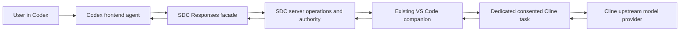

# Use ServerDrivenChat as a model provider for Codex

**Detailed analysis and proposed setup, reviewed 11 October 2026.** Codex supports custom model providers. ServerDrivenChat (SDC) has an OpenAI-shaped Responses endpoint. However, **the current SDC release is not a qualified Codex model provider**. This guide explains the available configuration mechanism, the precise gaps and how to build/test the integration without claiming that a base-URL change makes it work today.

No Codex configuration, service, credential, certificate trust or native grant was changed for this documentation. No Codex model request was sent. The locally installed CLI reports `codex-cli 0.159.0`; the desktop app's bundled runtime and VS Code extension versions were not established by that check.

## Read these documents in order

| Reader/goal | Document |
|---|---|
| Understand what this integration does and how future setup works | This guide |
| Understand compatibility, request identity, tool ownership, history and streaming | [Compatibility and architecture](compatibility-design.md) |
| Implement the missing pieces and qualify the exact Codex client | [Implementation and testing plan](implementation-and-testing.md) |
| Use the current supported SDC APIs directly | [Existing API guide](../api-guide.md) |
| Prepare/trust the current local HTTPS deployment | [Certificate guide](../certificates.md), [operator runbook](../operator-guide.md) |

## 1. What “our server as a model” means

Codex is the application/agent the user interacts with. Its model request goes to SDC rather than directly to a vendor model endpoint. SDC turns that request into server-owned work on a consented Cline task. Cline asks its configured upstream model and returns output through the existing companion/server/gateway path.



The model name `sdc-default` is a **service alias** for the authorized native binding. It is not a new trained model, an OpenAI model ID or a way to choose Cline's provider. Model/provider selection remains in Cline's native settings. Changing Codex's alias does not provision another Cline task.

This direction is different from making Codex an SDC native backend. SDC does not acquire control of the Codex conversation that calls it. The existing Cline adapter remains in use; deferred native Codex milestones M16–M18 do not resume through this proposal.

OpenAI documents the custom-provider mechanism and API/provider-credential route for local Codex clients. [Custom providers](https://learn.chatgpt.com/docs/config-file/config-advanced#custom-model-providers), [gateway setup](https://learn.chatgpt.com/docs/enterprise/connect-to-a-gateway).

### A simple text exchange

1. You type a question in Codex.
2. Codex constructs a Responses request containing instructions, input/history and potentially tool definitions.
3. A qualified connection supplies one stable logical-request identity.
4. SDC authenticates/adopts the request and submits an authority-checked command to its Cline binding.
5. Cline's model provides the backend result.
6. SDC freezes a validated result and returns the Responses envelope/events.
7. Codex displays the answer or handles a caller tool call in a qualified coding profile.

Even a prompt asking for plain text may be accompanied by tool definitions or additional client fields. A “do not use tools” sentence or Codex read-only sandbox does not prove the HTTP request contains `tools: []`.

### A coding exchange requires more

For a qualified coding profile, Codex receives a caller function/tool request, performs the effect under its own permissions, sends the matching result and receives the final answer. **Cline must not independently execute that caller effect.** The default deployed M24 binding is not caller-tool qualified. Historical disposable M30 caller-effect acceptance is not qualification of this new client or current binding.

## 2. Current endpoint and software baseline

| Item | Current reference |
|---|---|
| Public server | `https://localhost:15943` |
| Codex-facing API base | `https://localhost:15943/openai/v1` |
| Generation endpoint | `POST https://localhost:15943/openai/v1/responses` |
| Discovery | Authenticated `GET /openai/v1/models` |
| Model alias | `sdc-default`, within the scoped credential's binding |
| Native host | Isolated, signature-verified VS Code 1.140.0 on macOS arm64 |
| Native backend | Maintained Cline 4.1.2204/API 1.3 plus companion 0.7.3 |
| Current native control profile | Prompts/questions/cancel; approvals disabled |
| OpenAI facade | `sdc-openai-v1`, restricted fields and local retention |

The accepted deployment and artifacts are recorded in the [support matrix](../support-matrix.md) and [M24 manifest](../../../evidence/M24/artifact-manifest.json). Existing browser and pinned SDK text success does not prove Codex works.

Do not use the first-party `/api/v1` root or the Anthropic `/anthropic/v1` root in Codex's model-provider configuration. Codex needs the Responses path under the OpenAI facade. The current documented `wire_api` value is `responses`; a Chat Completions-only server is insufficient. [Configuration reference](https://learn.chatgpt.com/docs/config-file/config-reference).

## 3. What works now, and what remains

| Requirement | Current SDC behavior | Consequence |
|---|---|---|
| HTTPS bearer authentication | Available with SDC scoped credential | Use an SDC key, not ChatGPT login or an OpenAI key |
| Responses text contract | Implemented and accepted with exact SDK consumers | Useful prerequisite; not a Codex client test |
| Stable request key | Mandatory `Idempotency-Key` per generation intention | Configuration cannot invent a reliable per-call identity |
| Custom alias metadata | SDC exposes an alias; no Codex-specific catalog supplied | Build a truthful exact-client catalog |
| Request compression | Gateway rejects compressed request bodies | Disable Codex request compression for the pilot |
| Retention | Only `store: true` | A client requiring `store: false` needs an explicit different design |
| Reasoning/additional fields | Restricted; unsupported fields refused | Capture actual requests and disable/map only supported semantics |
| Tools | Function tools only; default binding withholds caller tools | Full coding is blocked until dialect and effect ownership qualify |
| Stream | Created/progress then terminal-buffered committed text | Different from documented unbuffered Codex gateway expectations |
| Follow-up | Append-only canonical server history and response lineage | Compaction, rewind, branches and native context require qualification |
| Transport | HTTPS/SSE; no Responses WebSocket endpoint | Keep WebSocket support disabled |

The [compatibility design](compatibility-design.md) explains why a stateless reverse proxy cannot solve all of these problems. OpenAI's gateway requirements cover streaming, continuation and a complete tool round trip; one text reply is not full qualification. [Official gateway requirements](https://learn.chatgpt.com/docs/enterprise/gateway-compatibility).

## 4. Choose a supported Codex surface for the pilot

### Desktop app on macOS

OpenAI's documented gateway setup uses the local `~/.codex/config.toml`, followed by an app restart. An environment variable exported in a terminal may not reach an application started from the Dock. A separately installed credential helper is one possible alternative. Do not change the ordinary desktop configuration during analysis; use a selected test account/configuration scope and confirm the winning configuration. [Desktop gateway setup](https://learn.chatgpt.com/docs/enterprise/connect-to-a-gateway#configure-the-macos-app).

### VS Code extension

Codex agent configuration is shared with local CLI/app surfaces; editor settings and model routing are different settings. Isolated VS Code data/extensions directories do not automatically isolate `~/.codex` or Keychain. Confirm the exact extension's bundled runtime, effective config and secret-delivery path. [Developer settings](https://learn.chatgpt.com/docs/developer-settings).

### CLI as a developer qualification tool

A developer may inspect the pinned CLI and run a future isolated client acceptance. That is a consumer test, not a replacement SDC executor. Never put `codex exec` or a new Codex app-server behind the SDC gateway. The existing graphical Cline task remains the server backend.

### Cloud/web environments

Local provider configuration is not a promise of custom inference routing in managed cloud or ChatGPT Work environments. Do not copy a local profile and claim cloud support. Qualify each local surface independently; use the applicable product/admin documentation for any separate cloud proposal. [Configuration scope reference](https://learn.chatgpt.com/docs/config-file/config-reference).

## 5. Candidate configuration: useful, but not a working release recipe

This is a **future pilot skeleton** after resolving the gates in the engineering plan. It uses the real current SDC origin to show the correct routing path. It does not supply dynamic request identity, tool compatibility, retention compatibility or a model catalog. Do not distribute it as a working supported configuration.

```toml
# Future qualification skeleton; no credential literals.
# Supply/install a reviewed exact-version catalog before enabling the alias.
model = "sdc-default"
model_provider = "sdc-qualification"
web_search = "disabled"
model_supports_reasoning_summaries = false
model_reasoning_summary = "none"
# model_catalog_json = "/absolute/installed/path/sdc-models.json"

[features]
enable_request_compression = false

[model_providers.sdc-qualification]
name = "ServerDrivenChat qualification"
base_url = "https://localhost:15943/openai/v1"
wire_api = "responses"
env_key = "SDC_CODEX_API_KEY"
requires_openai_auth = false
supports_websockets = false
supports_standalone_web_search = false
request_max_retries = 0
stream_max_retries = 0
stream_idle_timeout_ms = 660000
```

Keep top-level keys before TOML table headers. The timeout is a proposed pilot policy above the current 600-second server deadline, not a fix for incompatibility; heartbeat/client parsing and lower proxy timeouts still require tests. Zero retries reduce automatic replay during diagnosis but do not establish exactly-once behavior. Disabling reasoning summaries is not proof all reasoning fields disappear; inspect the actual request.

These settings are documented in the [current configuration reference](https://learn.chatgpt.com/docs/config-file/config-reference). Validate them against the selected binary with strict configuration handling in the future pilot. A TOML parser can prove syntax only.

Do not add `http_headers = { "Idempotency-Key" = "one-key-for-everything" }`. Do not make an environment-backed key static for the whole Codex process either. Each distinct model call needs its own identity, preserved across retries; one user turn can contain several tool/model rounds.

If an explicitly implemented compatibility facade is later used, its operator supplies a different verified base URL. There is no such deployed Codex service or port in this proposal. The facade remains a protocol client/translator and never runs the model or accesses the database directly.

## 6. Credentials, sign-in and certificates

### Obtain the right key

1. Prepare the current local server and isolated backend using the [existing graphical journey](../user-guide.md).
2. Use a dedicated disposable Cline task for the pilot, with the reviewed local categories. Keep Cline's actual model provider pointed at its genuine upstream service.
3. Sign into SDC through its normal identity flow and issue a session-scoped credential with `view` and `prompt`; the issuer must own the active consented binding.
4. Deliver that secret as `SDC_CODEX_API_KEY` to the exact process running Codex, or through a future reviewed helper. Do not place it in TOML, source, screenshots or diagnostics.
5. Verify credential expiry, session restriction and intended route. A subscription login does not become an SDC bearer token.

Issuing a key does not qualify caller tools, expand native permissions or configure provider secrets. SDC keys are bound to a principal/session/binding; rotating the key changes operation ownership. Resolve outstanding work before rotation rather than replaying it under a new key.

### Credential helper option

Codex's documented command-backed authentication can obtain a bearer token from an installed helper. It is an alternative to `env_key`, not an extra mechanism to combine with it. The helper must print only the token on stdout; logging must never copy that stdout. It does not generate dynamic request IDs or grant new server authority. [Authentication helper contract](https://learn.chatgpt.com/docs/config-file/config-advanced#custom-model-providers).

SDC does not currently ship a Codex credential helper. The engineering plan describes its proposed responsibilities. Do not call a nonexistent helper path or reuse native device credentials.

### Make HTTPS valid for the actual Codex runtime

For private roots, Codex documents `CODEX_CA_CERTIFICATE` pointing to a public PEM bundle, falling back to `SSL_CERT_FILE` when unset. Verify support/trust in the selected local binary and app environment. This is separate from the isolated Cline launcher's `NODE_EXTRA_CA_CERTS`. [Codex custom CA documentation](https://learn.chatgpt.com/docs/auth#custom-ca-bundles).

Supply only the reviewed **public** CA bundle; never the CA private key. Use the [certificate guide](../certificates.md) to obtain/verify it and understand browser versus runtime trust. Do not disable certificate checks. A new frontend connection needs no change to the server's private upstream or identity backchannel.

## 7. How to use it after qualification

These are future user steps, contingent on the named client/profile passing the plan's tests:

1. Start the selected local services and open the isolated VS Code backend.
2. Connect the dedicated Cline task through the existing companion; verify its readiness.
3. Open the qualified Codex surface with its installed provider config, catalog, public CA and scoped credential.
4. Verify the effective provider/alias. Ask for `gateway-ok` in a new disposable conversation and confirm the gateway/native records identify the intended route. Asking the model its name is not route evidence.
5. Send a follow-up in the same conversation. Keep the same canonical context; do not use rewind/fork/new-chat as though a stateful native task were an unlimited stateless model service.
6. In a qualified coding profile, test one permitted read-only local tool loop before any file edit. Review Codex permissions independently of backend consent.
7. If progress stalls, inspect the original server generation/native task. Do not resubmit repeatedly or rotate to another key to bypass admission.
8. On logout/cleanup, revoke only the selected scoped client key when intended. Do not delete Cline history or revoke another profile's device.

The default Codex conversation and the backend Cline task are separate histories. SDC's shared-task mode explicitly shares hidden native context; it is not a multi-user isolation fix. Full pilot design should use the exclusive append-only profile with a dedicated binding and tests for compaction/branches.

## 8. Avoid a recursive backend

Do not configure the backend Cline task's provider to call SDC bound to that same task:

```text
Codex calls SDC
SDC asks Cline for output
Cline calls SDC for output
SDC tries to ask the already-waiting Cline task again
```

This can deadlock or be refused as busy/context-incompatible. Cline must use its separate upstream model provider. Separate API keys are not separate native tasks. Do not add another agent/SDK executor as a workaround.

## 9. Troubleshooting

| Symptom | Likely layer | What to do |
|---|---|---|
| `idempotency_key_required` | Request identity | Stop; implement/verify per-model-call durable identity, not a static header |
| 400/422 unknown fields | Codex payload/profile | Inspect sanitized field names; preserve or explicitly refuse semantics |
| Compressed body refused | Transport | Disable request compression for the pinned pilot |
| `store=false` rejected | Retention | Resolve the client's storage requirement explicitly; do not flip it silently |
| Tool call rejected before dispatch | Binding/tool dialect | Qualify exact effect ownership and supported schema; a prompt is not a grant |
| Alias missing/generic behavior | Catalog/routing | Match alias, catalog slug and actual route; do not disguise it as GPT |
| TLS failure | Actual runtime trust | Verify selected public CA and process environment; keep validation on |
| 401 after rotation | Credential lifecycle | Check expiry/revocation; old response ownership is not transferred |
| Long pause then final text | Terminal buffering/native wait | Inspect original work; do not claim live token streaming |
| Follow-up/compaction conflict | Canonical history | Inspect original conversation; use a reviewed fresh binding if required |
| File changed twice | Effect ownership/retry failure | Stop the pilot, reconcile both effects and fail qualification |

## 10. Recommended result

Treat this as a **named Responses client compatibility project**, starting with a pinned local Codex surface and a disposable backend task. Configuration, TLS and an alias are necessary. Durable request identity, truthful client metadata, accepted payload/tool semantics, compatible context/retention and actual native tests determine whether it can be used safely.

The [compatibility design](compatibility-design.md) and [implementation plan](implementation-and-testing.md) give the concrete work. [Research evidence](../../../evidence/research/codex-model-2026-10-11/README.md) separates documented capabilities, source findings and untested proposals. Current release support remains unchanged.
