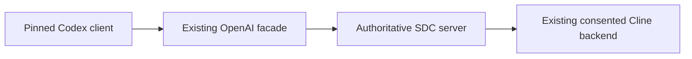
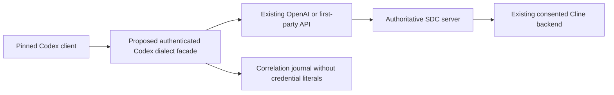
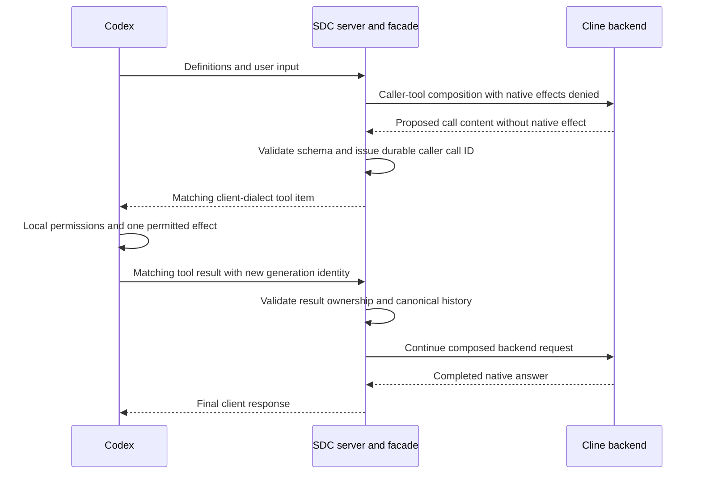

# Codex model-provider compatibility and architectural design

**Proposed integration, 11 October 2026.** Start with the [user/configuration guide](README.md). This document analyzes the actual SDC contract against a Codex model consumer. It does not establish the exact payload emitted by a desktop/IDE build or accept a new client.

## 1. Keep the direction and authorities explicit

Codex is a **caller of the model API**. Cline remains the **native backend**. The gateway normalizes provider fields; the server owns generation operations, idempotency, credentials, instructions/history, service aliases, caller-tool IDs/results and estimates. The existing bridge/device owns native transport and effect-boundary authority checks.

| Owner | Owns | Does not gain through this integration |
|---|---|---|
| Codex client | User conversation, caller tool execution and its local permissions | Authority to access SDC databases or native device secrets |
| Codex-facing translator, if implemented | Exact client dialect mapping and correlation records | Model execution, native consent or arbitrary routing |
| FastAPI facade | Provider-format normalization and HTTPS/SSE relay | Native application control outside server commands |
| TypeScript server | Durable admission, context, caller-tool ledger, authority and outcomes | Replacement native LLM executor |
| VS Code companion/Cline | Existing consented task, native permissions, backend output | Permission to perform caller effects that belong to Codex |

Native Codex backend attachment, MCP tools and model-provider routing are three separate integrations. Only the last is designed here. A model provider does not carry all plugin/MCP/service connections through the gateway; those retain their own credentials and execution paths. [Official gateway boundary guidance](https://learn.chatgpt.com/docs/enterprise/gateway-compatibility#data-and-tool-boundaries).

## 2. Direct provider versus compatibility facade

### Option A: direct Codex → existing facade



This is the simplest path, but requires the selected client to emit an accepted request with durable request identity and compatible features. Static provider configuration supports URL/auth/header/transport selection, not proof of a dynamic logical generation ID. If stock behavior lacks a required mechanism, direct use is a no-go until a supported client setting/hook or reviewed client change resolves it.

A narrowly maintained Codex client patch could assign/persist an identity at the model-call boundary and select only qualified dialect/features. That would be a separately pinned client distribution, not support for unmodified Codex. Desktop/IDE bundled-runtime deployment must be supported explicitly; swapping a bundled binary or assuming the shell CLI is used is not a valid installation plan.

### Option B: a dedicated client compatibility facade



No such facade exists today. If implemented, keep it loopback/HTTPS/authenticated and route only the operator-selected public SDC origin. Prefer an explicit integration module or versioned provider profile with ownership tests over an invisible generic proxy. It must call the public API, not PostgreSQL, native sockets or another model runtime.

A facade can normalize supported client fields, validate a tool mapping, retain original response/correlation and return the client's exact dialect. It **cannot infer user intent reliably from identical request bodies**, erase storage promises or grant a native tool profile. If the client supplies no proven per-model-call identity, the facade alone cannot establish safe arbitrary retries; it needs a client-side identity mechanism.

### Recommendation

First capture the chosen client contract against a harmless nonexecuting fixture. Then decide whether direct configuration plus supported controls is enough. Use a narrowly scoped facade only for demonstrated translation needs. If a required semantic cannot be preserved, reject that feature/profile. Do not build a new model executor to make the facade look compatible.

## 3. Exact current contract constraints

Source references: [Responses request/normalizer](../../../api-gateway/sdc_gateway/openai_profile.py), [provider HTTP boundary](../../../api-gateway/sdc_gateway/openai_http.py), [neutral generation/conversation authority](../../../server/src/public-api/conversations.ts), [OpenAI profile](../../openai-api-profile.md).

| Area | Current source behavior | Design requirement |
|---|---|---|
| Request fields | Strict model forbids unknown fields | Inventory actual selected-client payload; reject unsupported required semantics |
| Model | Only provider alias `sdc-default` | Use exact authorized alias and truthful catalog |
| Input | Text/messages/function calls/results; bounded fields | Preserve roles, instructions, prior IDs and canonical content |
| Functions | Only `type: function`; bounded JSON-object arguments | Freeform/custom/built-in tool dialect needs a reviewed mapping or refusal |
| Function replay | Issued IDs and committed item identities are validated | Do not replace IDs with arbitrary client-generated history |
| Retention | `store` must be true | Preserve/disclose local storage contract; no silent false-to-true rewrite |
| Reasoning | No supported reasoning request block/items | Disable where supported or add honest explicit semantics; no fabricated reasoning |
| Text options | Only ordinary text format | Structured/verbosity/other nested options require separate qualification |
| Images | Owned committed PNG/JPEG attachment references | Raw data URLs/vendor file IDs cannot be forwarded as supported |
| Compression | Compressed request body rejected | Disable compression in pilot or add bounded reviewed decompression |
| Query parameters | Explicit endpoint-specific allowlist | Unsupported provider-added query parameters must be refused |
| Tools/native authority | Caller tool profile withheld on default binding | Fresh exact-binding ownership qualification before admitting tools |
| History | Owned append-only canonical continuation | Compaction, branch and hidden native context must be resolved explicitly |

Examples of fields a client **may** use include reasoning options, no-storage settings, custom tools, extra text options and replayed non-message items. These are risks to inspect, not claims that every Codex version sends them. No real Codex HTTP trace was captured for this documentation.

## 4. Durable request identity: the primary gate

An SDC generation requires a stable `Idempotency-Key`. The identity names one intended **model call**, not an entire Codex user turn. A user turn can contain model call → tool → model call → another tool → final model call.

### Required identity behavior

| Event | Correct key behavior |
|---|---|
| First dispatch of one logical model call | Allocate and save a unique key before network dispatch |
| HTTP admission response lost | Reuse original key and identical normalized request |
| Stream drops after partial receipt | Recover original response/request identity |
| Tool result sent for next model call | Allocate a new key for that new generation |
| User intentionally asks identical wording later | New key despite identical body |
| App/client process restarts with unresolved request | Recover original saved key/body/principal/context |
| Credential rotation or binding change | Do not transplant unresolved intent to a new principal/binding |

The key is not a secret, but correlation/logging can expose sensitive workflow metadata. Partition it by authenticated caller/session and retain original body digest/operation association under a privacy policy.

### What does not work

- **One static TOML/header key:** later calls conflict or replay the wrong original result.
- **One environment key per client process:** several independent model calls still share it.
- **One key per user turn:** multiple model/tool rounds are distinct generations.
- **Fresh UUID per HTTP arrival at a proxy:** retries become new native commands.
- **Hash of request body alone:** two deliberately identical submissions collapse into one.
- **Body hash plus time window:** slow retries can become duplicates and distinct requests can collide.
- **Credential helper token refresh:** auth token retrieval is not a model-call identity callback.
- **Turning retries off:** an interrupted client/user restart can still create ambiguous repeat work.

A usable source is a **documented/observed client-owned per-call ID** preserved across transport retries and process recovery. Do not assume a header with “turn” or “session” in its name meets that definition. Trace its actual lifecycle. If none exists, implement a reviewed durable client mechanism; the facade should refuse requests lacking required evidence instead of guessing.

### Proposed correlation ledger

```text
principal + client installation + thread + model-call intent
    -> original normalized body digest
    -> SDC Idempotency-Key
    -> original response/generation/operation IDs
    -> binding/context association
    -> state: prepared / admitted / resolved / reconciliation-required
```

This ledger is correlation, not a replacement operations database. The SDC server remains authoritative. Persist before forwarding; save returned IDs transactionally; retrieve the original server record after response loss. Expired retrieval/tombstone is not permission to create another generation.

## 5. Client metadata for `sdc-default`

Codex must know how to behave with the alias. A model list response proves discovery only; it does not supply a complete Codex-specific capability catalog.

OpenAI documents a local `model_catalog_json` for custom aliases, loaded at startup. Use the catalog matching the selected CLI tag/source commit or desktop bundled version. A custom catalog replaces the bundled catalog; preserve every intended selectable entry and set alias migration metadata such as `upgrade` appropriately. [Official custom-alias catalog procedure](https://learn.chatgpt.com/docs/enterprise/roll-out-a-gateway#supply-metadata-for-a-custom-alias).

For SDC, do not blindly clone a recognized GPT entry and change only `slug`. The backend can use another provider through Cline, while SDC adds different retention, context, streaming and tool policies.

Review each selected-version catalog field:

| Metadata concern | SDC-specific review |
|---|---|
| Alias/availability | Match `sdc-default` and prevent migrations to unconfigured vendor aliases |
| Instructions | Retain client agent responsibilities without directing backend native effects |
| Tool representation | Select only qualified tool shapes; disabling permissions alone does not remove schemas |
| Reasoning | Advertise only actually supported request/output behavior |
| Context/compaction | Do not equate SDC estimated units with a vendor tokenizer window |
| Media | Start text-only; committed-reference image support is not direct Codex image support |
| Transport | HTTP/SSE only unless a separate WebSocket implementation qualifies |

The exact JSON fields/schema are version-dependent. This design deliberately does not invent a minimal catalog file that a selected client might reject. Construct it from the matching official source/artifact in the future implementation and validate it with that client. A catalog cannot add capability that the gateway/native backend lacks.

## 6. Retention and unsupported options must remain truthful

`store: true` means **local SDC server retention**, not OpenAI cloud storage. Responses/conversations have seven-day retrieval; the server retains retry tombstones and other durable authority/history records. Backend Cline has its own task history. A Codex client also has local history/cache. These storage owners must be explained separately.

If the client requests `store: false`, changing it silently is not harmless normalization. Choose one of:

1. A supported client setting that opts into SDC's documented storage contract and is verified on the wire.
2. An explicitly approved different integration profile with accurate storage semantics and sufficient operations/idempotency retention.
3. Refusal when the client's required privacy/storage semantics cannot be honored.

Similarly, “ignore all unknown fields” is not a compatibility strategy. A client may require strict output shape, reasoning continuity, search or another semantic. Distinguish truly transport-only metadata from requested behavior, allowlist accepted mappings and return useful pre-dispatch errors for the rest. Keep gateway provider details out of neutral stored parameters.

## 7. Tool ownership and dialect translation

The default binding refuses caller tools before dispatch. Full Codex coding support needs both a qualified native caller-tool binding and a qualified named client.



For current supported function tools, SDC validates definitions/arguments/results, issues IDs and sets native tool denial for caller-tool contexts. Observed native tool activity causes failure rather than publication of a caller result. Fresh native qualification is required, including effect-boundary denial under races; turning off Cline Auto-approve alone is not that guarantee.

### If the selected Codex client uses custom/freeform tools

Capture the exact tool definitions, grammar, call items, argument formats and result items. SDC currently accepts object-valued JSON function arguments; a freeform patch or built-in provider tool is not automatically equivalent.

A proposed translator must preserve tool meaning and IDs in both directions. For a supported text-valued custom tool, a deliberately defined neutral function schema could carry the text, with grammar/size validation and deterministic restoration of the original client dialect. This is a future design option, not a shipped mapping. Reject it if validation or effect ownership cannot be proven.

Do not rename every tool to a function, erase grammar, strip definitions or return a text answer that pretends a requested tool executed. Audit name mappings/collisions, nonobject arguments, parallel calls, tool limits, failures, permission denials and duplicate-result submission. The current profile permits at most 32 definitions; a client with additional plugins/MCP tools can exceed it.

### Permission boundary

Codex's local permissions apply to the frontend's tools. Cline's native permissions and SDC local control grant apply to the backend. They are independent. The Codex-facing service key needs view/prompt, not administrator/approval authority merely because the frontend can call a local tool.

## 8. Context, replay, compaction and multiple chats

SDC's default `exclusive` mode binds a stateful backend route to an owned API conversation. The server can infer a full-history continuation without `previous_response_id` when the canonical prefix matches, or accept a completed current-head response parent plus new input. It refuses changed/rewound history, old-head branching, foreign identities and unverified caller calls.

Current instructions apply to the current generation; previous Responses instructions are not implicitly reused. Ensure the client sends the intended current instructions on every round where needed.

Qualification must inspect:

- Whether the client sends full replay or incremental parent continuation.
- Whether replayed assistant/function item IDs match SDC's issued IDs.
- Whether reasoning/custom-tool items are present in replay.
- How native context revisions change after local task activity.
- Whether compaction replaces the canonical prefix or requests an unsupported compact endpoint.
- What new chat, rewind, edit, retry and fork do to the client history.

There is no generic HTTP endpoint that creates a fresh Cline task. Two Codex chats sharing one native binding do not become isolated because they have separate frontend IDs. For an independent history, select a separately consented fresh backend route or a future reviewed pool of already consented bindings. A pool cannot manufacture native task consent or copy history freely.

`shared-task` explicitly tolerates shared hidden native task context; it does not fix privacy/context isolation for unrelated Codex users. Do not switch to it to make every conflict disappear. Stop or repair unknown native outcomes instead of recycling the binding automatically.

## 9. Streaming, deadlines and cancellation

SDC sends created/progress events and heartbeat comments while waiting, then deterministic chunks of the immutable committed result. Native text may be revised or replaced before commitment; buffering prevents exposing invalid text/tool calls as final.

OpenAI's documented gateway qualification expects unbuffered incremental forwarding and successful terminal completion, with meaningful failure events. The existing terminal-buffered profile is therefore a material difference; emitting final text in several chunks does not prove live generation compatibility. [Official streaming requirement](https://learn.chatgpt.com/docs/enterprise/gateway-compatibility#streaming).

Choose an explicit product target:

| Target | Requirement |
|---|---|
| Limited terminal-buffered text pilot | Exact client tolerates wait/heartbeats/terminal behavior; disclose latency and limited qualification |
| Full documented streaming gateway | Establish safely committed incremental native output or a separately reviewed stable-output profile; qualify proxy/client transport end to end |
| Caller tool stream | Publish only validated issued tool identities/arguments; do not invite premature execution |

A translator cannot safely turn mutable partial native text into irrevocable Responses token deltas by guessing. Do not relax server-owned terminal/authority validation. Any adapter change requires reviewed adoption and fresh affected exact-pin acceptance.

SDC's deadline/output policy bounds published/settled results, not the native provider's token spend or guaranteed stop time. HTTP/SSE disconnect does not cancel retained generation. Background response cancellation and observed-turn native controls have separate evidence. If Codex's Stop only closes a connection, backend work may still run. Capture and define that behavior rather than promising frontend Stop always aborts Cline.

## 10. Deployment, security and capacity

A facade, helper or catalog is a new maintained artifact. Pin versions, keep private keys/credentials outside checkout, use verified HTTPS and scoped per-user credentials, redact content by policy and verify actual routed binding. An auth helper may be useful for Keychain/GUI delivery, but must not rotate principals underneath unresolved operations or read extension device secrets.

SDC has one outstanding prompt per public session across ingress, 120 requests/minute per principal, finite normal/control capacity, a 1 MiB JSON request limit and bounded result/event/media storage. A Codex tool loop can generate many rounds and large tool results; admission/backpressure must be explicit. Do not advertise arbitrary parallel agents or large vendor context windows through this alias.

Backend provider billing is incurred through Cline's provider/account. SDC usage counters are deterministic versioned estimates whose scope excludes hidden native context; they do not establish provider billing or Codex subscription usage. Do not promise cost savings, latency parity, native token counts or unlimited model access.

The next work is a named-client contract capture and bounded qualification, described in the [engineering plan](implementation-and-testing.md). No current accepted native backend or milestone status changes through this design.
