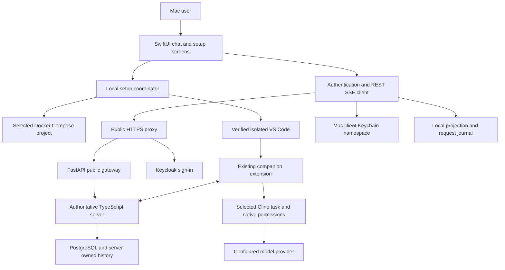
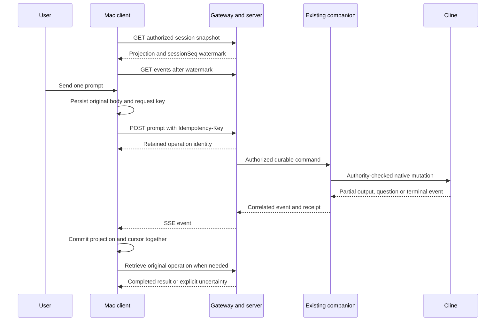

# A macOS client for ServerDrivenChat: architectural design

**Design reviewed: 11 October 2026. Status: proposed application, not implemented or accepted.** This document answers how a native Mac app could prepare the local server/backend, sign in and chat through this project's APIs. It does not start a new milestone or expand the current release. M24/M25 remain complete for their recorded local subsets; M26 remains separate.

Read this document for the overall design. Read the [implementation plan](macos-client-implementation-plan.md) for component interfaces, exact API requests, proposed development stages and acceptance checks. The [current manual](../README.md), [API guide](../api-guide.md), [certificate guide](../certificates.md) and [operator runbook](../operator-guide.md) describe existing functionality.

## 1. What the app will actually do

The proposed app is a **native chat and setup client**. It can provide one place to check the server, open the correct backend, guide connection, sign in, choose a connected conversation, send a prompt, show progress, answer questions and request cancellation.

Cline continues running inside VS Code. The app does not contain a new LLM engine. Docker keeps the server and identity services running. The existing companion extension carries authenticated commands between the server and the selected Cline task. The new app calls the public gateway rather than reaching into VS Code, Cline or either database.

There are two distinct ways to perform an action:

1. **Local setup:** the app asks macOS to open an approved application, checks selected installation paths, or runs a narrowly defined local service-management operation. This is new app functionality.
2. **Public API:** after the server is reachable, the app sends authenticated HTTPS requests to the existing gateway for identity, sessions, prompts, controls and updates.

An HTTP API hosted by a stopped server cannot start that server. The existing API also does not install VS Code, configure Cline's provider password, create an arbitrary native task or grant local control consent. A product promise of “everything through the API” would therefore be inaccurate. A guided app can combine local setup with API use while keeping those responsibilities clear.

### Existing support versus proposed work

| Desired action | Available now | What the Mac app must add |
|---|---|---|
| Start the local server | Operator-managed Docker Compose lifecycle | Local setup coordinator, ownership checks, progress and recovery UI |
| Open the backend | Verified isolated VS Code launcher | Select/validate launcher and open it from the app |
| Install the maintained extension pair | Exact signed M24 artifacts and installation procedure | Reviewed installer UI with explicit target and integrity checks |
| Configure Cline's provider and select a task | Native graphical Cline settings/task UI | Guided handoff to that UI; no current public configuration/task-creation endpoint |
| Connect a Cline task | Existing companion sign-in, pairing and local consent | Guided handoff and authenticated discovery of the resulting binding |
| Sign the Mac app into SDC | Public sign-in start/exchange/refresh endpoints | Registered app callback, authentication coordinator and Keychain storage |
| List authorized sessions and send text | First-party REST APIs | Native screens, request journal and API models |
| Receive updates | Snapshot/transcript plus first-party SSE | Bounded parser, projection, durable cursor and reconnect logic |
| Answer a question/request stop | Addressed control endpoints | Current-interaction UI and receipt tracking |
| Create a new Cline conversation entirely through HTTP | Absent | Native manual task setup, or a separately reviewed future extension feature |

The distinction is useful for a beginner: **opening VS Code is not connecting a task; connecting a task is not signing this new app in; signing in is not permission to perform every action.**

## 2. Exact baseline and operating modes

The first engineering target should match the accepted deployment rather than silently selecting newer software:

| Component | Current reference |
|---|---|
| Native host | macOS arm64, signature-verified isolated VS Code 1.140.0 |
| Maintained Cline | Package 4.1.2204, derived from upstream 4.1.22, native API 1.3 |
| Companion | `server-driven-chat.sdc-cline-bridge` 0.7.3 |
| Public origin | `https://localhost:15943` |
| First-party API root | `https://localhost:15943/api/v1` |
| Services | Persistent Docker deployment, PostgreSQL 17.11, Keycloak 26.4.7, TLS proxy, TypeScript server, FastAPI gateway |
| Current native consent | Prompts, questions and cancel; approvals disabled; native Auto-approve None |

See the [signed artifact manifest](../../../evidence/M24/artifact-manifest.json) and [support matrix](../support-matrix.md). A successful new Swift client needs its own real acceptance; existing SDK/browser evidence is a prerequisite, not proof of the new app.

Support two modes in the design, but implement them in this order:

**Attach mode, first:** an operator has provisioned the installation. The app connects to the chosen HTTPS server and optionally opens an explicitly selected isolated launcher. It can diagnose “server unavailable” and explain how to start it. This is the smallest useful client.

**Managed local mode, second:** the app manages one selected local deployment after an explicit setup review. It can ensure Docker is running, start that Compose project, launch the approved backend and show an onboarding checklist. Existing state must be retained. Installing Docker, trusting a new CA or granting access to a selected folder remain visible setup decisions.

**Remote connection mode, later:** the app can connect to an operator-provisioned HTTPS origin. “Start server” is hidden for that profile; there is no implied remote-host management/SSH capability. Production identity, remote deployment and new callback registration need independent configuration and acceptance. The currently accepted loopback deployment is not made public by this design.

## 3. Component architecture

All chat/control traffic follows **Mac app → gateway → server → companion → Cline**. The local coordinator does not have a side channel for sending prompts. The gateway retains its public-facade role and fixed private upstream. It has no direct database or native execution access.

### Proposed native modules

| Module | Responsibility | Important boundary |
|---|---|---|
| App shell / `@MainActor` view models | Screens, accessibility, drafts, progress, explicit user actions | No transport or process execution directly from a view |
| `SetupCoordinator` | Readiness checks, onboarding stages and scoped local lifecycle | Can operate only a selected local installation |
| `BackendLauncher` | Validate/open the isolated launcher and chosen workspace | No private Cline RPC or simulated button clicking |
| `AuthenticationCoordinator` | Browser sign-in, callback/state validation and serialized refresh | No password entry or password storage |
| `CredentialVault` | Own human tokens and session-scoped client credentials | Separate from companion/device Keychain entries |
| `PublicAPIClient` | Typed requests, status/error handling, bounded responses | Only documented HTTPS endpoints |
| `SessionRepository` | Authorized session/binding/capability discovery | Server authorization is authoritative |
| `OperationCoordinator` | Durable submission identity and operation/control tracking | Transport failure never becomes a new intention |
| `EventStreamClient` | SSE framing, replay, cancellation and backoff | A TCP chunk is not an event |
| `ProjectionStore` | Atomic event application/cursor and transcript revisions | A cache, not the authoritative server ledger |
| `DiagnosticsExporter` | Version/hash/status summaries and redacted logs | No credentials, private keys or sign-in URLs/codes |

Use Swift concurrency with actors for mutable network/auth/journal state. Use SwiftUI for primary screens and AppKit where application launch, file selection or macOS integration needs it. A proposed macOS 15 minimum aligns with the existing Swift companion package, but it is a product choice to verify for this new app, not existing client support.

`URLSession.bytes(for:delegate:)` provides incremental response bytes suitable for implementing an SSE reader. It does not parse SSE itself. [Apple's async response API](https://developer.apple.com/documentation/foundation/urlsession/bytes(for:delegate:)) supports this transport choice.

### Reuse from the repository

Review [CompanionCore](../../../companion/Sources/CompanionCore) for Keychain and profile validation concepts, and [the Swift package](../../../companion/Package.swift) for existing platform conventions. `CompanionServer.swift` speaks older internal `/v2` routes and is not a complete first-party REST/SSE client. Its existing callback and pairing flow cannot simply be copied as the new product's login.

The historical standalone companion's fake session-picker preview is not the accepted Cline backend. The accepted bridge is the VS Code extension. Do not instantiate a second device bridge in the new Mac client, share its inbox or copy its device tokens. This app is an authorized human/API consumer; the extension remains the native device owner.

## 4. User journey and screen design

### First use, in simple steps

1. **Choose installation.** “Use an existing server” or “Set up this Mac.” Show the endpoint and exact backend versions. A folder picker requests only needed local paths.
2. **Check server.** In local managed mode, explain what will start and retain, then start the selected project. Show service progress without displaying environment files or secrets.
3. **Check certificates.** Verify the selected public CA and server hostname. Guide trust only when needed. A green server badge requires successful certificate-verified HTTPS, not an open TCP port.
4. **Open the backend.** Launch the isolated editor with its own data and extension directories. Explain that this window must stay open.
5. **Prepare Cline.** The user opens the selected project, reviews Workspace Trust, configures their model provider in Cline and creates/selects the intended conversation. The Mac app does not collect the provider API key.
6. **Connect through the companion.** In VS Code, the user reviews the server origin, signs in, pairs the task and allows the selected control categories locally. Existing instructions and screenshots remain in the [beginner guide](../user-guide.md).
7. **Sign this app in.** Open system browser sign-in and let the user enter their SDC credentials. The app stores returned tokens in its own Keychain namespace.
8. **Choose the registered session.** Show task/session/binding identity and available actions. If no session is visible, explain the missing native connection or ownership rather than pretending to create a task.
9. **Prepare chat access.** Issue/store a short-lived session-scoped view/prompt credential under the signed-in human, if the chosen credential policy uses scoped keys.
10. **Load conversation and connect updates.** Fetch snapshot, start event replay from its watermark and enable Send only when admission/capability/authority checks allow it.
11. **Chat.** Enter text, send once, watch pending/running/waiting/completed states, answer a current question or request stop.

Steps 6 and 7 are different sign-ins for different components. Browser SSO may make the second short, but tokens still have separate owners and lifecycles. A developer can let the human sign the Mac app in earlier and show sessions as they appear; the native consent step still happens in the backend.

### Proposed screens

| Screen | Content and primary action | Expected result |
|---|---|---|
| Welcome / installations | Endpoint, local/remote mode, selected installation | Saved nonsecret profile |
| Setup checklist | TLS, Docker/project, isolated editor, packages, task connection | Individual checks with actionable explanations |
| Sign in | Server identity and browser continuation | Verified user identity; no password form in the app |
| Session chooser | Authorized sessions, binding state, supported controls | Explicit session selection |
| Chat | Transcript, draft, operation badge, Send, question card, Stop | Addressed API interactions and verified outcome |
| Connection details | Server/editor/native versions, lease/capability issues | Clear diagnosis and “Open backend” |
| Settings / credentials | Expiry, key labels, sign out, revoke selected key | Scoped credential management |
| Local service management | Start, status, separately reviewed stop | No implied history deletion or Docker-wide shutdown |

Label task identity clearly when several sessions exist. A “New chat” button must say “Create/select a task in Cline” in the initial version. Clearing the Mac display or changing a server conversation ID does not erase or isolate the native task's hidden history.

### Readiness is a combination of facts

Maintain separate state for server health, authenticated identity, credential validity, session/binding, native lease, effective capabilities, stream and pending operation. A useful formula is:

`canSend = verifiedOrigin AND authorizedSession AND usableBinding AND promptCapability AND openAdmission AND noUnresolvedSubmission`

Treat this as a UI prediction. The server must still authorize/admit each request, and the native adapter must check authority at its effect boundary. A capability can change between displaying a button and submitting it. On refusal, refresh state and explain it.

Do not collapse all state into one “Connected” light. Suggested labels are “Server reachable,” “Signed in,” “Backend connected,” “Chat ready,” “Waiting for answer,” and “Outcome needs review.” Read-only transcript access may remain useful when sending is disabled.

## 5. Local service and editor orchestration

### Server startup

The current [local lifecycle script](../../../deploy/m24/local.sh) describes the existing operator procedure. It starts one named Compose project using selected public configuration plus a private state directory. It uses detached startup with bounded health waiting. Docker documents that `compose up` can create/recreate services; `--wait` waits for running/healthy services, not end-to-end native chat readiness. [Docker Compose startup reference](https://docs.docker.com/reference/cli/docker/compose/up/).

A shipping GUI should expose typed operations such as `inspectInstallation`, `startSelectedServices`, `inspectHealth` and `stopSelectedServices`. It should not expose a generic terminal or a shell-command API. The developer-only script is a reference for implementing that coordinator; this proposal does not relabel CLI tools as an existing end-user app.

Before starting, validate project identity, configuration/version manifest, state ownership, expected paths and published ports. Use a serialized lifecycle lock. If a startup times out, inspect containers and verified health before retrying: the containers may have started despite the lost process result. Never re-provision a nonempty partial state directory automatically. Existing provisioning intentionally refuses this case and retains an already provisioned installation.

Opening Docker Desktop is different from installing it or completing its first-run setup. If the engine is unavailable, show that distinction. The local manager has powerful Docker access and should manage only the selected project. Do not stop shared Docker Desktop, remove volumes, delete unknown containers or enumerate secret environment values for diagnostics.

### Correct VS Code isolation

The maintained Cline retains the stock ID `saoudrizwan.claude-dev`. A VS Code profile alone does not isolate its binary. Require the selected official editor plus physically separate **user-data and extension directories**. The [official VS Code CLI](https://code.visualstudio.com/docs/configure/command-line) documents these directory switches and VSIX installation options. These are setup operations, not a headless model executor.

For the currently provisioned machine, the approved launcher is `/Users/samin/Documents/ServerDrivenChat-local/m24/ServerDrivenChat VS Code.app`; its selected host is `/Users/samin/Applications/ServerDrivenChat VS Code 1.140.app`. These are reference-machine paths, not portable defaults for every user. Resolve selected installation paths from configuration.

Prefer opening the selected launcher after validating its target. A future integrated launcher should fail closed if its exact host is missing or invalid. The current generated launcher contains fallback executable paths; do not mistake their existence for acceptance of the ordinary editor. Require explicit migration/review before selecting another host.

macOS application launch configuration can carry arguments/environment, but reusing an already-running application can defeat assumptions about a fresh process environment. Validate the actual isolated instance and extension activation. [Apple launch configuration](https://developer.apple.com/documentation/appkit/nsworkspace/openconfiguration).

### What can be automated, and what cannot be assumed

It is reasonable for a future reviewed installer to install verified VSIX archives into the selected isolated directories and check manifest versions/hashes. It is not sufficient to see an extension listed: activation, adopted API fingerprint and real binding behavior need acceptance.

Provider credentials, workspace trust, selected native task and control categories remain in the existing graphical native flow. There is no current documented URI that makes all of those steps happen. A future narrow companion handoff could carry a nonsecret server origin and intended setup screen, with explicit local review. That would be a new extension feature requiring separate approval and affected tests; arbitrary settings writes or GUI automation are not a stable integration contract.

## 6. Identity, certificates and credentials

### Use system browser authentication

Recommend `ASWebAuthenticationSession` for the Mac app's sign-in. The system handles browser presentation and returns the authentication callback to the initiating session. Keep an explicit callback URL/state check in the app. Use external browser OAuth rather than collecting the user's password in a WebView or native text field. [Apple authentication sessions](https://developer.apple.com/documentation/authenticationservices/aswebauthenticationsession), [OAuth for native apps, RFC 8252](https://datatracker.ietf.org/doc/html/rfc8252).

The current server is an OAuth broker: it creates the state, nonce and PKCE verifier/challenge. The Mac client calls `/auth/signin/start`, opens the returned authorization URL and exchanges the returned `code` and original `state` through `/auth/signin/exchange`. Do not introduce a second independent PKCE verifier into that exchange or embed an OIDC client secret in the app.

**A new callback must be configured.** For example, a product with a real owned identifier might choose `com.example.sdcclient://auth/callback`; this is a design placeholder, not a registered current callback. The exact value must be added to both the TypeScript server's redirect allowlist and Keycloak's client configuration. Existing callbacks must be retained. Details are in the [implementation plan](macos-client-implementation-plan.md).

The existing public sign-in request accepts `redirectUri`, not an arbitrary OIDC `clientId`. The local broker is configured for `sdc-native`. A separate OIDC client per application would require a reviewed broker/configuration change. Do not implement it by inventing a field in the request.

### Keep the three credential classes separate

| Credential | Owner/location | Used for |
|---|---|---|
| Human access/refresh tokens | Mac app's own Keychain namespace | Identity/session discovery and owner-authorized credential management |
| Session-scoped API credential | Mac app's own Keychain namespace | Routine view/prompt/control access within chosen scopes and expiry |
| Native device credentials | Existing VS Code companion's vault | Device transport, inbox/acknowledgements and native binding authority |

The Mac app must never read the companion's saved device tokens to avoid a sign-in step. Issuing a scoped key does not grant native consent. The effective action is constrained by identity, session ownership, credential scope, server policy, current binding/lease and native permissions.

For ordinary chat, choose `view` and `prompt` scopes only. Answer/cancel use `prompt`; session disable requires `administer`; approval decisions require `approve` and an independently enabled/qualified native binding. The current local profile has approvals disabled. Human credentials can be used directly for permitted APIs, but session-scoped routine keys make the app's ongoing authority easier to inspect/revoke.

Store small secrets in Keychain, following Apple's credential-storage model. Use an application-specific service/account namespace including server/profile and principal identity. Match accessibility to the product's foreground/background policy; do not blindly copy the companion's `AfterFirstUnlockThisDeviceOnly` choice. Keep refresh serialized, replace rotated refresh tokens safely and handle Keychain failure as a real setup problem. [Apple Keychain services](https://developer.apple.com/documentation/security/keychain-services).

### TLS trust is not one setting

Browser, URLSession, Node extension hosts and container backchannels each need valid trust. The current isolated launcher supplies its selected public CA through `NODE_EXTRA_CA_CERTS`; that does not configure URLSession. Conversely, app-specific certificate handling would not make the external sign-in browser or Cline extension trust the CA.

Use the [certificate guide](../certificates.md) for current graphical login-keychain SSL-only trust and exact fingerprint checking. Prefer normal platform trust for the Mac client and external browser. If a future app implements a narrower per-profile trust policy, require full hostname/chain validation against the reviewed anchor; it is separate engineering work. Never use trust-all delegates, broad ATS exceptions or `-k` as a setup fix. Do not bundle private CA/server signing keys in the client.

## 7. Chat, operations and event flow

Use the **first-party REST/SSE API** for this native UI. It exposes sessions, interactions and native events directly. The OpenAI/Anthropic profiles remain useful for compatible external consumers but are not necessary inside this app, and their terminal-buffered stream formats should not be used as the native transcript reducer.

### Sending exactly one intention

Generate a stable request UUID and persist the original normalized body, selected profile/session/principal and intended context **before** sending. A network timeout may occur after admission. Retry the identical request under its original key and principal, or retrieve the saved operation. Never generate a new key merely because the response was lost.

Save returned operation, command, prompt and turn IDs plus binding revision/lease generation. `202` means retained, not finished. `200` is not proof of a successful native answer: inspect operation status/terminal evidence. A command's `applied` receipt is also distinct from terminal completion. `result.answer` is the completed-result convenience selection; partial transcript text remains partial.

A session admits only one outstanding public prompt across its ingress paths. A browser or another client may occupy it. Do not keep an invisible client queue that releases new prompts after a timer. Show admission refusal and wait for authoritative resolution.

### Replaying updates safely

Load snapshot, read `watermark.sessionSeq`, and stream after that decimal cursor. Parse complete SSE frames across arbitrary byte boundaries, including comments, CRLF/LF, multiline data and UTF-8 boundaries. Enforce frame/response limits before unbounded allocation. Deduplicate IDs, apply output revisions as replacements where specified, and commit the projection with its processed cursor in one local transaction.

On reconnect, resume from the last fully applied decimal sequence. A gap/conflict requires a fresh snapshot and reconciliation. Do not stitch a new snapshot onto old duplicates. Closing a stream or sleeping the Mac does not cancel the server operation. A revoked key may end reads while work remains retained.

Unknown protocol events must not crash the reducer or be interpreted as native completion. Record a bounded diagnostic, refresh supported state and disable uncertain actions where needed. The client journal supports recovery; the server remains the authority.

### Questions and cancellation

Answer the exact current `requestId`, `requestRevision` and observed `turnId`. A question card should update or disappear when a local answer, task switch or newer revision makes it stale. A rejected stale answer is a recoverable UI refresh, not a reason to guess a different ID.

Stop targets the observed turn. Show “Stop requested” until evidence resolves it. A recorded request with `nativeApplied: false` has not confirmed native cancellation. Cancelling the app's HTTP task, signing out or disconnecting SSE only stops waiting. None is an undo operation.

### History, tools and images

For v1, display the shared native session and send first-party text prompts. Server-owned generation/conversation APIs can later provide composed history/instructions and caller-tool workflows, but they do not create a separate native Cline task. Stateful native context isolation and caller-tool qualification remain required. Do not route native tool activity into fabricated caller tool results.

Add image UI only after the new client is qualified against its exact native pin. The existing PNG/JPEG contract is upload → checksum commit → attachment reference. The current final M24 text checks do not constitute a new final-pin image acceptance run. File-picker availability is not support for PDF, arbitrary local paths, URLs, audio or video.

## 8. Local storage, privacy and diagnostics

Use a local SQLite journal, separate from the bridge inbox, for:

- Installation/profile metadata with no secrets.
- Session projection and last committed event sequence.
- Submission records: local intent ID, stable request key, original body/digest, principal, session, operation IDs and outcome.
- Addressed controls/decisions and their stable IDs.
- Drafts and UI preferences if the user opts to retain them.

Partition everything by normalized server origin/profile and authenticated principal. A key rotation creates a different API principal for operation ownership; a new key cannot necessarily retrieve an old key's operation. Keep the old operation association and show explicit recovery boundaries. Never silently migrate an unresolved intention to a replacement key or another binding.

Prompt/transcript data is sensitive even though it is not an API secret. Define cache retention, file permissions, backup behavior and “clear local cache” semantics. That button deletes only the Mac app's cache; it does not erase server or Cline history. Do not claim standard SQLite storage is encrypted unless a separately verified encryption design is implemented.

Redact Authorization headers, refresh/API/device tokens, authorization URL query, callback code/state, cookies, private paths where unnecessary, provider secrets and document content. Diagnostics should identify versions, fingerprints, endpoint origin, status/error codes and request IDs. A user-selected export can contain more, but needs explicit preview and redaction.

## 9. Failure and recovery design

| Failure | User sees | Correct app response |
|---|---|---|
| Docker not running | “Local services need Docker” | Open the selected Docker app; wait boundedly for engine readiness |
| Services start but public TLS fails | “Server identity cannot be verified” | Show hostname/chain/fingerprint guidance; do not disable validation |
| VS Code starts, extension host stalls | “Backend activation not confirmed” | Keep Send disabled; show version/isolation checks and open backend |
| Human sign-in succeeds, no sessions | “No connected task available to this account” | Guide native task pairing/consent; distinguish ownership from installation |
| Server restarts during sign-in | “Sign-in attempt expired; try again” | Discard consumed/invalid attempt and start a new sign-in |
| HTTP reply lost after Send | “Checking the original request” | Query operation or same-key original request; preserve uncertainty |
| SSE disconnects/Mac sleeps | “Reconnecting updates” | Resume cursor with bounded jittered backoff; inspect original operation |
| Lease lost/task switched/local takeover | “Backend authority changed” | Refresh capabilities; stop dispatching; retain original outcome records |
| Key expires/revoked | “Chat access needs renewal” | Reauthenticate/reissue deliberately; do not replay work under new principal |
| `reconciliation_required` / projection needs repair | “Outcome needs review in backend” | Block automatic resubmission and open the original native task |
| Operation expired with 410 | “Result retention expired” | Explain tombstone and manual reconciliation; no automatic rerun |
| Keychain write fails after issuance | “Access could not be saved” | Retain enough nonsecret metadata to revoke/reconcile issued key; never log it |

## 10. App closure, service stop, updates and distribution

Closing the chat window or quitting the app should leave backend services and retained operations running by default. Offer separate named actions: **Stop this turn**, **Sign out of this app**, **Revoke selected chat key**, **Open backend**, and, in managed local mode, **Stop local services**. Device revoke/forget is a separate consequential backend action; revocation does not confirm native abort. Never combine logout with Docker shutdown or native-history deletion.

Before planned local shutdown/update, inspect outstanding operations and uncertainty, fence new work and follow a deliberate drain/stop procedure. If uncertainty remains, preserve records and ask the user to resolve it. The current two-database/attachment backup and independent restore guidance remains authoritative; an app cache backup is not a server backup.

Choose distribution deliberately. An attach-only client is easier to constrain than a Docker/installer manager. Apple requires App Sandbox for Mac App Store apps; sandbox entitlements constrain resource access. A managed local product needs an explicit design for selected files, process launch and Docker access rather than assuming a helper escapes those constraints. [Apple App Sandbox](https://developer.apple.com/documentation/security/app-sandbox).

For a future Developer ID distribution, sign the app and any helper, adopt Hardened Runtime as applicable, notarize and staple the artifact using the documented Apple workflow. These would be new client release artifacts. The existing project's detached Ed25519 package integrity signature is a different trust mechanism. [Apple notarization](https://developer.apple.com/documentation/security/notarizing-macos-software-before-distribution).

Prefer foreground same-user orchestration initially. An optional login helper needs a separate requirement and user-visible enable/disable controls. `SMAppService` is Apple's API for bundled login items/agents/daemons on macOS 13 and later and subjects registration to user approval; it is not necessary for a foreground chat client. [Apple service management](https://developer.apple.com/documentation/servicemanagement/smappservice).

Do not bundle or redistribute VS Code, Docker or arbitrary Cline builds without reviewing the selected artifacts' terms/notices and distribution ownership. Installing independently acquired official applications is a different product design from distributing them inside one installer. Avoid “latest” dependency selection; keep a compatibility manifest and qualify every change affecting the native boundary.

## 11. Recommended architectural decision

Build a **SwiftUI first-party REST/SSE client in attach mode first**, with a guided “Open backend” flow. Add a narrowly scoped local service coordinator after text chat, login and recovery work against the accepted native pair. Extend the companion only if a documented, consent-preserving setup handoff is needed. A full first-run installer comes last, with clean-host testing and explicit distribution ownership.

This approach can eventually give users one main Mac application while preserving the project's core rule: the existing consented Cline application executes the work; the server owns authority/history/operations; the Mac app prepares access and presents authenticated interactions.

The [implementation plan](macos-client-implementation-plan.md) turns this proposal into ordered development steps. [Research and contract evidence](../../../evidence/research/macos-client-2026-10-11/README.md) records what was checked and what remains unimplemented.
