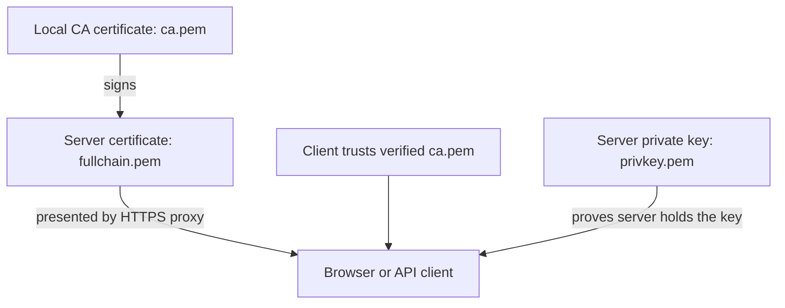

# Certificates: obtain, create, install and verify HTTPS access

This guide explains certificates for ServerDrivenChat from the beginning. It covers the current **macOS local installation at `https://localhost:15943`**, then explains how an operator creates certificates for a new installation. Everyday users can follow the Finder/Keychain steps; certificate generation and server configuration are operator tasks.

**For this already configured machine, use the existing `tls/ca.pem`. You do not need to create a new certificate.** Creating a replacement CA would change the identity that clients trust and require a deliberate migration.

## Contents

1. [What a certificate does](#1-what-a-certificate-does)
2. [Which file you need](#2-which-file-you-need)
3. [Get the existing certificate](#3-get-the-existing-certificate)
4. [Verify the certificate before trusting it](#4-verify-the-certificate-before-trusting-it)
5. [Add it to macOS for browser access](#5-add-it-to-macos-for-browser-access)
6. [Access from the isolated VS Code bridge](#6-access-from-the-isolated-vs-code-bridge)
7. [Access from curl, Node and Python](#7-access-from-curl-node-and-python)
8. [Create certificates for a new local installation](#8-create-certificates-for-a-new-local-installation)
9. [Connect certificates to the server](#9-connect-certificates-to-the-server)
10. [Renew or replace certificates](#10-renew-or-replace-certificates)
11. [A public domain or another computer](#11-a-public-domain-or-another-computer)
12. [Troubleshooting](#12-troubleshooting)
13. [Completion checklist](#13-completion-checklist)

## 1. What a certificate does

When you visit an HTTPS site, the server presents a **server certificate**. Your browser checks the certificate's identity, validity dates and issuer. It also checks that the server possesses the corresponding private key. A valid connection encrypts data between the client and HTTPS endpoint.

A **certificate authority**, abbreviated **CA**, signs certificates. Browsers already trust certain public CAs. This project's local installation uses its own private CA, which your client needs to trust explicitly.



The browser must be able to connect **and** trust what it connects to. Installing a certificate does not start Docker, open a port or sign you in. You still need the server running, a working URL, your account, and graphical native task consent. This installation does not use client-certificate login; do not expect the browser to request a personal `.p12` certificate.

Three checks have different meanings:

| Check | Question it answers |
|---|---|
| Certificate trust | Do I trust the issuer and this server's identity? |
| Account sign-in | Which user is requesting access? |
| Device/task consent | May this device control this exact Cline task with these categories? |

Passing one does not grant the other two. See the [beginner user guide](user-guide.md) for sign-in and consent.

## 2. Which file you need

The current files are in:

```text
/Users/samin/Documents/ServerDrivenChat-local/m24/tls/
```

| File | Meaning | Where it belongs |
|---|---|---|
| **`ca.pem`** | Public root CA certificate | Import/configure this on clients after fingerprint verification |
| `ca-key.pem` | Private key that can sign new certificates | Protected operator storage only; never distribute/import as client trust |
| `fullchain.pem` | Server certificate presented by nginx | HTTPS server; not the normal client trust file |
| `privkey.pem` | Private key matching the server certificate | Protected HTTPS server storage only |
| `localhost.csr` | Certificate signing request containing the server public key | Operator's certificate issuance workflow |
| `extensions.cnf` | Names and certificate-purpose configuration | Operator configuration |
| `ca.srl` | Issuance serial-number state | Retain with operator CA state; not a client certificate |

`PEM` is a text encoding for certificates/keys. A `.cer` or `.crt` extension can contain either PEM text or binary DER. The extension alone does not determine whether something is a public certificate or a private key. For this guide, use the named public `ca.pem`, not a whole directory or an archive containing its private keys.

The local file named `fullchain.pem` contains the server certificate signed directly by the private root. There is no intermediate CA in this selected local chain. With a public CA, a file with that name normally contains the leaf followed by required intermediate certificates. The filename is a configuration convention; inspect the actual contents/issuer rather than assuming a chain from its name.

The project also has an Ed25519 **release-signing key** and an approval-decision key. They serve different purposes and are not TLS certificates. Importing `release-public.pem` will not fix HTTPS access.

## 3. Get the existing certificate

### On the currently configured Mac

1. Open **Finder**.
2. Choose **Go → Go to Folder…**, or press **Command+Shift+G**.
3. Enter `/Users/samin/Documents/ServerDrivenChat-local/m24/tls/`.
4. Find **`ca.pem`**. This is the certificate to use.
5. Verify it using section 4 before adding trust.

The directory is private because it also contains server keys. If you cannot access it, ask the operator for a copy of **only the public `ca.pem`** and its expected SHA-256 fingerprint. Do not ask them to loosen the whole private-state directory's permissions.

### If the operator gives you a certificate

Receive the public CA file through an agreed channel. Obtain the expected fingerprint from the known operator through an independently trusted channel. A certificate and fingerprint received together from an unknown sender do not establish who supplied them.

The copy can be named `ServerDrivenChat-Local-CA.pem` for clarity; renaming it does not change its certificate fingerprint. Your application settings must use the actual copy's path. Copying the certificate does not copy its trust settings: each client/user must configure trust as appropriate.

### Export a certificate already in Keychain Access

If you no longer have the public file, open **Keychain Access**, select the intended certificate under **Certificates**, and use **File → Export Items…**. Export the public certificate, not an identity/private-key bundle. Verify the exported certificate's fingerprint against the original trusted record. Apple's guide covers certificate/item import and export. [Apple: import/export Keychain items](https://support.apple.com/guide/keychain-access/import-and-export-keychain-items-kyca35961/mac).

If your export is binary DER, the operator can inspect it with:

```sh
openssl x509 -inform DER -in /absolute/path/ServerDrivenChat-Local-CA.cer -noout -fingerprint -sha256
```

Node's extra-CA file must be PEM. Convert a verified DER certificate when needed:

```sh
openssl x509 -inform DER -in /absolute/path/ServerDrivenChat-Local-CA.cer -out /absolute/path/ServerDrivenChat-Local-CA.pem
```

Replace `/absolute/path/` with the folder containing your copy. These commands convert a public certificate, not a private key.

## 4. Verify the certificate before trusting it

A **fingerprint** is a cryptographic digest identifying the certificate. Two certificates can have the same display name and different fingerprints. Verify the fingerprint, not just “ServerDrivenChat Local CA.”

The current installation's expected **SHA-256 certificate fingerprint** is:

```text
6A:97:03:D4:EA:87:E4:2F:9F:86:A5:EB:2B:4C:9F:3A:19:EA:CF:83:47:DE:16:FD:C9:86:39:C9:84:B7:DB:5F
```

This is the existing M24 CA only. A newly created CA will have a different fingerprint, even if you give it the same name.

### Graphical check

Open the certificate in Keychain Access and expand **Details**. Find its SHA-256 fingerprint and compare every hexadecimal pair with the expected value. Importing a public certificate and granting trust are separate steps; inspect it before changing trust. If the interface does not display SHA-256 clearly, ask the operator to perform the command-line check below.

### Operator check

```sh
openssl x509 \
  -in /Users/samin/Documents/ServerDrivenChat-local/m24/tls/ca.pem \
  -noout -subject -issuer -dates -fingerprint -sha256
```

For the current installation, the public CA subject and issuer are both `CN=ServerDrivenChat Local CA`; it is self-signed. Recorded public validity is 10 October 2026 06:34:14 UTC through 9 October 2031 06:34:14 UTC. The server certificate expires sooner, on **10 October 2027 06:34:14 UTC**. Check the actual files and computer clock whenever diagnosing access; these dates describe the existing installation, not future renewals.

`openssl x509 -fingerprint -sha256` hashes the certificate encoding. A plain `shasum ca.pem` hashes the PEM file bytes, so its value is not the certificate fingerprint shown above. Use the certificate command for this comparison. [OpenSSL certificate inspection](https://docs.openssl.org/3.6/man1/openssl-x509/).

**Expected result:** the fingerprint matches the trusted record, the validity window includes the current time, and the operator confirms that this is the intended private CA. If anything differs unexpectedly, resolve it before granting trust.

## 5. Add it to macOS for browser access

The accepted local setup stores this certificate in the **login keychain** for the current Mac user and grants **SSL trust only**. System-wide trust is not needed for this walkthrough.

### Import the public CA

1. Press **Command+Space** and search for **Keychain Access**. Open that application, rather than the Passwords app.
2. Select the **login** keychain in its sidebar.
3. Choose **File → Import Items…**.
4. In the picker, use **Command+Shift+G** and enter `/Users/samin/Documents/ServerDrivenChat-local/m24/tls/`.
5. Select **`ca.pem`** and import it into **login**. If you have a separately supplied public copy, select that copy instead.
6. Under **Certificates**, find **ServerDrivenChat Local CA**. If a matching certificate is already present, inspect it rather than importing another duplicate. [Apple: importing Keychain items](https://support.apple.com/guide/keychain-access/import-and-export-keychain-items-kyca35961/mac).

### Review and grant SSL trust

1. Double-click the intended certificate and verify its fingerprint as described above.
2. Expand **Trust**.
3. Set **Secure Sockets Layer (SSL)** to **Always Trust**.
4. Leave other trust categories at **Use System Defaults**. Do not choose a blanket “Always Trust” setting that changes every purpose.
5. Close the certificate window. If macOS requests authentication, the human user completes that prompt.
6. Reopen the certificate to confirm that the intended SSL setting was saved. [Apple: changing certificate trust](https://support.apple.com/guide/keychain-access/change-the-trust-settings-of-a-certificate-kyca11871/mac).

Trusting this CA for SSL is not limited to one URL merely because its name says “Local.” It authorizes certificates that chain to that root under the client's applicable checks. The operator must protect the CA's private key. If a managed Mac prevents a trust change, involve its administrator rather than attempting a bypass.

### Verify browser access

Save any important browser work and restart the browser if the old error persists. Visit exactly:

```text
https://localhost:15943
```

**Expected result:** the control page loads through validated HTTPS without a certificate interstitial. A missing old-style padlock icon is not, by itself, a failure; browser security indicators vary. A displayed privacy/certificate warning still needs investigation. Do not bypass it.

Chrome supports user/local certificate trust in addition to its default public root policy. The existing M24 browser/Keychain path was verified locally; browser or enterprise policy can still affect a different machine. [Chromium: public roots and locally trusted CAs](https://www.chromium.org/Home/chromium-security/root-ca-policy/), [M24 local verification](../../evidence/M24/persistent-local/final-health.json).

Loading the page does not pair a native task. Continue with **Sign in securely** and the [graphical connection guide](user-guide.md#6-sign-in-pair-and-connect).

## 6. Access from the isolated VS Code bridge

The browser and VS Code's Node extension host can have different trust configuration. The M24 bridge once failed before opening sign-in because Node could not verify this local issuer, even though the browser could reach the site. Supplying the public CA fixed that verified connection path. [Recorded Node trust repair](../../evidence/M24/persistent-local/resume-2026-10-10.json).

For everyday use:

1. Save your work and close the old isolated editor instance if it is running.
2. In Finder, open `/Users/samin/Documents/ServerDrivenChat-local/m24/`.
3. Double-click **ServerDrivenChat VS Code.app**.
4. Verify the intended isolated host and project/task.
5. Use **Cline Bridge: Connect Current Task to Server**, reviewing the exact task and categories.

The generated launcher supplies:

```text
NODE_EXTRA_CA_CERTS=/Users/samin/Documents/ServerDrivenChat-local/m24/tls/ca.pem
```

This is an environment setting for that process and its extension hosts. It adds the public CA while retaining normal certificate validation. It does not contain a private key. Opening ordinary VS Code from the Dock or another launcher is not equivalent.

If an older launcher lacks this setting, the operator can rebuild only the launcher, using the repository root:

```sh
python3 deploy/m24/provision-local.py \
  --state /Users/samin/Documents/ServerDrivenChat-local/m24 \
  --refresh-vscode-launcher
```

Close/reopen the isolated editor afterwards. This repair retains existing certificates, credentials and databases. It does not rotate the CA or silently give a native grant. Certificate trust repair and the exact sign-in/callback configuration are separate concerns; see [operator troubleshooting](operator-guide.md#9-diagnose-common-installation-failures).

## 7. Access from curl, Node and Python

These commands are for an operator or integration developer. The ordinary browser user can skip this section. All examples request a public health endpoint and require no password/API key.

### curl: trust this CA for one request

```sh
curl --ipv4 \
  --cacert /Users/samin/Documents/ServerDrivenChat-local/m24/tls/ca.pem \
  --silent --show-error --fail \
  https://localhost:15943/api/v1/health
```

`--cacert` selects the trusted public CA file. `--ipv4` matches the current IPv4-only published listener while retaining the `localhost` hostname. Expect successful JSON containing `version` and `requestId`. A successful health check proves this TLS/HTTP route responded; it does not prove Cline is online.

### Node 24: add the CA before starting the process

```sh
NODE_EXTRA_CA_CERTS=/Users/samin/Documents/ServerDrivenChat-local/m24/tls/ca.pem \
node -e 'fetch("https://localhost:15943/api/v1/health").then(async r => { if (!r.ok) throw new Error("HTTP " + r.status); console.log(await r.json()); }).catch(e => { console.error(e.message); process.exitCode = 1; })'
```

For repeated developer commands in the same Terminal session:

```sh
export NODE_EXTRA_CA_CERTS=/Users/samin/Documents/ServerDrivenChat-local/m24/tls/ca.pem
node docs/guide/examples/rest-text.mjs snapshot
```

The snapshot example additionally requires the separately supplied scoped key/session from the [API guide](api-guide.md#8-runnable-node-sdk-and-rest-examples).

Node reads `NODE_EXTRA_CA_CERTS` when the process starts. Setting it later inside an already running application does not update that process's trust. A client with an explicit `ca` option has its own configured CA set, which may supersede this mechanism. [Node 24 extra CA documentation](https://nodejs.org/download/release/v24.19.0/docs/api/cli.html#node_extra_ca_certsfile).

### Python and HTTPX: load the CA into an SSL context

Use the gateway's locked developer environment for this example (`api-gateway`, Python 3.13.16 and its existing `uv.lock`):

```sh
cd api-gateway
uv run --locked python - <<'PY'
import ssl
import httpx

context = ssl.create_default_context()
context.load_verify_locations(
    cafile="/Users/samin/Documents/ServerDrivenChat-local/m24/tls/ca.pem"
)
with httpx.Client(verify=context, trust_env=False, timeout=10) as client:
    response = client.get("https://localhost:15943/api/v1/health")
    response.raise_for_status()
    print(response.json())
PY
```

This adds the local CA to the context's default roots and leaves verification enabled. It does not rely on macOS Keychain or Node settings. HTTPX supports an explicitly configured SSL context; `trust_env=False` also avoids ambient proxy/environment configuration for this explicit example. [HTTPX SSL configuration](https://www.python-httpx.org/advanced/ssl/).

Do not solve TLS failures with `curl -k`, `verify=False`, `NODE_TLS_REJECT_UNAUTHORIZED=0` or browser warning bypasses. Repair issuer trust, hostname, expiry or server-chain configuration instead.

## 8. Create certificates for a new local installation

There are two paths. Choose one intentionally:

| Path | Use when | What it does |
|---|---|---|
| Project provisioning | You are preparing a complete new SDC local installation | Creates CA/server certificates plus the deployment's separate keys, credentials and launcher |
| Manual certificate lab | You want to understand or independently prepare the certificate files | Creates certificate files only; does not configure a running SDC deployment |

### A. Project provisioning

For a **new, deliberately selected empty private-state path**, the operator follows the [operator preparation guide](operator-guide.md#2-prepare-an-installation), including its host/build prerequisites:

```sh
python3 deploy/m24/provision-local.py --state /absolute/private/path/new-sdc-state
```

Replace that placeholder with the actual intended state directory. The script creates a 3,072-bit RSA private root valid for 1,825 days and a 2,048-bit RSA server key/certificate valid for 365 days. Its SANs are `localhost`, internal Docker name `proxy`, and IP `127.0.0.1`. It restricts the leaf to server authentication and protects private key files. [Authoritative provisioning source](../../deploy/m24/provision-local.py).

Running it on the existing provisioned M24 state retains existing certificates and credentials; it is **not** a renewal command. It rejects an unknown nonempty unprovisioned state. Do not delete retained state to force initialization.

### B. Manual creation, step by step

This walkthrough creates an independent lab in `$HOME/SDC-certificate-lab`. **Do not point it at the current `m24/tls` directory.** Its newly generated CA will not match the current installation's fingerprint. OpenSSL 3.6.2 was used to verify these examples; if your `openssl` has different options, use the operator's supported OpenSSL build.

Run each block in the **same Terminal session**. Stop if a command fails. Do not continue to signing with missing/mismatched files.

#### Step 1: create a private empty folder

```sh
openssl version
umask 077
export SDC_CERT_LAB="$HOME/SDC-certificate-lab"
mkdir "$SDC_CERT_LAB"
cd "$SDC_CERT_LAB"
```

`mkdir` deliberately fails if this name already exists. Choose another new folder rather than overwriting existing keys. `umask 077` makes newly created files/directories private to your user.

#### Step 2: create the private CA and its public certificate

```sh
openssl req -x509 -newkey rsa:3072 -sha256 -nodes \
  -keyout ca-key.pem \
  -out ca.pem \
  -days 1825 \
  -subj '/CN=ServerDrivenChat Certificate Lab CA' \
  -addext 'basicConstraints=critical,CA:TRUE' \
  -addext 'keyUsage=critical,keyCertSign,cRLSign'
```

This produces private `ca-key.pem` and public `ca.pem`. `CA:TRUE` marks a certificate authority; the key usage allows certificate signing. `-nodes` leaves the private key unencrypted for this file-protected local example, matching the existing unattended provisioning approach. Protect it with restricted storage; an operator-managed CA can instead use encrypted/offline signing under its own workflow. [OpenSSL request/root creation options](https://docs.openssl.org/3.4/man1/openssl-req/).

#### Step 3: create a server key and signing request

```sh
openssl req -new -newkey rsa:2048 -sha256 -nodes \
  -keyout privkey.pem \
  -out localhost.csr \
  -subj '/CN=localhost'
```

`privkey.pem` is the server's secret. `localhost.csr` requests a certificate for its public key. A CSR is not the finished server certificate and is not imported into client trust.

#### Step 4: specify the exact names and purpose

```sh
cat > extensions.cnf <<'EOF'
subjectAltName=DNS:localhost,DNS:proxy,IP:127.0.0.1
basicConstraints=critical,CA:FALSE
keyUsage=critical,digitalSignature,keyEncipherment
extendedKeyUsage=serverAuth
EOF
```

**Subject Alternative Name (SAN)** lists the DNS/IP names the server certificate identifies. `localhost` is the browser URL; `proxy` is the selected server's internal HTTPS identity backchannel name. `127.0.0.1` is an IP SAN. There is no IPv6 `::1` SAN here. A port is not included in a SAN: `15943` belongs in the URL/listener configuration.

For the selected SDC installation, continue using `https://localhost:15943`. An IP SAN does not change the configured issuer, callback allowlists or proxy Host policy. Adding a new hostname to the certificate alone does not authorize a different deployment origin.

#### Step 5: sign the server certificate with the CA

```sh
openssl x509 -req -sha256 \
  -in localhost.csr \
  -CA ca.pem -CAkey ca-key.pem -CAcreateserial \
  -out fullchain.pem \
  -days 365 \
  -extfile extensions.cnf
chmod 600 ca-key.pem privkey.pem
```

This creates the finished leaf certificate and CA serial state. In this direct-root lab, `fullchain.pem` contains the leaf; clients supply the verified root as their trust anchor. A certificate signed by your private CA is not automatically trusted by public browsers. [OpenSSL certificate signing options](https://docs.openssl.org/3.6/man1/openssl-x509/).

#### Step 6: verify chain, hostname, purpose and key match

```sh
openssl verify -CAfile ca.pem -purpose sslserver \
  -verify_hostname localhost fullchain.pem
openssl x509 -in fullchain.pem -noout -subject -issuer -dates -ext subjectAltName
openssl x509 -in ca.pem -noout -fingerprint -sha256
```

Expect `fullchain.pem: OK`, the intended SANs, valid dates and a new CA fingerprint. Compare the certificate and server private key's public-key digests:

```sh
openssl x509 -in fullchain.pem -pubkey -noout | openssl pkey -pubin -outform DER | openssl dgst -sha256
openssl pkey -in privkey.pem -pubout -outform DER | openssl dgst -sha256
```

Those two digests must match. The pipelines output public-key digests, not private key material. Chain verification checks the provided trust path; the hostname/purpose checks separately verify the intended server use. [OpenSSL verification options](https://docs.openssl.org/3.4/man1/openssl-verification-options/).

**Expected result:** you have a verified matching server key/certificate and a separately identified public CA. The lab has not installed them in the live server or trusted them in macOS. Distribute only `ca.pem` to intended clients, then deliberately perform the fingerprint/trust review for that new CA if it becomes an approved installation.

## 9. Connect certificates to the server

The browser needs the public CA. The HTTPS proxy needs **`fullchain.pem` plus `privkey.pem`**. These are different installation steps.

In the selected local deployment:

| Configuration | Purpose |
|---|---|
| `SDC_TLS_DIR=<private-state>/tls` | Host folder containing nginx's server certificate/key |
| `SDC_TLS_DIR` mounted read-only at `/etc/nginx/certs` | Proxy reads certificate/key inside its container |
| `ssl_certificate /etc/nginx/certs/fullchain.pem` | Certificate nginx presents |
| `ssl_certificate_key /etc/nginx/certs/privkey.pem` | Matching private key nginx uses |
| Public `ca.pem` mounted at `/run/sdc-ca.pem` in the server | Node server verifies the fixed HTTPS identity backchannel |
| Server `NODE_EXTRA_CA_CERTS=/run/sdc-ca.pem` | Adds the local root to that server process |
| Isolated launcher points to host `tls/ca.pem` | Native bridge independently verifies HTTPS |

See [local Compose configuration](../../deploy/m24/local.compose.yaml) and [nginx local template](../../deploy/m24/local.nginx.conf.template). The gateway's selected upstream is fixed private HTTP; it does not require this local CA for that hop. External client HTTPS terminates at the proxy.

For a new installation, the operator completes its reviewed configuration before starting services. For a replacement certificate, verify it in a separate staging location, retain the matching previous pair and protected configuration, then plan the switch. Do not copy lab keys over retained live files as a learning exercise.

After an approved switch, validate nginx configuration and restart/recreate the affected services. For the selected deployment, an operator can check:

```sh
docker exec sdc-local-proxy-1 nginx -t
```

This checks nginx configuration/file loading; it does not prove client trust. Complete the verified curl/browser/client checks in this guide. Read the [operator lifecycle runbook](operator-guide.md) for service downtime, protected backups and compatible rollback. A CA replacement also affects server/bridge/client process trust and cannot be completed by reloading nginx alone.

## 10. Renew or replace certificates

A certificate has an expiry even if you never change the application. Record both root and leaf expiry, and check before the leaf expires:

```sh
openssl x509 -in /Users/samin/Documents/ServerDrivenChat-local/m24/tls/fullchain.pem -noout -dates
openssl x509 -in /Users/samin/Documents/ServerDrivenChat-local/m24/tls/fullchain.pem -checkend 2592000 -noout
```

`2592000` is 30 days in seconds. Exit status `0` means the certificate will remain unexpired for that interval; nonzero indicates expiry within the interval or an error requiring inspection. This is a manual check, not a configured automatic renewal/monitor.

| Situation | Operator action | Client consequence |
|---|---|---|
| Leaf needs renewal, root/key remain trusted and valid | Generate/verify a fresh server key/CSR and sign a staged leaf using the retained CA/serial workflow; switch matching pair and validate | Usually no new root import; recheck hostname/chain/date/policy |
| New approved root | Plan root rotation, verify new fingerprint, distribute new public CA, update all affected clients/server trust and switch certificates | New trust review/import; old trusted name is insufficient |
| Lost CA private key | Existing leaf may work until expiry, but that key cannot issue its renewal | Recover protected CA material or plan a new root; do not claim the public root can sign |
| CA private key compromised | Incident response: stop relying on that authority and plan replacement/removal across clients | Reissuing a leaf under the compromised root is insufficient |
| Server private key compromised | Replace its key/certificate and apply the operator's revocation/incident policy | Protect the new key; changing expiry alone is insufficient |

The provisioning script does not renew an already provisioned state. Keep CA serial/configuration and protected backups under operator control. Do not extend trust by changing the computer's clock.

When retiring a CA, find the exact certificate/fingerprint in Keychain Access and deliberately return SSL trust to defaults or remove that exact public certificate under the owner's retention decision. Also remove its explicit runtime trust references where no longer needed. Coordinate with other services using the CA. Removing a certificate from Keychain does not delete copies in Node/Python configuration or revoke SDC accounts/devices.

## 11. A public domain or another computer

**`localhost` means the computer on which the client is running.** Importing this CA on a second computer will not make that computer's `localhost:15943` reach this Mac. The selected deployment publishes only `127.0.0.1:15943`; certificate installation does not change that network boundary.

For a publicly served domain, the operator normally obtains a certificate for the owned domain from a publicly trusted CA using its verified issuance/renewal process. Let's Encrypt cannot issue for the name `localhost`; its own documentation explains the local private-certificate approach. [Let's Encrypt: localhost certificates](https://letsencrypt.org/docs/certificates-for-localhost/).

A new domain/deployment needs coordinated DNS/routing, exact certificate SANs, HTTPS proxy hostname, issuer, identity client/audience/callbacks and native server-profile review. A public certificate from a normally trusted issuer typically avoids manual private-root installation, provided the presented chain and client policy are valid. Public issuance does not establish SDC authorization or production acceptance.

This guide does not publish the selected local stack, change ports/firewall rules or claim another native host/platform. Internet or remote access requires separately selected infrastructure and acceptance. The [support matrix](support-matrix.md) retains the actual supported scope.

## 12. Troubleshooting

| Symptom | Likely check | Fix/check result |
|---|---|---|
| `ERR_CERT_AUTHORITY_INVALID` / unknown issuer | Verified public CA imported? SSL trust saved? Correct keychain/user/browser policy? Complete server chain? | Correct trust/chain, restart affected client and test; do not bypass warning |
| Browser works; Connect fails before sign-in | Node extension host may lack the CA | Use the isolated launcher and restart its process; verify public CA path |
| Node `UNABLE_TO_VERIFY_LEAF_SIGNATURE` | CA missing/unreadable, wrong issuer or incomplete chain | Start Node with verified `NODE_EXTRA_CA_CERTS`; inspect actual chain |
| Python `CERTIFICATE_VERIFY_FAILED` | Explicit context/root path, hostname and dates | Load verified CA in the actual HTTP client context |
| Hostname mismatch | URL hostname is absent from leaf SAN | Use intended URL or obtain correctly named certificate; trust alone cannot repair identity mismatch |
| Connection refused | Services stopped, wrong port or IPv6 chosen against IPv4 listener | Start/check selected services; use `curl --ipv4` with exact `localhost` URL |
| Imported a file but nothing changed | CSR/private key/leaf instead of root; trust not saved; app still using cached context | Inspect public CA/fingerprint, trust category and client restart |
| Fingerprint differs | Different CA, wrong file or an unreviewed replacement | Resolve with known operator; do not trust by matching display name |
| Expired/not-yet-valid | Leaf/root expiry or incorrect computer time | Check real dates/clock; renew deliberately |
| nginx cannot load key or key values mismatch | Wrong files/mismatched certificate/key or permissions | Verify public-key digests and intended mount; no private-key logging |
| TLS health works but sign-in says invalid redirect | Certificate path succeeded; callback/identity configuration is separate | Verify exact callback allowlists and issuer/backchannel; see operator guide |
| Page loads but no Cline session works | Device/task pairing/readiness/permissions are separate | Complete graphical user guide and inspect binding; certificate trust grants no native control |
| “Permission denied” reading CA | Client cannot traverse private path | Operator supplies a verified public-only copy readable by that client; preserve private key directory restrictions |

Do not share private keys, login files, bearer headers or full authentication callback URLs while reporting errors. Useful details are the error code, intended hostname, public certificate fingerprint/expiry, client/runtime version and a sanitized health result.

## 13. Completion checklist

For the current beginner browser path:

- You obtained **only the intended public `ca.pem`**.
- Its SHA-256 fingerprint matches the trusted M24 record.
- It is installed in the intended user's **login** keychain, with **SSL** trust reviewed and saved.
- `https://localhost:15943` opens without a certificate warning while the local services are running.
- The isolated launcher starts the exact accepted host with its own Node CA configuration.
- Sign-in and exact device/task consent are completed separately when you want native control.

For an operator-created certificate:

- CA and matching server key/certificate are separate, protected and backed up appropriately.
- SANs, purpose, validity, chain and key match were verified before deployment.
- The correct leaf/key are installed on the proxy; the verified public root is configured on each required client/server runtime.
- TLS/identity/native workflow checks pass after the deliberate switch.
- Expiry/renewal responsibility and rollback material are recorded.

This documentation was checked against the actual local provisioning/launcher/proxy configuration, public certificate fingerprint/dates and validated live HTTPS. Manual creation was checked in an isolated temporary certificate lab, without installing its root or replacing the deployment. Details are in [certificate-guide verification](../../evidence/M25/certificate-guide-verification.json). No new system trust, certificate rotation or remote exposure is claimed.
