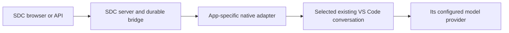
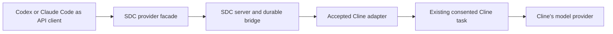

# Codex, Claude Code and other VS Code extensions

Reviewed **11 October 2026** against repository code and official documentation. “Claude plugin” here means Anthropic's official **Claude Code** VS Code extension. A third-party extension with Claude in its name needs a separate review.

This document gives ordinary-use setup and proposed integration steps. **Codex and Claude Code are not accepted ServerDrivenChat backends or named API clients today.** No extension was installed, no new native permission was granted and no configuration was changed for this research. Existing Cline acceptance remains unchanged.

## 1. Choose the meaning of “use with our system”

The direction of control is the most important choice.

| Route | Who starts work? | Who executes the native agent? | What is possible now? |
|---|---|---|---|
| Independent extension | You type into Codex/Claude Code in VS Code | That extension | Vendor's normal workflow, separate from SDC; not SDC acceptance |
| Native SDC backend | SDC browser/API sends a command to an existing Codex/Claude Code conversation | The selected extension | Requires new adapter/interface, graphical consent and native acceptance |
| SDC model gateway consumer | Codex/Claude Code makes a model HTTP request to SDC; SDC forwards a neutral command to an already bound Cline task | Client agent owns its tools; existing Cline supplies backend output | Vendor configuration mechanisms exist, but these named clients are unqualified and have substantial compatibility gaps |
| MCP tool consumer | The agent chooses an SDC tool while answering your prompt | Existing agent plus existing SDC-bound app | Requires an SDC MCP wrapper not currently implemented; does not replace a native adapter |
| Another provider in Cline | You configure Cline's model connection | Cline | Preserves app identity; affected behavior still needs qualification |

Two diagrams show why the routes differ:





In the second diagram, the SDC browser controls Cline. It does not acquire control of the Codex/Claude Code chat that called the gateway. If the client receives caller tool calls, the client executes those tools under its own permissions. That responsibility must not also fall to Cline.

## 2. What changes for the user

| Area | Maintained Cline backend today | Codex/Claude Code as a future backend | Codex/Claude Code as a future gateway client |
|---|---|---|---|
| Conversation | Selected Cline task | Selected app-specific conversation; fresh binding | Client conversation and backend Cline task both exist |
| Sign-in | SDC OIDC/device pairing plus Cline's model configuration | SDC pairing plus native vendor authentication | SDC API key for gateway; vendor/client credential behavior separately configured |
| Files/tools | Native Cline permission system | Native target's permissions, mapped only where evidenced | Client owns caller effects; backend native effects must be fenced for that profile |
| Questions/cancel | Exact accepted native categories | Must map and test target's request/turn identity | SDC controls refer to backend Cline, not automatically the client's own UI |
| History | Native Cline history and server projections | New native history; no automatic conversion from Cline | Client history plus SDC/server composition plus backend native context |
| Usage | Server versioned estimates; native billing unknown | Same honest estimate policy unless independently measured | SDC estimates remain estimates even if client UI labels them tokens |
| Reliability | Accepted durable bridge and bounded native recovery | Shared durable infrastructure reusable; target effects require proof | Stable per-operation keys, client retries and tool-result lineage must be qualified |
| Costs/latency | Cline's actual model/provider path | Depends on target's account/provider and behavior | Extra orchestration hop; client tool loops may make multiple generations |

No cost saving, performance parity or full vendor compatibility is promised. A service alias such as `sdc-default` identifies an authorized SDC service; it does not select a real vendor model or create access to a subscription. Native permissions and SDC control consent are separate boundaries.

## 3. Using Codex independently in VS Code

These are vendor setup steps, not SDC backend setup. Use a separate disposable editor environment for evaluation, preserving the accepted Cline installation.

1. Open the intended editor's Extensions view.
2. Follow the official installation link, verifying extension ID **`openai.chatgpt`** and publisher OpenAI.
3. Open the Codex sidebar. The official command is **Codex: Open Codex Sidebar** if its icon is hidden.
4. Complete the vendor sign-in flow yourself.
5. Open a disposable project and choose a restrictive native permission setting appropriate to the test.
6. Ask it to explain a harmless file before testing any edit.
7. Record the installed extension/runtime version, architecture, editor version and effective permissions.

The official [IDE quickstart](https://learn.chatgpt.com/docs/codex/ide) documents this editor workflow. Success here proves ordinary Codex use only.

Codex agent behavior is configured in `config.toml`; editor behavior uses `chatgpt.*` VS Code settings. Open **Codex Settings** from the sidebar gear and inspect the active configuration layer. Configuration is shared with other local Codex surfaces, so an isolated VS Code data directory does not necessarily isolate `~/.codex` or OS credential storage. Use a separate test account or an explicitly supported configuration-home arrangement and confirm the effective scope. [Developer settings](https://learn.chatgpt.com/docs/developer-settings).

### Making Codex a native SDC backend

There is no `sdcCodex.connect` command or accepted Codex adapter in this release. Installing Codex does not satisfy the companion's Cline dependency or native export checks. Renaming `cline.vscode` to `codex.vscode` would change a label without adding control.

OpenAI documents app-server for rich clients, including thread/turn events and approvals. That is a useful protocol candidate, but a standalone app-server process is not attachment to the user's existing IDE session. This repository excludes launching a substitute runtime or connecting through a private socket. The reviewed documentation does not establish this project's authenticated external attachment to the already running official IDE session. [Official app-server documentation](https://learn.chatgpt.com/docs/app-server).

A future implementation should first obtain a supported, app-owned attachment route to the exact selected IDE conversation. Then implement the neutral adapter operations, explicit local Connect/consent, task identity, event checkpoints, native questions/approvals/cancel and recovery. A documented approval hook alone does not submit an idle prompt or provide the complete lifecycle. OpenAI's [PermissionRequest hook](https://learn.chatgpt.com/docs/hooks#permissionrequest) can decide eligible requests, but its availability and scope must be tested in the target host.

The historical [M01 report](../feasibility/codex.md) concerns a particular **desktop app**, not this VS Code extension. It is a scoped negative route finding, not proof that every future IDE route is impossible. M16–M18 remain Deferred; this research does not resume them.

## 4. Codex as an SDC Responses API client

For the user's subsequent, more detailed model-provider request, read [CodexModelIntegration](CodexModelIntegration/README.md), its [compatibility design](CodexModelIntegration/compatibility-design.md) and [implementation plan](CodexModelIntegration/implementation-and-testing.md). That analysis adds current official custom-alias catalog, request-compression, custom-CA and gateway streaming requirements. Existing examples here remain hypothetical; no Codex client support follows from them.

OpenAI documents custom model providers with a base URL, environment-backed credentials and optional headers. The current configuration reference supports `wire_api = "responses"`; do not use an old Chat Completions configuration example for this route. [Custom providers](https://learn.chatgpt.com/docs/config-file/config-advanced#custom-model-providers), [configuration reference](https://learn.chatgpt.com/docs/config-file/config-reference).

The following is a **proposed lab configuration after compatibility work**, not a working configuration for the current deployment. The port **16944** is an example for a future authenticated, certificate-verified client compatibility service; no service exists there today. It must preserve the SDC server's authority and cannot execute models/tools or access its database.

```toml
model = "sdc-default"
model_provider = "sdc_lab"

[model_providers.sdc_lab]
name = "SDC qualification lab"
base_url = "https://localhost:16944/openai/v1"
env_key = "SDC_API_KEY"
wire_api = "responses"
supports_websockets = false
```

`SDC_API_KEY` is the name of an environment variable that the operator supplies securely to the isolated editor process, not a key value to commit. The direct current SDC base URL is `https://localhost:15943/openai/v1`; changing the example to that address does not solve the gaps below.

### Compatibility work required first

| Gap | Current repository behavior | Qualification work |
|---|---|---|
| Request identity | Every generation needs one stable `Idempotency-Key` | Prove the exact client exposes/preserves a logical request ID, or implement a durable, reviewed client compatibility mechanism. One static header for a whole session is invalid. |
| Input/output dialect | Restricted Responses profile; function caller tools only; no arbitrary provider features | Capture sanitized requests from the pinned client and map supported semantics explicitly. Unsupported required features remain a no-go. |
| Retention | Only `store=true` supported | Check actual client behavior; do not silently ignore a client's no-storage requirement. |
| Reasoning and native tools | Provider reasoning options/built-in tool types are outside the profile | Disable through supported client controls where possible; otherwise implement deliberately or reject. Do not fabricate reasoning items. |
| Caller effects | Default M24 binding is not caller-tool qualified | Fresh native ownership/permission tests; SDC must return issued calls while Cline cannot execute their effects. |
| Streaming | SDC provider SSE is terminal-buffered | Test client timeouts, progress expectations and retries; do not advertise token-by-token live generation. |
| Context | Server owns normalized history/instructions/lineage; backend has native state | Qualify exclusive API context and compaction/replay. Do not use shared-task mode as a universal workaround. |
| Transport/trust | Current facade provides HTTPS/SSE, not a Responses WebSocket service | Use supported HTTP behavior, verify the actual native runtime trusts the public CA, and retain TLS validation. |

The restrictions above come from the current [OpenAI profile implementation](../../api-gateway/sdc_gateway/openai_profile.py) and [HTTP boundary](../../api-gateway/sdc_gateway/openai_http.py), not speculation about what one client version always sends. No Codex request capture/native client test was performed here.

A proxy that generates a new random key on each received HTTP request duplicates work on retry. A proxy that hashes the body permanently can merge two intentional identical prompts. Before accepting a compatibility service, prove stable operation identity across retry/process loss and a distinct identity for a new intentional send. If the pinned client cannot supply that distinction through a supported interface, stop this route rather than guessing.

### Ordered future setup

1. Pin the Codex extension and its bundled runtime; establish which version reads the candidate config.
2. Capture harmless traffic against a controlled test endpoint; redact credentials and sensitive prompt content.
3. Complete request identity, field and tool-ownership work above using disposable bindings.
4. Provision a short-lived SDC key scoped to that binding and the minimum allowed operations.
5. Deploy/review the compatibility service only if it is actually needed; authenticate it and verify TLS upstream and downstream.
6. Apply the lab provider configuration to the test environment and restart the extension.
7. Send text-only requests, then repeated same-key retries, then explicit tool tests after separate qualification.
8. Verify the client's own permission prompt and a single file effect; verify backend Cline did not perform the same effect.
9. Test cancellation, timeout/process-loss reconciliation and unsupported option refusals.
10. Remove the test config/key and record results. Add named-client support only for the exact passing subset.

## 5. Using Claude Code independently in VS Code

1. In the intended isolated editor, follow the official **Claude Code** listing, extension ID **`anthropic.claude-code`**, and verify the publisher. [Official Marketplace listing](https://marketplace.visualstudio.com/items?itemName=anthropic.claude-code).
2. Open its panel and complete sign-in yourself.
3. Select **Manual** permission mode for disposable edit/approval testing rather than relying on automatic edit acceptance.
4. Open a small disposable project, ask it to explain a file and inspect its history/model/account status.
5. Record the exact extension version. Anthropic documents that the extension version identifies its bundled Claude Code version.

The extension supplies its own chat-panel runtime; this procedure does not require starting a second terminal agent. [Official VS Code guide](https://code.claude.com/docs/en/vs-code). Successful ordinary use is separate from SDC control acceptance.

The reviewed vendor guide lists VS Code 1.94+, while the Marketplace listing lists 1.98+. Verify the selected VSIX manifest's editor requirement instead of assuming either mutable page defines the exact package. The current SDC editor 1.140.0 exceeds both stated minima, but that does not establish Claude Code native acceptance.

The editor's data directory is not a guarantee of isolation for user-level Claude settings, plugin storage, native credentials or history. Inspect the actual target's supported scope; use a separate macOS test user when broad native state separation is required. Do not copy the accepted Cline bridge's saved credentials into the Claude environment.

### A promising native integration: Claude Code mods

Current official documentation states that in-process **mods** run hooks in the VS Code chat panel, although their custom UI drawing is unavailable there. This makes them a candidate app-owned integration route rather than requiring a fork of the official extension. Availability still depends on the exact build and organization policy. [Mods overview and surface table](https://code.claude.com/docs/en/plugins/mods/overview#where-mods-run).

The documented API includes session inspection, prompt submission and turn abort; session/turn/tool events can supply observations. `$.prompt.submit({ text })` waits for idle before starting a turn. Those are useful primitives, not an accepted SDC adapter. [Mods API](https://code.claude.com/docs/en/plugins/mods/api), [reference](https://code.claude.com/docs/en/plugins/mods/reference), [event lifecycle](https://code.claude.com/docs/en/plugins/mods/events).

Our proposed integration would load reviewed bridge code inside the already running Claude Code session. It would authenticate to the SDC server and consume commands for only the locally consented binding. It would use app-owned methods to submit/observe the selected session, preserving the existing execution runtime. See the [engineering plan](plugin-integration-plan.md#5-claude-code-native-feasibility-sequence).

Important unresolved questions include whether queued prompt submission can be cancelled/fenced before it finally executes, whether abort is addressed to the captured turn, whether every question and permission category exposes a stable request identity, and whether local resolution wins atomically. Native modifications must never turn `deny` or organizational restrictions into an SDC remote `allow` bypass. Keep remote approvals disabled until exact behavior is established.

Conventional `PermissionRequest` hooks can allow/deny certain native tool requests, but the documented hook payload lacks `tool_use_id` and excludes sandbox network prompts. An adapter cannot invent a safe request identity from that hook alone. [Hooks reference](https://code.claude.com/docs/en/hooks#permissionrequest).

Anthropic's vendor **Remote Control** is another product route, not this project's API. Its documentation describes vendor web/mobile access and excludes custom `ANTHROPIC_BASE_URL` gateways for that workflow. Do not assume vendor Remote Control hands SDC an integration endpoint. [Remote Control documentation](https://code.claude.com/docs/en/remote-control).

## 6. Claude Code as an SDC Anthropic Messages client

Anthropic documents gateway routing through `ANTHROPIC_BASE_URL` and gateway credentials. In VS Code, its guide uses `claudeCode.environmentVariables` in user settings so the extension's login check sees them. [Gateway connection guide](https://code.claude.com/docs/en/llm-gateway-connect#vs-code-extension).

After implementing and accepting a compatible route, this **proposed lab settings shape** identifies the relevant fields. Again, **16944 is a future example service**, not an existing endpoint, and the key text is a placeholder:

```json
{
  "claudeCode.environmentVariables": [
    { "name": "ANTHROPIC_BASE_URL", "value": "https://localhost:16944/anthropic" },
    { "name": "ANTHROPIC_AUTH_TOKEN", "value": "REPLACE_WITH_SHORT_LIVED_LAB_KEY" },
    { "name": "ANTHROPIC_MODEL", "value": "sdc-default" }
  ]
}
```

The current direct SDC base is `https://localhost:15943/anthropic`; the client appends `/v1/messages`. Do not append a second `/v1`. `ANTHROPIC_MODEL` selects the gateway alias; a base URL alone does not select a model. [Model configuration](https://code.claude.com/docs/en/model-config).

Keep real credentials outside repository files and synchronized/shared editor settings. If the selected extension requires a credential in local user settings for its login check, use a separate protected test user configuration and short-lived key, then remove/revoke it after testing. Review supported credential-helper alternatives for that exact build; do not invent shell-variable expansion inside JSON.

### Why this does not work as a supported client today

The SDC Anthropic profile rejects beta headers, thinking/output controls, caching fields outside its text blocks, unsupported content and invalid tool shapes. It requires exactly one SDC credential transport and one stable generation key. Claude Code's gateway protocol can carry richer feature fields and headers. That mismatch needs explicit handling rather than claiming full Anthropic parity. [Vendor gateway protocol](https://code.claude.com/docs/en/llm-gateway-protocol), [current SDC normalization](../../api-gateway/sdc_gateway/anthropic_profile.py), [HTTP boundary](../../api-gateway/sdc_gateway/anthropic_http.py).

Additional work includes checking model/background aliases, client prompt sizes versus SDC's bounded estimates, caller-tool count/schema/result shape, terminal-buffered stream timeouts, request identity and client permission outcomes. Gateway token counting is the SDC estimator, not Anthropic's native tokenizer. Never claim a native 200K/1M window for `sdc-default` merely because the client assumes one.

Follow the same ordered capture → compatibility → scoped key → TLS → text → retry → tool ownership → recovery qualification procedure as Codex. Use only the pinned client's supported controls to omit optional unsupported features. If a required semantic feature cannot be represented honestly, refuse that profile. Do not silently strip reasoning, retention or permission semantics to make a test green.

## 7. An MCP route for either extension

Both vendors document MCP clients. Codex's local clients use configured MCP servers in `config.toml`; Claude Code has its own MCP configuration. [OpenAI MCP](https://learn.chatgpt.com/docs/extend/mcp), [Claude Code MCP](https://code.claude.com/docs/en/mcp).

SDC currently exposes REST/SSE and provider profiles; **it does not expose an MCP server**. Putting `https://localhost:15943/api/v1` into an MCP server URL cannot convert REST into MCP. A wrapper must implement MCP initialization, tools, authentication and response/error behavior first.

A proposed wrapper could expose `list_authorized_sessions`, `inspect_session`, `submit_prompt`, `get_operation` and `cancel_operation` as deliberately bounded tools. These are proposed names, not callable tools in the current repository. Start with read-only tools; require explicit authorization for writes. Every call still goes through SDC's public API and owner/device/binding checks, never directly into PostgreSQL or the native extension.

A hypothetical Codex configuration after that wrapper exists could be:

```toml
[mcp_servers.sdc_lab]
url = "https://localhost:16944/mcp"
bearer_token_env_var = "SDC_MCP_TOKEN"
```

The `/mcp` path, port and token are future service configuration; nothing is deployed by this document. A Claude client would be configured through its supported MCP connection flow against the same implemented wrapper. Verify TLS/authentication and tool schemas before granting write capabilities.

This route lets an agent **call SDC as a tool**. It does not make SDC push arbitrary work into that agent's idle conversation, resolve its native approval dialog, or observe its complete lifecycle. Keep separate identities and avoid submitting to the same task whose model/tool request is waiting for the result.

## 8. Avoid a circular model request

Do not point the accepted backend Cline's model provider at the SDC API key bound to that same Cline task:

```text
Cline asks SDC for model output
SDC tries to submit a prompt to the same busy Cline task
Cline is waiting for SDC's answer
```

That arrangement can deadlock or be refused as busy/context-incompatible. A client experiment needs a distinct frontend agent and backend binding, with the backend's provider pointing to its genuine upstream model. Separate keys alone do not create separate native conversations. An MCP tool that synchronously calls back into its own busy bound task has the same problem.

## 9. Troubleshooting and decisions

| Symptom | What to inspect |
|---|---|
| SDC still says Cline after installing Codex/Claude | Expected: existing companion is Cline-specific. New extension installation did not create an adapter. |
| Gateway returns 400/422 | Stable key, beta headers, extra fields, content/tool dialect and unsupported controls. Read the exact error; do not broadly suppress validation. |
| Gateway returns 401 | Key expiry/revocation, credential transport conflicts, correct client configuration scope and inherited environment. Vendor subscription login is not an SDC key. |
| Model not found | Use an authorized SDC alias, not a vendor model name. Verify model discovery using the key for the intended binding. |
| UI appears frozen | Terminal-buffered output, pending native question/permission, client timeout, busy backend or a circular request. Inspect the server operation and actual native task. |
| Certificate error | Verify the public CA in the actual bundled runtime. Browser, Node, Rust and other runtimes may use different trust paths; do not disable validation. |
| File changed twice | Caller and backend both executed an effect or retries lacked logical identity. Stop the experiment and reconcile; qualification failed. |
| Uninstall did not remove login/history | Extension binaries and user/vendor state have different lifecycles. Use scoped vendor sign-out/cleanup and preserve unrelated data. |

For another Cline version, the most direct path is [porting and qualifying its maintained patch](cline-version-migration.md). For an official alternative backend, Claude Code mods deserve a focused feasibility prototype; Codex first needs a supported app-owned attachment route established for the IDE host. For merely exposing SDC functions inside an agent, an MCP wrapper is a narrower project but does not deliver full native control. For using SDC as these agents' model service, first resolve named-client request identity and caller-tool compatibility. None of these routes follows from changing a base URL alone.
