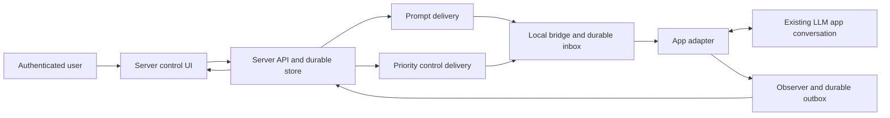
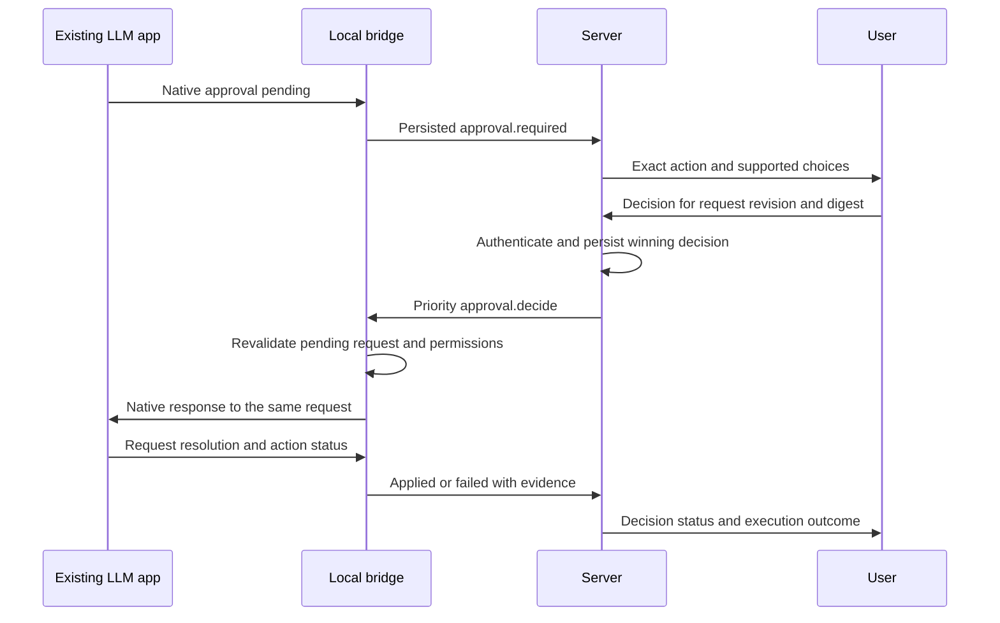

# Requirements: server control of existing LLM chat apps

**Version:** 2.4 (specification; wire protocol 2.0)  
**Updated:** 2026-10-08  
**Status:** Shared foundation and adopted local Cline integration verified through M23; M27 In Progress with a first-party checkpoint; M28–M30 and M24–M26 Not started. Revision 2.4 is a user-authorized architectural/plan amendment, not runtime implementation.  
**First final-release target:** The adopted Cline integration in local VS Code, its companion extension, shared server/control interface, and a FastAPI REST gateway with OpenAI-compatible and Anthropic-compatible profiles.  
**Deferred:** Codex desktop integration, native controls and pilot acceptance (M16–M18); no Codex companion installer or native conformance gate in this release.  
**Transport baseline:** Outbound SSE subscriptions plus HTTPS POST, with independent prompt and control delivery.

The user’s 2026-10-08 scope decision selects a Cline-only first release. [DECISION-008](docs/decisions/008-cline-first-release.md) and the [implementation tracker](IMPLEMENTATION_TRACKER.md) established its original M23–M26 sequence, subsequently amended below. Deferral changes app/release scope, not app-neutral security, permissions, durability or performance requirements. The wire protocol remains 2.0.

The subsequent [public API amendment](docs/decisions/009-fastapi-public-api.md) adds M27–M30 to this release, scheduled before M24–M26: **M27 → M28 → M29 → M30 → M24 → M25 → M26**. Preserve existing milestone IDs/history. The user authorized research and appending the plan, not implementation in this amendment. [Research, proposed REST catalog and compatibility gates](docs/feasibility/public-api.md) distinguish targets from verified native support.

## 1. Problem, intended outcome, and boundaries

Revision 2.4 follows the user's explicit server-ownership clarification in [DECISION-010](docs/decisions/010-server-owned-api-semantics.md). It supersedes prior native-provider-equivalence prerequisites while preserving API IDs, app-only execution, native permission/authority gates and honest reported estimates. The [server-owned plan](docs/feasibility/server-owned-api-plan.md) is authoritative.

The user wants to operate an existing LLM chat application from a server interface: select a conversation, submit successive prompts and attachments, see responses and activity, answer questions, approve or reject requested actions, and stop work. The installed app owns model execution, native local history/tools/credentials and permission enforcement. The server owns public API histories/instructions, caller-tool protocol/state, aliases/routing, budgets/accounting and response lineage through a neutral backend connection.

The server is a remote control surface. A local **bridge**, packaged as a graphical companion or an in-app extension, translates between the server protocol and the selected application's controls. It operates independently of whether the LLM is generating, idle, or blocked awaiting approval.

For Cline, the installed Connect tool is a bounded task-scoped request, not an installer or grant. The host supplies the originating task out of band; model arguments may select only a configured server profile and display label. Local consent, server authentication, and native app permissions remain separate graphical actions. See §9.3 and the M04 protocol contract.

### 1.1 Mandatory app-only constraint

- Do not launch Codex CLI, Claude Code CLI, Cline CLI, a headless agent, or a provider SDK as a substitute for the selected app.
- Do not create a separate model session and present it as the user's existing app conversation.
- Installation, sign-in, pairing, native conversation selection and local consent remain graphical. The user explicitly adds authenticated programmatic REST/SSE operation alongside the GUI; a future desktop client may consume those APIs. Product operation does not require terminal commands, and API access does not bypass local binding or native permissions.
- A packaged companion process is permitted. It handles connectivity, persistence, observation, and app interaction; it does not run the LLM itself.
- The app's own implementation and tools remain its responsibility. This constraint prohibits using a CLI to drive the LLM; it does not silently change which tools the user has enabled inside the app.

### 1.2 What “any LLM chat app” can mean

Use one server protocol with adapters for different apps. Support depends on each app exposing a native integration, an extension surface, or an accessible user interface. A transport cannot manufacture these capabilities.

Publish support per **app version, operating system, integration method, and operation**:

| Support level | Promise |
|---|---|
| Native control | Verified conversation identity, structured events, and request-bound controls through an app-supported interface |
| UI-assisted control | Verified submission and observable output through accessibility or browser UI; supported dialogs only |
| Supervised control | User inspects a live app view and performs supported remote UI actions; semantic automation is limited |
| Unsupported | No reliable way to identify the conversation or perform the operation |

Complete unattended control of every unmodified app cannot be guaranteed. An opaque approval dialog, protected OS prompt, unavailable app, or inaccessible conversation must become an explicit limitation or local-action request. Do not work around a missing capability by replacing the app runtime.

### 1.3 End-to-end success scenario: Cline first release

1. The user installs the reviewed Cline native/companion VSIX pair graphically, opens a project in supported local VS Code and selects its existing native Cline task.
2. After profile setup, type “Connect to my server and follow its instructions.” The installed task-scoped Connect tool performs graphical sign-in, server pairing and independent local binding/control consent. The extension owns the persistent listener; credentials and authority do not enter model messages.
3. The initiating native turn ends. A later prompt from the server UI appears in that exact existing task without returning to the native composer; the server displays observed output and accurate turn state.
4. An app approval request appears on the server with exact native request/action identity, revision, target and supported choices. The user records allow once or deny; the bridge observes native resolution and subsequent action outcome separately.
5. A follow-up retains task context. Questions and addressed cancellation use the native app controls; unsupported grants are rejected and accurately reported.
6. Reconnect preserves accepted work or explicitly reconciles uncertain effects without duplicate actions. Local takeover, task/host changes and disable prevent stale remote dispatch. Verified attachments and output reconstruction do not silently lose content.
7. Disconnect and uninstall expose accurate state and credential/data cleanup. Release acceptance includes clean GUI installation, real server HTTPS/identity deployment, upgrade/rollback, failure hardening and measured latency/backlog/soak checks.

Codex repeats this journey only in a future explicitly resumed adapter/pilot effort. No Codex workflow is required for first-release acceptance; no Codex support is claimed by a successful Cline release.

### 1.4 End-to-end success scenario: public API release target

1. Graphically install/pair the reviewed native/companion pair and explicitly bind the intended Cline task/control categories. Register an authorized API client and scoped alias; public discovery cannot silently bind another task.
2. A first-party REST call submits a prompt with a stable retry key. FastAPI calls the existing server; the original command is persisted and delivered to the bound native task. The caller receives verified output or a resumable operation, never a receipt presented as an answer.
3. Follow-ups preserve the intended client/native context. Other clients/conversations do not inherit hidden history or authority. Questions, approvals and cancellation are addressed through the API and require their existing native evidence/permissions.
4. Pinned OpenAI and Anthropic SDKs use the advertised profiles, aliases and SDC credentials; named coding assistants exercise supported histories/tool ownership/options through the same native route. Required declared server-profile gaps remain blockers; exact native provider equivalence is not required under DECISION-010.
5. A reference client uses documented REST/SSE to discover state, send, render output, resolve supported interactions and recover/retry. No new desktop GUI, model runtime or private app interface is necessary to establish the contract.
6. The frozen deployment validates public TLS/identity, scoped-key revocation, proxy streaming, result durability/isolation and native failures alongside the graphical workflow and measured release gates.

## 2. Review of the previous proposal

The separation of server, transport, persistent listener, adapter, and durable queues is sound. The earlier emphasis on transport comparison leaves the decisive app-control work underspecified.

| Previous design | Finding and revision |
|---|---|
| Five transports as five solutions | They solve delivery, not app control. Prove one real app workflow first. |
| Generic `POST /run` executor | Lacks explicit attach, inspect, approval, and reconciliation operations. Replace with the adapter contract in section 9. |
| CLI/SDK adapters allowed | Excluded. Only the existing app or extension may execute the turn. |
| `payload.text` input | Insufficient for attachments, active-turn answers, steering, and approvals. Introduce distinct commands and content blocks. |
| Deltas plus terminal text | Insufficient for edits, artifacts, partial observation, and recovery. Add stable output items, revisions, and snapshots. |
| Generic `input.required` | Clarification, action authorization, permission grants, and OAuth have different semantics. Model them separately. |
| Approvals deferred | They determine whether the integration works. Test them in the first real-app milestone. |
| Shared runner/executor token | Separate user, paired-device, and local-adapter identities. |
| Acknowledgment treated as progress | Distinguish server persistence, bridge persistence, app acceptance, request resolution, and execution outcome. |
| Working lab and benchmarks | The referenced lab, archive, source, and results are absent here. Earlier claims are unverified historical notes. |

## 3. Integration strategy and evidence

### 3.1 Codex desktop: deferred future pilot

**First-release scope:** M16–M18 are Deferred. The following research/mapping is retained for future work and is not a prerequisite for the Cline release. Resume only by explicit user instruction with a viable approved route.

OpenAI documents native Remote connections supporting existing chats, questions, and approvals through its own clients. This demonstrates an app-only remote workflow, but does not establish a public integration API for this project's server. [Remote connections](https://learn.chatgpt.com/docs/remote-connections).

Codex App Server documents thread/turn events and request-specific approval responses. Its standalone launch workflow is outside scope; protocol documentation alone does not establish supported companion attachment to the running desktop app. Investigate app-owned attachment first. If unavailable, use accessibility with explicit limitations. [Codex App Server](https://learn.chatgpt.com/docs/app-server).

Prove attachment to the **already running desktop conversation**. Record the app version, identity source, observation mechanism, approval categories, and foreground requirements. Do not launch a second app-server process or assume an undocumented socket is a supported integration.

### 3.2 Cline in VS Code: first-release target

The stock Cline interface inspected during M02 exposed `startNewTask`, `sendMessage`, `pressPrimaryButton`, and `pressSecondaryButton`. That interface does not expose structured event subscription or request-ID approval methods. [Cline public API](https://raw.githubusercontent.com/cline/cline/main/apps/vscode/src/exports/cline.d.ts).

The implementation acts on the sidebar's current task; `startNewTask` clears it before starting another. A resolved call is therefore insufficient proof that the intended conversation received a command, and a primary-button call does not identify the permission being approved. [Cline API implementation](https://raw.githubusercontent.com/cline/cline/main/apps/vscode/src/exports/index.ts).

Build a VS Code companion extension using a supported, versioned Cline API. If the public interface remains insufficient, propose a small upstream integration API. A separately identified, maintained Cline extension build is a fallback requiring explicit adoption. Both keep execution in the visible Cline app. Private webview messages must not be treated as a stable public API.

Needed additions are task identity/selection, event subscription and snapshots, pending-interaction enumeration, request-bound answers, cancellation, and applied-result reporting. A UI-assisted prototype can precede them, but cannot claim equivalent reliability.

The user explicitly adopted the maintained Cline build in DECISION-004. M19–M22 subsequently verified local existing-task input/output, PNG, exact native controls, trusted Connect/pairing and the complete graphical server journey. The starting release baseline is Cline 4.1.22 `sdc-m21.3` (4.1.2203), API 1.2 and companion 0.4.0; [M22 evidence](evidence/M22/verification.json) records exact scope. M23–M26 must harden, distribute and verify the release candidate; historical development acceptance is not production conformance. Stock Cline, Antigravity and remote hosts are not implied support.

### 3.3 Additional apps

| Approach | Use and limitation |
|---|---|
| Native app integration | Preferred when a supported interface attaches to the actual app session and resolves its requests |
| In-app/IDE extension | Best fit for Cline; bind the correct window, workspace, extension host, and task |
| Browser extension | Operate the selected app's DOM with allowed site access; revalidate after navigation/UI changes |
| Desktop accessibility | Observe controls and invoke semantic actions; serialize foreground operations and recheck identity |
| Screenshot-assisted human control | Fallback for incomplete semantics; explicit user actions against a live view, without invented permissions |

Content scripts can read and modify page DOM, but do not automatically access the page's internal JavaScript state. Extension workers can terminate, so persist state and recover. [Chrome content scripts](https://developer.chrome.com/docs/extensions/develop/concepts/content-scripts), [worker lifecycle](https://developer.chrome.com/docs/extensions/develop/concepts/service-workers/lifecycle). Desktop adapters should use platform accessibility facilities such as [Apple AXUIElement](https://developer.apple.com/documentation/applicationservices/axuielement) and [Windows UI Automation](https://learn.microsoft.com/en-us/dotnet/framework/ui-automation/ui-automation-overview), with real-app verification.

### 3.4 Why MCP alone does not solve this

A tool server can offer a cooperative mailbox, but the app must call it. An instruction to keep calling `next_prompt` cannot guarantee idle wakeup, survival after a completed turn, or access to host approval dialogs. A paused model cannot reliably relay the approval blocking it.

MCP sampling does not standardize appending a user turn to a selected visible chat; revision 2026-07-28 deprecates it. Elicitation gathers information through the client, including form and external-URL flows; it is not blanket authority over host permissions. [MCP sampling](https://modelcontextprotocol.io/specification/2026-07-28/client/sampling), [MCP elicitation](https://modelcontextprotocol.io/specification/2026-07-28/client/elicitation).

MCP may support tools or metadata, but must not be the sole lifecycle or native-approval mechanism. Similarly, Claude connectors expose services to Claude; that does not establish remote control of its conversation UI. [Claude connectors](https://support.claude.com/en/articles/11176164-use-connectors-to-extend-claude-s-capabilities).

## 4. Architecture and ownership



| Component | Responsibility |
|---|---|
| Server | Authenticate operators, authorize sessions, store commands/events/decisions, render transcript and controls |
| Companion | Pair device, manage local consent/credentials, persist queues, connect outward, provide local stop control |
| Scheduler | Order normal turns; dispatch approvals, answers, and cancellation without waiting for the active turn |
| Adapter | Bind native identity, interact with the app, observe evidence, translate controls, report limitations |
| App | Own model execution, context, native tools, and actual permission enforcement |
| Local policy gate | Restrict bridge actions/grants; enforce app tool policy only where an app-supported pre-execution gate exists |

The control loop runs in ordinary bridge/extension code, independently of the LLM. It stays responsive while the model is blocked.

A binding records `deviceId`, `appId`, app account/workspace identity where available, `appInstanceId`, `nativeConversationId`, server `sessionId`, and monotonic `bindingRevision`. Cline also needs VS Code window, workspace, extension-host identity, and native task ID. Never identify a conversation by title alone.

One bridge owns the control lease for each binding. Every mutation checks lease generation and binding revision. A takeover must fence the old controller before dispatch; if that is impossible, hold for reconciliation. The local bridge is the sole remote mutator. UI adapters additionally lock the desktop interaction surface across sessions.

Local disable takes effect immediately at the bridge. Server-side disable is reported as pending until acknowledged; an offline bridge stops new dispatch when its short-lived lease expires. Start with a 60-second lease renewed every 20 seconds, enforced using a conservative local monotonic deadline. This bounds remote authority during a partition, not work already running inside the app. Lease expiry is not cancellation or revocation of an applied native grant.

## 5. Capability discovery

Advertise operations only after a version-specific probe. Submission does not imply streaming, cancellation, or approval support. Record:

- **Identity:** app/platform/version, adapter version, integration method, identity confidence.
- **Input:** text, supported attachments/limits, queueing, steering, clarification answers.
- **Output:** native deltas, snapshots, visible text only, artifact retrieval, history scope, completion evidence.
- **Approvals:** categories, native request IDs or UI fingerprints, choices/scopes, resolution observation, reconnect recovery.
- **Permissions:** subset grants, native lifetime, revocation, enforcement boundary.
- **Lifecycle:** background operation, foreground/app-open requirements, cancellation, reconciliation.

Use `supported`, `unsupported`, or `unverified`, with a reason and evidence reference. Reject unsupported operations rather than silently degrading them. App updates, account/workspace changes, or UI structure changes suspend affected capabilities until revalidated.

## 6. Input and output protocol

### 6.1 Identity, ordering, and validation

Use a versioned JSON envelope and publish JSON Schemas before implementation. Examples below are **proposed project messages**, not existing vendor API payloads.

The initial schema package is protocol version `2.0`. A receiver rejects unsupported versions and unknown control types. Command IDs remain stable across retries; identical ID/content retries are duplicates, while changed content with the same ID is a conflict. Prompt and control sequences are contiguous independently; a gap triggers replay or explicit resynchronization. The bridge reports its producer sequence per session and bridge epoch; the server assigns the UI replay sequence after durable ingestion. See `docs/protocol-v2.md` for the complete contract and compatibility rules.

| Field | Meaning |
|---|---|
| `protocolVersion`, `type` | Negotiated major version and typed command/event |
| `commandId` or `eventId` | Immutable ID, stable across retries |
| `sessionId`, `bindingRevision`, `leaseGeneration` | Conversation binding and current control authority |
| `turnId` | Server-assigned logical turn; adapter retains its native-turn mapping |
| `promptId` | Client idempotency key for normal prompt submission |
| `requestId`, `requestRevision` | Exact pending approval or input interaction |
| `createdAt`, `expiresAt` | UTC timestamps; expiry is mandatory for approval decisions |
| `payload` | Type-specific data |

Derive identities from authentication and stored ownership; never trust a client-supplied `approvedBy`. Validate endpoint/body identities, sizes, enums, and capabilities. Reject unknown controls or unsupported major versions. Additive fields must not alter authorization semantics.

Server-to-bridge `seq` is monotonic per device and delivery lane (`prompt` or `control`); it is a receipt checkpoint, not execution ordering across lanes. Bridge events carry `producerSeq` per session and bridge epoch. The server assigns `sessionSeq` after durable ingestion for UI replay. Deduplicate by ID and require identical content on retries. Detect gaps and repair them instead of silently skipping.

### 6.2 Commands are distinct from chat text

| Command | Semantics |
|---|---|
| `turn.submit` | Queue one normal turn in the bound conversation |
| `turn.steer` | Address a running turn, only when the app supports it |
| `turn.cancel` | Request interruption of a specific turn; await native confirmation |
| `input.respond` | Answer an identified clarification using its schema |
| `approval.decide` | Decide one identified pending authorization |
| `session.inspect` | Obtain current state and pending-interaction snapshot |
| `session.disable` | Stop new remote dispatch and invalidate pending remote authority |
| `permission.revoke` | Revoke a tracked grant where the app supports enforcement |

Never submit “yes,” “approved,” or “allow everything” as a substitute for `approval.decide`. A clarification answer must not be upgraded into authorization.

Example delivered prompt:

```json
{
  "protocolVersion": "2.0",
  "type": "turn.submit",
  "commandId": "cmd-101",
  "lane": "prompt",
  "seq": 51,
  "sessionId": "session-7",
  "bindingRevision": 3,
  "leaseGeneration": 4,
  "turnId": "turn-22",
  "promptId": "prompt-22",
  "createdAt": "2026-10-04T14:00:00Z",
  "payload": {
    "content": [
      {"type": "text", "text": "Review this design and propose the change."},
      {"type": "image", "attachmentId": "attachment-9", "mimeType": "image/png"}
    ],
    "delivery": "queue",
    "expectedConversationRevision": 18
  }
}
```

`expectedConversationRevision` protects against local edits, task switches, and stale composers; it does not advance for every output token. Verify at admission and before dispatch. Server-assigned queue order serializes normal turns; controls remain independent.

Track a separate adapter revision for external/local conversation mutations. Ordinary completion of the server's preceding queued turn must not invalidate its own queue; an observed local edit, branch/regeneration, or untracked turn must. If the adapter cannot distinguish these, pause and reconcile queued prompts instead of guessing.

Attachments use authorized upload/commit with size, MIME type, checksum, owner, and retention metadata. Verify availability and app support before submission, then confirm attachment in the app. Do not silently omit content or fetch arbitrary URLs with local credentials. Text conversion requires a user-visible choice. Documents and image text remain content, not control metadata.

### 6.3 Stable output items and observable states

| Events | Purpose |
|---|---|
| `command.received`, `command.rejected` | Bridge persisted or rejected the command |
| `turn.started`, `turn.state` | Verified app acceptance and execution/wait state |
| `output.item.created`, `.delta`, `.replaced`, `.completed` | Text, code, tool activity, and other displayed items |
| `artifact.available` | Authorized file/image/diff reference and retrieval status |
| `input.required`, `input.resolved` | Clarification lifecycle |
| `approval.required`, `approval.updated`, `approval.resolved` | Native approval lifecycle |
| `approval.applied`, `approval.apply_failed` | Outcome of returning a remote decision to the app |
| `turn.completed`, `turn.failed`, `turn.cancelled` | Terminal status supported by app evidence |
| `session.snapshot`, `session.reconciliation_required` | Recovery state or unresolved execution |
| `local_action.required` | Sign-in, protected UI, or other step requiring local interaction |

Each output item has `itemId`, `turnId`, `kind`, `revision`, `source`, and content blocks. Deltas carry `baseRevision` and resulting `revision`; apply only to the matching base. Replacements carry the full item. This handles edits/regeneration without duplicate text. The final item snapshot is authoritative; terminal events reference items instead of appending final text again.

Example bridge event replacing an observed item:

```json
{
  "protocolVersion": "2.0",
  "type": "output.item.replaced",
  "eventId": "event-84",
  "sessionId": "session-7",
  "bindingRevision": 3,
  "leaseGeneration": 4,
  "bridgeEpoch": "epoch-2",
  "producerSeq": 84,
  "createdAt": "2026-10-04T14:01:00Z",
  "payload": {
    "turnId": "turn-22",
    "itemId": "message-31",
    "kind": "assistant_message",
    "revision": 4,
    "source": "accessibility",
    "partial": true,
    "content": [{"type": "text", "text": "The design needs a separate approval path."}]
  }
}
```

The server adds its replay `sessionSeq` after storing this event. Observation time does not establish when the model generated the text.

Sources distinguish `native_event`, `accessibility`, `dom`, and `screen_observation`. Include observation time, available history range, and partial-output status. UI snapshots are not native token streams. An idle connection, missing spinner, or quiet transcript alone does not prove completion. Without a reliable terminal indicator, report `completion_unverified` and reconcile.

Forward only authorized observable content: answers, displayed progress, tool summaries, artifacts, and exposed usage. Do not manufacture hidden reasoning or absent tool results. Safely render untrusted output; app-generated text cannot create server approval buttons or commands.

### 6.4 Clarifications and authentication

`input.required` includes revision, question, schema, allowed choices, and expiry where applicable. `input.respond` returns validated answers to that request. Preserve the app's actual choices and resolution semantics.

Login, OAuth, account consent, and OS prompts use `local_action.required` or a verified external-auth handoff. Report completion, not passwords/cookies/MFA codes, through the conversation stream. Server approval cannot impersonate an OS grant.

## 7. Approval propagation and decision lifecycle

### 7.1 Authority and classification

An approval originates from an observed native pending request or a trusted integration hook at the app's action boundary. A model statement such as “I need permission” does not prove that a host permission request exists. Ordinary model questions may be shown as clarifications.

| Kind | Handling |
|---|---|
| Action approval | Exact tool/action, arguments, target, effects, and supported decisions |
| Permission grant | Requested resource permissions, supported subsets/lifetime, native enforcement |
| Clarification | Answer content; no permission changes |
| External authentication | Verified sign-in flow owned by provider/app |
| OS permission | Local action unless the OS explicitly supports the remote mechanism |

Normalize requests while preserving native ID, supported choices, raw display evidence, and semantic differences. Denying an operation may let the agent continue; cancelling may stop the turn. Do not collapse these into a boolean.

### 7.2 Request schema

An `approval.required` event includes the common envelope plus a payload such as:

```json
{
  "requestId": "approval-8",
  "requestRevision": 1,
  "nativeRequestId": "native-req-53",
  "kind": "action_approval",
  "appId": "vscode-cline",
  "appInstanceId": "extension-host-14",
  "bindingId": "binding-7",
  "sessionId": "session-7",
  "nativeConversationId": "task-53",
  "bindingRevision": 3,
  "leaseGeneration": 4,
  "turnId": "turn-22",
  "action": {
    "tool": "file.write",
    "arguments": {"path": "/workspace/project/README.md"},
    "artifactId": "proposed-diff-12"
  },
  "requestedPermissions": [
    {"resource": "filesystem", "operation": "write", "scope": {"path": "/workspace/project/README.md"}}
  ],
  "availableDecisions": [
    {"id": "allow_once", "effect": "allow", "scope": "action"},
    {"id": "deny_once", "effect": "deny", "scope": "action"},
    {"id": "cancel_turn", "effect": "cancel", "scope": "turn"}
  ],
  "actionDigest": "sha256:<canonical-action-digest>",
  "evidence": {"source": "native_event", "snapshotId": "snapshot-41", "complete": true},
  "expiresAt": "2026-10-04T14:10:00Z"
}
```

This illustrative app supports those exact choices; it is not a claim about Codex or Cline's native format. Angle-bracket digest values are placeholders, not production hashes.

Compute the digest over app/binding/turn/request identity and revision, normalized action/arguments, working directory, resources, requested permissions, offered scopes, and immutable artifact checksums. Define deterministic canonical serialization in the schema package. Include exact command arguments/environment changes where exposed; include recipients/body/attachments for a send action. Hash complete reviewable content, not an LLM summary. Incomplete evidence must not be labeled a fully specified structured approval.

Protocol v2.0 uses RFC 8785 JSON Canonicalization Scheme over the `ActionDigestInput` fields, UTF-8 encoded and SHA-256 hashed. Object keys canonicalize independent of input key order. Array order is significant except explicitly set-valued permission, choice, and checksum arrays, which the normalizer deduplicates and sorts. Strings are not Unicode-normalized. The digest is `sha256:` plus 64 lowercase hex characters. The package ships fixed test vectors; servers and bridges must match them before exchanging approvals.

For UI-only requests, retain a local handle and fingerprint of app instance, conversation, dialog contents, and semantic controls. This fingerprint is evidence, not an atomic host request ID. Recheck immediately before acting. If the UI cannot prevent a request-switch race, require supervised control or local action instead of unattended structured approval.

### 7.3 Decision schema and authorization

The server UI submits a proposal containing:

```json
{
  "decisionId": "decision-19",
  "requestId": "approval-8",
  "requestRevision": 1,
  "actionDigest": "sha256:<canonical-action-digest>",
  "choiceId": "allow_once",
  "grantedPermissions": [
    {"resource": "filesystem", "operation": "write", "path": "/workspace/project/README.md"}
  ]
}
```

Authenticate the reviewer and check session access, approver role, pending state, local delegation, digest, and expiry. Atomically record one winning decision per request revision. Identical retries return the recorded result; conflicting decisions return a conflict.

The server then creates `approval.decide` with session, turn, binding, lease, policy revision, expiry, and a server-authenticated decision assertion bound to the device/request. Reviewer identity comes from authentication. Store verification keys and credentials outside model-visible data. This assertion is not an app login token and cannot authorize unrelated actions.

The authenticated assertion covers `decisionId`, request revision/digest, chosen native decision, and exact granted subset as well as the binding and expiry. For deny/cancel choices, the grant set must be empty. Enforce one-time consumption locally; the external app response still needs reconciliation if its outcome is uncertain.

### 7.4 Application and confirmation



The bridge must:

1. Persist receipt before acknowledging delivery. Verify assertion, expiry, lease, binding, request revision, and current local policy.
2. Confirm the same request remains pending in the same app conversation/turn. Reject changed, dismissed, answered, or ambiguous requests.
3. Verify the choice and permission subset can be represented without broadening them.
4. Persist an application attempt, then send the native response or invoke the verified UI action. Bypass the normal prompt queue.
5. Observe request-specific acceptance. Emit `approval.applied` only with evidence that this decision took effect; a click or transport receipt is insufficient.
6. Report execution success/failure separately. Approval permits an attempt; it does not establish success.

Request states are `pending`, `decision_recorded`, `applying`, `applied`, `denied`, `expired`, `superseded`, `resolved_elsewhere`, `apply_failed`, and `reconciliation_required`. A recorded decision can become stale before application. Expiry never grants permission: apply native denial only if safely supported; otherwise leave the app paused and request local action.

If a local user or another client resolves the request first, invalidate the remote decision. After a crash between sending and observing a response, inspect native state rather than repeating a click/grant. Some apps cannot recover pending request handles after restart; these require reconciliation, not a generic “yes.”

Track concurrent requests independently. A later batch-decision feature must enumerate exact revisions/actions; it cannot mean “approve whatever appears next.”

## 8. Permission design: what the server can grant

### 8.1 Separate permission layers

| Layer | Owner and meaning |
|---|---|
| Remote-control consent | Local user delegates selected app conversations to this paired bridge/server |
| Server authorization | Which authenticated people may view, prompt, approve, or administer the session |
| Native tool/action permission | App-owned approval and enforcement |
| OS/service authorization | Sandbox, accessibility, account scopes, credentials, and organization policy |

A server decision authorizes the bridge to answer a native request. The app must apply the grant. The server cannot create OS rights, expand OAuth scopes, bypass organization policy, or enforce permissions through prompt text.

Maximum grant = intersection of **requested scope**, **app-supported scope**, **local delegation**, **reviewer authority**, and **organization/OS constraints**. Preserve hard denials. If a narrow scope cannot be expressed natively, reject it rather than map it to “always allow.”

### 8.2 Default policy

- Default to one pending action, once. No approval on timeout, disconnect, or missing response.
- Display exact native scope: action, turn, session, destination group, or persistent rule. Disclose when one decision unblocks multiple operations.
- Offer subsets only when the host supports them; otherwise approve/deny the full displayed request.
- Offer time/use limits only when the host or a trusted pre-execution gate enforces them. Expiring a server record does not revoke a native session grant.
- Keep persistent/global permission changes outside the pilot. Do not disable app approval prompts to make control appear complete.
- Show observable native auto-approval settings. The bridge cannot relay requests for actions the app already permits without asking.

Later automatic policies must be explicitly enabled, evaluate authenticated structured requests outside the LLM, and audit every decision. A bridge policy that cannot constrain execution inside the app is an admission/decision policy, not a sandbox guarantee.

### 8.3 Grant ledger and revocation

Record grant/request/decision IDs, app binding, exact resources/actions, native scope, effective time, native grant ID where available, reviewer, enforcement owner, and revocation support. Do not store credential values in this ledger.

Disable/revocation stops new remote dispatch and invalidates unsent grants. Revoke applied native grants only through supported mechanisms. If a grant lasts until the app session ends or settings change, display that and the local remedy. Stopping the bridge cannot undo completed actions or necessarily cancel running work.

Bind file-change review to the proposed diff/base version; invalidate on action changes. Avoid naive path-prefix or command-prefix allowlists. Canonical paths, symlinks, exact arguments, and child-process effects belong to the enforcing app/gate. An opaque command approval cannot be described as permission to touch only one file unless that boundary is enforced.

## 9. Adapter contract and app-specific mapping

The adapter is a library or authenticated local IPC service, not a replacement executor. Operations return promptly; execution progress arrives independently.

```text
probe() -> versioned capabilities and evidence
attach(selection) -> exact app/conversation binding
inspect(binding) -> transcript, turn state, pending interactions
submit(binding, command) -> native acceptance or rejection/unknown
subscribe(binding, checkpoint) -> observed events and gaps
respondInput(binding, request, answer) -> applied/rejected/unknown
resolveApproval(binding, request, decision) -> applied/rejected/unknown
cancel(binding, turn) -> applied/rejected/unknown
revoke(binding, grant) -> applied/unsupported/unknown
detach(binding) -> local dispatch disabled
```

Every mutation checks binding revision and current request/turn identity. “Accepted” requires evidence of app acceptance; otherwise report pending/unknown and reconcile. `detach` does not claim execution stopped.

### 9.1 Deferred Codex mapping, conditional on app-owned access

**Deferred from the first release:** this mapping is future M16/M17 work; no required Cline gate depends on it.

An authorized integration exposing the documented protocol must retain native JSON-RPC request and thread/turn/item IDs. Map `item/commandExecution/requestApproval` and `item/fileChange/requestApproval` to action cards; map `item/permissions/requestApproval` to supported subsets. Preserve question/elicitation semantics. `serverRequest/resolved` may also mean cleanup, so correlate it with the attempted response and subsequent state. [Approval protocol](https://learn.chatgpt.com/docs/app-server#approvals).

If attachment is unavailable, implement the project contract through accessibility. Explicitly select the Codex window/conversation; verify input readiness, submitted-message echo, output boundaries, and approval identity. Report partial/unknown state when data is omitted. A generic “Allow” button does not prove safe authorization.

### 9.2 Cline mapping and required additions

Package a VS Code companion extension with status and session selection. Bind one task explicitly; sending to whichever sidebar task is active is unacceptable. Observe task switches, local prompts, extension reloads, and workspace changes.

Use the public message API only after confirming active-task preconditions and verifying the message echo. New-task creation is a separate explicit operation. Button helpers are suitable only for supervised mode with fresh request checks; they do not provide atomic request-bound semantics.

The required native Cline bridge contract exposes a task-scoped snapshot/event stream and resolve asks using `(taskId, askId, askRevision, decision)`. Cline must compare these values and transition the ask atomically before resuming. Include exact tool arguments/diff, native choices, results, and local-resolution events. These capabilities are implemented and verified only on the explicitly adopted maintained pin; they are not stock Cline public API claims. Preserve exact version/fingerprint gating and revalidate any changed release package.

Route through the correct VS Code extension host. Remote workspaces and multiple windows require explicit identity; local window and remote host are distinct. Version-pin and test the integration before enabling unattended approvals.

### 9.3 Prompt-triggered Connect contract

The user may ask Cline to connect after graphical installation, server-profile setup, and pairing. The model-visible `bridge.connect` input contains only a configured `serverProfileId` and optional display label. It contains no task/session IDs, raw server URL, callback URL, credentials, reviewer identity, permission grant, or authority scope. Cline supplies trusted installation, extension-host, window, workspace, native task, and tool-invocation identities out of band. Missing or ambiguous origin fails closed.

The handler verifies that the server profile exists, obtains local confirmation for the exact server/task binding and permitted control categories, authenticates/pairs the device, then persists and starts the bridge listener. It reports connected only after the server handshake and task binding are confirmed. Repeating Connect for the same binding is idempotent; a different binding requires fresh local selection and consent. The call returns a bounded status without secrets. The listener survives the model turn while the owning host remains alive.

`bridge.disconnect` is scoped to the trusted current binding. It revokes that binding and stops delivery; cancellation of work already executing is a distinct control with its own observed result. Disconnect does not install software, sign in, or claim app/OS grant revocation. Connect and disconnect schemas and types are in `protocol/schemas/v2.0/connect-tools.schema.json` and `docs/protocol-v2.md`. M02 did not find this app-owned integration contract in stock Cline APIs. The explicitly adopted maintained API 1.2 passed M21 real-host Connect acceptance and M22 server workflow acceptance; M24/M26 must verify the installed release packages against the same contract.

## 10. Transport and server API

### 10.1 Reassessment of transport choices

| Transport | Decision |
|---|---|
| Periodic polling + POST | Diagnostic/limited-client fallback; interval adds delay and idle traffic |
| Long polling + POST | First fallback when streaming is unreliable; configure wait deadlines and replay |
| SSE + POST | Baseline: outbound desktop connection, replayable commands, ordinary HTTP event ingestion |
| WebSocket | Optional duplex alternative; still needs acknowledgments, persistence, replay, and bounded queues |
| Webhook | Defer for desktops; a remote server cannot directly reach the user's loopback listener |

SSE supplies framing/reconnection IDs, not durable execution. Transport mechanics do not change app permissions. [SSE standard](https://html.spec.whatwg.org/multipage/server-sent-events.html), [HTTP long polling](https://www.rfc-editor.org/rfc/rfc6202.html), [WebSocket](https://www.rfc-editor.org/rfc/rfc6455.html).

Use independent prompt/control subscriptions, consumed without awaiting model execution. Reserve separate bounded upload capacity for approvals/state versus transcript/artifact traffic. Gaps may require snapshots but must not block receipt of pending approvals. Request identity/revision determines whether a control applies; it does not wait for earlier normal turns to execute.

Approval events must be self-contained enough to render safely without earlier transcript deltas. Maintain receipt/deduplication separately from ordered transcript reconstruction so a missing output event does not suppress an urgent interaction.

Initial configurable defaults: heartbeat every 15 seconds, stale after 45 seconds, jittered reconnect backoff capped at 30 seconds. Verify proxy buffering and timeouts. Authentication failures require repair, not endless retries. Browser EventSource has no arbitrary-header parameter: use authenticated streaming fetch or suitable same-origin cookies, with CSRF protection for mutations. Keep tokens out of URLs.

### 10.2 Proposed versioned endpoints

| Endpoint | Caller and purpose |
|---|---|
| `POST /v2/pairings`, `POST /v2/pairings/{id}/confirm` | Short-lived pairing with authenticated server confirmation and local consent |
| `GET /v2/devices/{id}/capabilities` | Authorized user reads verified capabilities |
| `POST /v2/sessions` | Select conversation; bridge must confirm exact binding |
| `POST /v2/sessions/{id}/turns` | Persist prompt with `promptId`; return 202 and logical turn ID |
| `POST /v2/sessions/{id}/turns/{turnId}/controls` | Capability-gated steering/cancellation |
| `POST /v2/sessions/{id}/inputs/{requestId}/responses` | Validated clarification answer |
| `POST /v2/sessions/{id}/approvals/{requestId}/decisions` | Authenticated reviewer records a request-specific decision |
| `POST /v2/sessions/{id}/disable` | Stop dispatch and invalidate remote authority |
| `POST /v2/sessions/{id}/grants/{grantId}/revoke` | Request supported native revocation |
| `GET /v2/devices/{id}/commands?lane=prompt` | Bridge SSE subscription with lane cursor |
| `GET /v2/devices/{id}/commands?lane=control` | Independent priority subscription |
| `POST /v2/devices/{id}/acks` | Acknowledge durable receipt/report application outcomes |
| `POST /v2/devices/{id}/events` | Upload deduplicated observations |
| `POST /v2/devices/{id}/lease/renew` | Renew binding leases with fencing generation |
| `GET /v2/sessions/{id}/snapshot` | Consistent transcript, pending requests, state, replay watermark |
| `GET /v2/sessions/{id}/events?after=N` | UI event replay and live subscription |
| `POST /v2/attachments`, `POST /v2/attachments/{id}/commit` | Authorized upload and checksum/metadata finalization |
| `GET /v2/attachments/{id}` | Authorized attachment/artifact retrieval |

Explicit errors include `CAPABILITY_UNSUPPORTED`, `BINDING_CHANGED`, `REQUEST_STALE`, `PERMISSION_SCOPE_UNSUPPORTED`, `APP_UNAVAILABLE`, `EXECUTION_UNKNOWN`, and `CURSOR_EXPIRED`. Use 409 for stale/conflicting state, 410 for unavailable replay history, 413 for size limits, and 429 for queue/rate limits. A 202 decision response means recorded, not applied.

Authenticate devices separately from browser users; authorize every session/artifact. A viewer cannot approve. Use TLS, secure local credential storage, expiring device credentials, revocation, origin checks, and restrictive local IPC access. Do not expose private app interfaces to the internet.

### 10.3 Public FastAPI gateway — required release target, not implemented

Implement an independently packaged FastAPI public boundary that calls the existing TypeScript server through authenticated HTTP/SSE. The server remains authoritative for transactions, principals/scoped API credentials, admission/order, operations/idempotency/results, attachments and exact signed approvals. The gateway has no direct database or native-app access and runs no LLM. Wire changes require explicit schema review; adding REST profiles alone does not change protocol 2.0.

The first-party API covers human sign-in/server pairing, scoped API-key management, authorized sessions/capabilities/model aliases, transcript/replay, prompt submission with bounded waiting, durable operation/status/results/events, questions, allow-once/deny, addressed cancel, remote disable/device-authority revocation, and supported attachments. New server-owned routes and operation/principal contracts are M27 work. Local activation/consent, lease renewal, dispatch permits, device event production and unsupported native grants cannot become public user-authority shortcuts.

The provider-facing interfaces expose an explicitly declared SDC task-backed profile using OpenAI-shaped models/Chat/Responses and Anthropic-shaped models/Messages/counting. The TypeScript server owns history/continuation, instruction composition, caller-tool calls/results, service aliases, estimated accounting/output budgets and committed results. FastAPI encodes these policies over the existing server. Aliases such as `sdc-default` are server-defined names routed to consented backend bindings, not vendor model identities. Deterministic versioned token estimates are permitted with explicit source/scope labels. Server delivered-output limits and best-effort cancellation do not guarantee upstream generation/billing limits. Native model execution/permissions remain app-owned. Reject unsupported options before dispatch; separate server history cannot silently erase native context. [DECISION-010](docs/decisions/010-server-owned-api-semantics.md) supersedes the prior mandatory native-provider semantic expansion. Familiar shapes alone do not establish named-client support or full vendor parity.

A first-party prompt call returns a verified result within a bounded wait or a durable operation/status URL. Admission is not app acceptance/completion; rejected/unknown command outcomes must also settle the operation. Timeout/client disconnect does not cancel native execution. Idempotency keys map transactionally to immutable original command/turn IDs. Cross-client histories and scheduling must be isolated across workers and all ingress paths, including the existing UI. Controls remain independent of pending prompt waits.

Publish generated OpenAPI, a field-level capability/limit matrix, SDK/client examples and versioned native acceptance. API shapes, native constraints and proposed tests are detailed in [the research document](docs/feasibility/public-api.md). Future desktop frontend construction, full vendor product/account parity and other native apps remain outside this release. The API requirement does not revive Codex M16–M18 or the standalone SwiftUI installer.

## 11. Persistence, recovery, and concurrency

Persist server bindings, commands, immutable events, interactions, decisions, grants, and audits. Persist bridge inbox/outbox, native mappings, contiguous lane checkpoints, and application attempts. Use transactions; SQLite suits a single companion, while shared servers need coordinated ownership.

Turn states are `queued → dispatching → running → waiting_for_input / waiting_for_approval → running → completed / failed / cancelled`. `dispatching` covers uncertainty between writing to the app and observing acceptance. Transport state (`online`, `stale`, `offline`) and app availability are separate. Uncertain side effects enter `reconciliation_required`.

1. Persist server commands before success and bridge receipt before advancing checkpoints.
2. Persist output before transmission; retry unchanged IDs until durable acknowledgment.
3. Inspect app state and pending requests after restart before resuming mutations. Preserve local resolutions.
4. Reconcile uncertain submissions through native IDs or verified message evidence. UI submission has no universal idempotency; do not automatically replay an uncertain send.
5. Never replay expired approvals or apply them to a new request with the same button label.
6. Recover UI from a consistent snapshot/watermark, then replay later events. Expired cursors require explicit resynchronization.
7. Pause remote dispatch on local conversation changes, relevant edits, or takeover. Preserve drafts; never overwrite the user's composer.
8. Surface app closure, sleep, protected/locked UI, and extension reload. Reconnect does not mean a turn restarted or stopped.

Delivery is at least once. Logical deduplication does not guarantee exactly-once app actions. Do not continue under split ownership or guess an action's outcome.

## 12. Graphical input and output experience

Setup: **Install → sign in → pair device → select app → select conversation → review capabilities/delegation → enable**. Request platform accessibility/screen access through native settings only when needed. Show a persistent connection indicator and local “Disable remote control” action.

The server UI contains:

- Device/app/conversation identity, connection health, owner, and capability limitations.
- Composer with supported attachments and explicit send/queue behavior; steering only when supported.
- Transcript with stable items, tool activity, artifacts, and partial-output indicators.
- Pending-interactions panel separating questions, action approvals, permission grants, and local sign-in/OS steps.
- Approval cards with exact action, target, diff/arguments, scope, expiry, identity, and evidence. Show “Decision recorded,” “Applying,” and confirmed outcome separately.
- Stop/disable controls describing their actual effect, including unsupported cancellation or grant revocation.

No global “approve all” in the pilot. Refresh restores pending cards with current revisions. Notifications link to a session/request; decisions require an authenticated, current review screen.

## 13. Functional requirements

Existing IDs are retained; FR-01 now covers enabled transports instead of requiring all five before app integration.

| ID | Requirement and evidence |
|---|---|
| FR-01 | Enabled transports share command/control/event semantics; baseline conformance passes |
| FR-02 | Correlate session, prompt, turn, item, request identities; no cross-session delivery |
| FR-03 | Preserve actual app conversation; second turn recalls first-turn context |
| FR-04 | Reconstruct supported output/status; label partial/unknown observations |
| FR-05 | Retries do not duplicate logical work; conflicting content is rejected |
| FR-06 | Replay retained work or explicitly resynchronize |
| FR-07 | Receive controls and observe approvals during active/blocked turns |
| FR-08 | Serialize normal turns and foreground UI access with ownership |
| FR-09 | Distinguish connection, app availability, queue, execution, and permission state |
| FR-10 | Answer questions/cancel through app-supported mechanisms with verified outcomes |
| FR-11 | Persist commands, output, approval attempts, and checkpoints |
| FR-12 | Locally enable/disable control and revoke paired-device authority |
| FR-13 | Only the selected app executes the LLM; no CLI/headless/provider replacement |
| FR-14 | Bind decisions to exact requests/actions; prove allow and deny paths |
| FR-15 | Grant expressible native permissions; report actual lifetime/revocation |
| FR-16 | Detect local intervention, stale UI, and app-version changes |
| FR-17 | Support structured content/attachments without silent loss |
| FR-18 | Deliver graphical Cline installation/Connect and real local VS Code Cline release conformance; Codex pilot deferred |
| FR-19 | Provide a FastAPI first-party REST/SSE facade for supported session, prompt, transcript, interaction, cancellation, disable/revocation and attachment functions through the existing server |
| FR-20 | Persist caller-scoped idempotent operations and correlated verified results; support bounded waiting/retrieval/replay and rejection/uncertainty without duplicate native sends |
| FR-21 | Authorize public users/service integrations with scoped, revocable SDC credentials; preserve exact review authority, live revocation and session/file isolation |
| FR-22 | Publish authorized server model/service aliases and capabilities over neutral backend routing; preserve app-owned execution/configuration, explicit local consent and exact adapter version/host fences |
| FR-23 | Deliver tested OpenAI-compatible model discovery, Chat Completions and Responses profiles, including required request/response/error/SSE and local response-ID semantics |
| FR-24 | Deliver a tested Anthropic-compatible models/Messages/counting profile with declared version/auth headers, content, lifecycle, stop/error and usage semantics |
| FR-25 | Own and isolate API-client histories/continuations and instruction composition in the server; enforce declared stateful-backend routing and reject unsupported edits/modes without covert context reuse |
| FR-26 | Own structured caller-tool definition/validation/call-ID/result continuation in the server; derive calls from actual backend replies, preserve caller execution ownership and prevent native double effects or permission bypass |
| FR-27 | Honor or reject options under the declared server profile; permit versioned explicitly labeled token/usage estimates and server output budgets, preserve committed output and distinguish public termination from observed native completion/generation/billing |
| FR-28 | Provide desktop-ready OpenAPI/SDK contracts and named real coding-client/native acceptance for advertised profiles; include APIs in production deployment and frozen release verification |

## 14. Implementation sequence and gates

The active first-release backend is Cline with required server-owned public APIs, per [DECISION-008](docs/decisions/008-cline-first-release.md), [DECISION-009](docs/decisions/009-fastapi-public-api.md) and [DECISION-010](docs/decisions/010-server-owned-api-semantics.md). Shared completed milestones and native M19–M23 evidence remain inputs; M16–M18 are Deferred rather than completed or blocking. M27–M30 are appended IDs scheduled before final packaging, not after release.

| Phase | Deliverable | Gate |
|---|---|---|
| Completed research/foundation: M01–M15 | Feasibility, protocol/adapter contracts, transactional stores, identity, transport, runtime, approvals, projections, attachments and GUI | Preserve evidence; fake/shared checks alone do not prove native support |
| Completed Cline integration: M19–M22 | Adopted native API and companion extension, task identity/output, exact controls, trusted Connect and graphical journey | Recorded real Cline acceptance for the exact local pin |
| M23: shared/Cline hardening | Crash/replay/fencing/reconciliation, isolation/decision races, resource limits and native spot checks | No duplicate uncertain effect, responsive controls, explicit required blockers; no M18 dependency |
| M27: server API contract and FastAPI | Common server history/tools/alias/budget/results policy; first-party REST, scoped identity and durable operations | Real server policy/durability/auth tests plus actual backend I/O/authority acceptance; generated OpenAPI |
| M28: OpenAI-shaped SDC profile | Service models, Chat/Responses, error/SSE encoders over server histories/tools/estimated accounting | Official SDK parsing and declared server semantics; no ignored required parameters or exact vendor parity claim |
| M29: Anthropic-shaped SDC profile | Models/Messages/counting, version/auth, blocks and server history/tools/accounting | Official SDK and declared server-profile fidelity; counts may be explicitly estimated |
| M30: public API/native/client acceptance | Gateway → server → real Cline; SDKs, named coding clients, desktop contract and failure/isolation tests | Native effects and histories evidenced for exact versions; no simulation-only compatibility claims |
| M24: Cline distribution and server/gateway deployment | Reviewed native/companion VSIX pair, GUI setup, gateway packaging, real HTTPS/OIDC/public credentials, upgrade/rollback/uninstall | M23/M30 inputs, clean supported user and actual proxy/API deployment checks; prerequisites resolved |
| M25: guides/handoff | Verified Cline/server/gateway, desktop API and coding-client user/maintainer documentation | Clean-user/integrator walkthrough without undocumented requirements |
| M26: Cline/API release | Frozen candidate, FR-01–FR-28 traceability, real Cline/API/client workflow, latency/backlog and soak evidence | All in-scope profiles pass for exact versions/platform; no Codex acceptance gate |
| Deferred: M16–M18 | Codex adapter, native controls and pilot | Explicit user resumption and approved integration route before implementation |
| Future expansion | Additional adapters/hosts/platforms/transports | Separate support matrix and per-version native conformance |

Keep execution in native Cline; do not substitute a CLI/headless runtime. The first release uses the Cline extension host as bridge owner, so a standalone Codex/macOS companion installer is not required. Existing companion modules and Codex research remain preserved. This app scope change does not waive real identity/HTTPS, release integrity, exact approvals, shared recovery or measured performance gates.

Existing modules are `protocol/`, `server/`, `bridge/`, `adapters/core/`, `adapters/cline/`, `extensions/vscode/`, `control-ui/`, `companion/` and `tests/`; `api-gateway/` is a planned Python boundary, not currently implemented. Share normalization/reliability logic and retain vendor-neutral boundaries. No Codex-specific implementation is required for this release.

## 15. Verification and release criteria

For the first release, these criteria apply to shared modules, public API profiles and the declared installed Cline packages/host/platform. Codex conformance is Deferred and explicitly excluded, never reported as passed. FR-01–FR-17 retain their app-neutral meaning; FR-18 targets the graphical Cline journey; FR-19–FR-28 require the programmatic/provider journey. API targets remain unimplemented until their own gates pass.

Fake adapters can validate the protocol. Release claims require the installed real app, with version/platform, integration path, settings, and evidence recorded for every capability.

| Test | Required result |
|---|---|
| App-only | Integration/process trace proves existing app use, without replacement CLI/runtime |
| Two-turn continuity | Both prompts appear in the selected app conversation and retain context |
| Wrong window/task | A switch before dispatch stops the command |
| Local draft/input | No overwritten draft; local changes trigger reconciliation |
| Allow/deny/cancel | Decision reaches the exact request and matches native semantics |
| Clarification | Textual “yes” cannot authorize another request |
| Decision races | Concurrent reviewers, local resolution, expiry/cancel produce at most one applicable decision |
| Offline disable/takeover | Local dispatch stops by lease deadline; no split control or false immediate-revocation claim |
| Changed action | Changed arguments/diff/scope/revision/binding invalidate old decisions |
| Permission subset | Host enforces supported subsets; unsupported narrowing is rejected |
| Grant revocation | Actual lifetime/revocation reported; server expiry is not native revocation |
| Spoofed approval | Assistant text/HTML cannot create a trusted request or command |
| Approval crash | Before/after response crashes reconcile or expose unknown; no blind repeat |
| Output flood | Controls remain responsive during queued work and large output |
| Reconnect | Persisted work survives; no automatic duplicate submission |
| Output reconstruction | Duplicates/reordering, edits, virtualized history, and artifacts handled consistently |
| Authorization | Unauthorized device/viewer cannot decide or access another session's files |
| App update | Stale capabilities/selectors/mappings disabled until reverified |
| Cline windows/reload | Correct task/host maintained; pending asks reconciled |
| Sleep/OS UI | Accurate unavailable/local-action state; no false completion/grant |
| Public API and retry | Real gateway/server/native prompt/result and operation replay; exact same-key retry does not create another effect |
| Public identity and history | Live key/role revocation, alias ownership, concurrent ingress and cross-client histories cannot leak or bypass local consent |
| Provider SDK/client | OpenAI and Anthropic sync/SSE/error schemas parsed by pinned SDKs; named real coding clients pass the advertised fields/history/tool profile |
| Provider semantics | Verified instruction/tool ownership, generation caps, usage/counting, terminal reasons and stable streamed text; unsupported required features remain explicit blockers |
| Desktop contract | Future frontend can use documented REST/SSE for all supported controls; no private extension/DOM/API or new model runtime required |

Initial targets, separate from model time: p95 server-to-bridge control delivery below 500 ms in a defined healthy test network; approvals visible within 1 second of bridge observation; no starvation under a bounded 10 MiB transcript backlog. Use three trials and a one-hour idle/active soak; report topology, load, failures, queue limits, and latency distributions. These are proposed targets, not measurements.

Set explicit limits for prompt/attachment sizes, pending turns, approval lifetime, event queues, storage, and retention before release. On storage exhaustion, reject new work and preserve unresolved state instead of dropping it. If output cannot be paused/recovered, report a gap and suspend new work.

## 16. Status, migration, and sources

Specification revision 2.3 adds the user-required FastAPI, OpenAI-compatible and Anthropic-compatible public APIs plus future-desktop contracts to this release; M27–M30 and FR-19–FR-28 are planned, not implemented. Revision 2.2 selected the Cline-only release and deferred Codex M16–M18; revision 2.1 introduced trusted task-origin Connect. The wire schema remains 2.0 pending explicit native/protocol review. M01–M15/M19–M23 retain their recorded completion; M24–M30 are Not started in the amended dependency order. Distribution/deployment, guides, native API/client acceptance and final conformance remain required. The [tracker](IMPLEMENTATION_TRACKER.md) is authoritative; historical evidence keeps its original scope. The v1 lab/archive/benchmarks remain absent. Graphical setup/local consent remain mandatory, authenticated API operation is explicitly added, and CLI tooling remains developer-only. Research/plan changes do not authorize implementation or publication.

If restored, the historical lab is a transport fixture only. Its prompt/text/delta interface requires migration to this versioned contract; it cannot establish app attachment, native approval, or durable permission behavior. Do not mix v1 messages with v2 controls silently.

Linked official documentation/upstream source was reviewed on 2026-10-04. It establishes primitives and limitations; adapter selection, schemas, permission boundaries, targets, and milestones are this project's proposed design. Recheck vendor support against installed versions before implementation and after updates.

Public API research uses official provider/framework/HTTP documentation reviewed on 2026-10-08. [Findings and source limits](docs/feasibility/public-api.md) record native semantic gaps; vendor documentation does not prove Cline provider compatibility.


### Revision 2.4 — server-owned API clarification, 2026-10-08

The user directs API history/instructions/caller tools/aliases/budgets/accounting into the existing server and permits server-defined model names and labeled estimates. DECISION-010 and the [revised plan](docs/feasibility/server-owned-api-plan.md) supersede mandatory native-provider expansion from the earlier plans. Preserve FR-01–FR-28 IDs, native permissions/effects, historical acceptance, explicit limitations and the M27 → M28 → M29 → M30 → M24 → M25 → M26 order. M27 remains In Progress; M28–M30 Not started; M16–M18 Deferred. No new backend/runtime is implemented by this amendment.
