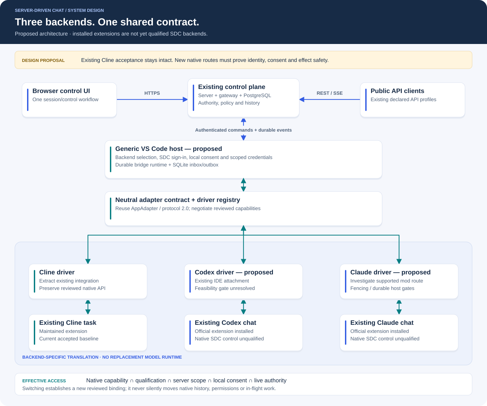

# Task: a shared VS Code protocol for Cline, Codex, and Claude Code

**Date:** 11 October 2026  
**Status:** implementation in progress; neutral driver contract complete; native routes remain gated  
**Requested outcome:** switch between supported VS Code coding assistants through one SDC control system  
**Implementation status:** MB-02 contract and MB-03 experimental host implemented and fixture-tested; native driver/acceptance phases remain open

## 1. Intent

The user wants Cline, the official Codex VS Code extension, and the official Claude
Code VS Code extension to participate in the same Server-Driven Chat system.
The browser and public API should use a stable neutral contract. Changing a native
plugin or its version should primarily affect its driver and compatibility record,
not require rewriting server authorization, persistence, transport, or the UI.

The requested direction is **SDC controls an existing conversation inside the selected
VS Code plugin**. It is not the separate arrangement where Codex/Claude calls SDC
as a model provider, nor a new agent launched by a CLI or SDK.

**Confirmed scope decision, 2026-10-11:** the user explicitly chose **Preserve existing
IDE conversations**. Separate vendor runtimes remain outside this task. Claude and
Codex stay blocked until supported native attachment/effect-fencing routes are
established; the three-backend completion criterion is not reduced.

The later user instruction to implement and finish this task authorizes sequential
implementation, including neutral work while native routes remain blocked. It does
not authorize sign-in, native task selection, remote approvals, account changes,
or model execution without the required local graphical consent. Preserve existing
acceptance and security boundaries.

## 2. Goal and definition of success

The proposed user experience is:

1. Open the SDC lab or a subsequently qualified installation of VS Code.
2. Open Cline, Codex, or Claude Code and select an existing native conversation.
3. Choose the backend in a generic SDC companion.
4. Review the server, native conversation, workspace, and supported control categories.
5. Sign in/pair and grant explicit local control for that exact binding.
6. Send prompts and receive output through the same SDC browser or API.
7. Switch to another backend by explicitly detaching/rebinding, without changing
   the browser's or client's basic request contract.

**The three-backend goal is complete only when all three exact native targets pass
the required core acceptance suite.** Installing an extension, parsing an API shape,
or passing simulated tests is not completion. If a plugin cannot provide a supported
safe attachment route, mark its integration blocked and record what must change;
do not claim universal support or substitute a separate runtime.

Success also requires:

- The existing Cline workflows and declared API profiles continue to work.
- A native version upgrade changes only a driver/compatibility package when the
  shared contract still expresses the required behavior.
- Unsupported and unverified features remain unavailable, with actionable reasons.
- Every binding retains native identity, consent, authority, and durable recovery.
- Switching plugins does not silently move history, permissions, credentials, or
  in-flight work between native applications.

## 3. Scope and boundaries

### In scope

- Official Codex and Claude Code extension installation in an isolated VS Code lab.
- Generic host, driver discovery/registration, local backend/task selection and consent.
- Reuse/evolution of `AppAdapter`, protocol 2.0 and capability discovery.
- Backend-specific mappings for identity, input, output, readiness, controls and lifecycle.
- Versioned compatibility manifests, capability qualification and common conformance tests.
- Explicit switching, context isolation, scoped credentials, packaging and rollback.
- Real graphical/native and HTTP/API acceptance for each advertised subset.

### Outside the initial implementation

- New LLM executor, agent subprocess, standalone app-server or headless replacement.
- Reading private app sockets, internal databases or tokens to bypass unsupported attachment.
- Generic clipboard/button automation presented as exact task or approval control.
- Automatic import of native conversation history into another vendor's task format.
- Global automatic approvals or carrying a grant from one backend to another.
- New model-provider, named-client, MCP, remote-host or standalone Mac-app support by implication.

The native plugin runs its model and enforces its own permissions. SDC owns its
server-facing history, operations, authorization, scheduling and policy; these
ownership rules follow [DECISION-010](docs/decisions/010-server-owned-api-semantics.md).

## 4. Installed lab and current facts

### Installation completed in this task

| Component | Installed/verified value | What this proves |
|---|---|---|
| VS Code host | Existing signed **1.140.0**, arm64; commit `07f806f999227108933c2e30515b26eecc1fda74` | Host signature check and version command succeeded |
| Codex | `openai.chatgpt` **26.1007.21434** | Official extension installed and listed by VS Code |
| Codex audio companion | `openai.codex-audio` **26.1007.21434** | Installed as Codex's declared extension-pack member |
| Claude Code | `anthropic.claude-code` **2.1.296** | Official extension installed and listed by VS Code |
| Lab editor settings | Automatic extension/editor updates disabled in this lab | Evaluation versions are held for reproducible inspection |
| Native sign-in and control | Not performed | No claim of working authentication, live task access or SDC integration |

The installation used the official extension IDs through the verified VS Code host's
extension manager CLI. Codex's manifest requires VS Code `^1.96.2`; Claude Code's
requires `^1.94.0`; this host satisfies both declared engine requirements. That is
installation eligibility, not native behavioral acceptance.

Installed entry-point SHA-256 values recorded for later comparison:

| Extension | Entry-point SHA-256 |
|---|---|
| Codex | `a8069de80c8f8141481d033f94c3a95e1b59f399143cb2554d3f68469dfbe5b8` |
| Claude Code | `1ce72af34e8df9d4545a645d5d0d7f225dfad54b88f93fe9b7942416a3f32353` |
| Codex audio | `bdfdb5b9bb1be13dc37befd800a82e479843516080079c935673a3327012d03e` |

These hashes identify the installed main entry files, not complete VSIX archives or
all bundled executables. Full artifact/runtime provenance is a discovery deliverable.

### How to open the lab

In Finder, choose **Go → Go to Folder…**, enter:

```text
~/Library/Application Support/ServerDrivenChat/PluginLab
```

Open **Open SDC Plugin Lab.command**. It launches the verified editor with:

```text
Host:       ~/Applications/ServerDrivenChat VS Code 1.140.app
User data:  ~/Library/Application Support/ServerDrivenChat/PluginLab/user-data
Extensions: ~/Library/Application Support/ServerDrivenChat/PluginLab/extensions
```

The launcher opens a fresh editor window without selecting a project. The application
and lab state are local machine assets, not files to publish to GitHub. No accounts
were signed in and no native task was started during installation.

Only the new plugins and Codex's declared companion were installed in PluginLab.
The accepted Cline/SDC pair remains in its existing M24 isolated installation. A
later phase will provision a reviewed copy of that pair into the combined lab and
verify all three coexist. Do not replace it with stock Marketplace Cline.

Separate editor directories isolate VS Code data and extension binaries. They do
**not** guarantee isolation of vendor home-directory settings, account credentials,
Keychain entries or histories. Discover each extension's configuration scope before
sign-in or mutation; do not copy or inspect stored secrets as a shortcut.

## 5. What the project already has

| Existing component | Reuse | Gap to close |
|---|---|---|
| [Protocol contracts](protocol/src/contracts.ts) | Neutral commands, events, binding identity, outcomes, capabilities | Audit whether small explicit additions are needed for new backends |
| [Adapter core](adapters/core/src/index.ts) | Shared operations and identity helpers | Add driver registration/qualification metadata without duplicating the adapter contract |
| [Bridge](bridge/src) | SQLite inbox/outbox, replay, leases and durable delivery | Host these primitives independently of Cline-specific connection code |
| [Server](server/src) | Identity, transactions, operations, scheduler and server-owned API semantics | Capability/qualification routing for newly supported binding types |
| [Gateway](api-gateway) | First-party and provider profiles | Conformance on each backend; no vendor-native bypass |
| [Control UI](control-ui/src) | Session display, prompts, controls, transcript | Backend labels and truthful feature/status presentation |
| [VS Code extension](extensions/vscode/src) | SecretStorage, profile/consent concepts, connection UX | Remove hard dependency on Cline from the generic host |
| [Cline adapter](adapters/cline/src) | Working native mapping | Keep native-specific implementation behind the new driver boundary |

`extensions/vscode/src/connect.ts` currently imports `ClineAppAdapter` and Cline
native types. Activation and task selection in `extensions/vscode/src/index.ts`
also look up the Cline extension directly. Those are concrete coupling points to
extract; changing only names in the manifest would not generalize the companion.

## 6. Proposed architecture



### 6.1 Shared control plane

The existing server and gateway keep their responsibilities. Public callers operate
on authorized SDC sessions/operations. They never supply an arbitrary vendor thread
ID to bypass selection or invoke native vendor APIs directly.

The bridge owns durable delivery and per-binding authority. Schedulers remain scoped
to bindings sharing a durable device inbox. Keep per-session/epoch checkpoints and
authenticated skipped-command tombstones. Preserve the current 60-second lease and
20-second renewal defaults unless an independently reviewed change requires otherwise.

### 6.2 Generic VS Code host

A new generic host owns:

- SDC sign-in, device pairing, profile storage and scoped cleanup.
- Backend discovery and user-visible selection of a supported native conversation.
- Consent, online/disconnected status and capability explanations.
- Bridge runtime creation, SecretStorage and local SQLite lifecycle.
- Registration and lifecycle of reviewed backend drivers.

The generic package must not declare Cline as a mandatory extension dependency.
Vendor-specific entry points belong in separate driver packages or small vendor
registration extensions. Keep the existing Cline companion as a supported migration
path until the generic host has passed fresh acceptance.

### 6.3 Drivers and optional native shims

Each driver translates the existing `AppAdapter` operations into a supported native
interface. Its code owns vendor event shapes, exact version compatibility and error
mapping. A native shim is optional and app-owned: Cline already has a maintained
export; another backend may provide a documented native extension mechanism.

Proposed responsibilities, not implemented paths:

```text
protocol/                         Existing neutral wire and operation contracts
adapters/core/                    Existing AppAdapter + proposed registration metadata
adapters/cline/                   Cline native implementation and driver
adapters/codex-vscode/             Proposed Codex driver after route feasibility
adapters/claude-code/              Proposed Claude driver after route feasibility
extensions/vscode-host/           Proposed generic consent / identity / bridge host
extensions/vscode-drivers/        Proposed thin registration packages, if needed
native-integrations/              Proposed app-owned shim sources, where permitted
tests/conformance/                Shared contract and backend qualification suites
```

Prefer a VS Code extension's explicit exported API when suitable. Registration must
bind a driver to its reviewed extension identity and compatibility record. A backend
name or a driver-provided self-assertion is not proof of qualification. Multiple
windows/extension hosts need explicit instance identity; do not assume one global
active task.

No transport is selected for an unproven native route. An in-process exported API
is the preferred simple case. A supported app-owned cross-runtime route needs its
own authentication, origin/identity, cancellation, size and recovery review. It
must not become an unauthorized private socket or substitute model runtime.

## 7. Shared protocol design

### 7.1 Reuse the existing operation vocabulary

Keep protocol **2.0** as the starting point. Do not introduce a parallel protocol
just to rename Cline operations. Design additions through schema/version review and
compatibility tests; unsupported mandatory semantics must fail closed.

| Operation | Common meaning | Core requirement |
|---|---|---|
| `probe` | Report native identity and supported/unsupported/unverified features | Required |
| `attach` | Bind only to the user-selected existing native conversation | Required |
| `inspect` | Report observed state or an explicit uncertain outcome | Required |
| `submit` | Deliver one authorized command to that exact binding | Required for text control |
| `subscribe` | Emit ordered correlated events with checkpoint semantics | Required for text control |
| `detach` | Fence future delivery without deleting native history | Required |
| `cancel` | Address the observed native turn; distinguish request acceptance from stop | Optional capability, independently tested |
| `respondInput` | Resolve the exact native question and revision | Optional capability |
| `resolveApproval` | Apply an offered choice to a complete exact action/request | Optional capability with stricter qualification |
| `stageAttachment` | Verify and admit authenticated bytes to the intended native turn | Optional capability |
| `revoke` | Revoke a native permission grant if the backend supports it | Optional; distinct from device/API credential revocation |

A text-only backend must still enforce identity, consent, fencing and truthful
outcomes. Optional cancel means inability to stop a running turn must be visible;
it does not permit weakening local detach or expiry checks.

### 7.2 Driver descriptor and compatibility negotiation

The descriptor wraps `AppAdapter`. MB-02 implements this local contract in
`adapters/core/src/driver.ts`, with its schema under `adapters/core/schemas/` and
qualification semantics in [DECISION-011](docs/decisions/011-backend-driver-contract.md):

```text
BackendDriverDescriptor
  backendId                 stable neutral registry identity
  driverId / driverVersion  implementation identity
  hostKind                  local VS Code for this proposal
  extensionIds              exact vendor extension identities
  compatibility             reviewed native versions / APIs / fingerprints
  qualificationRef          trusted acceptance record and declared subset

Driver factory
  discover()                supported, user-visible native selections
  createAdapter(hostContext, selected) -> AppAdapter
  readConversationRevision(adapter, binding)
  dispose()                 release listeners and local resources
```

Keep wire version, driver contract version, vendor native API version, package
integrity, and behavioral qualification separate. A compatible upstream interface
may reuse the same driver, but new package bytes still need review and affected
acceptance before entering an accepted compatibility record. Avoid blanket “all
versions” ranges derived only from a manifest engine constraint.

A signed manifest authenticates recorded bytes; the capability evidence establishes
what those bytes were observed to do. Neither should be used as a substitute for
the other.

### 7.3 Capability intersection

Effective permission is the intersection of:

```text
Native implementation capability
  ∩ reviewed backend/version qualification
  ∩ server policy and authenticated principal scopes
  ∩ local user-selected categories
  ∩ current live binding / lease / readiness
```

Missing, unsupported or unverified capability is unavailable. Preserve the current
capability status vocabulary and reasons. Record the exact binding and capability
revision used for dispatch. Recheck effective authority at the effect boundary;
a capability read during discovery is not a permanent grant.

### 7.4 Identity, events and uncertain effects

Reuse existing binding fields and opaque native IDs. Preserve app/installation,
process/window/workspace, account where available, conversation, binding revision,
lease generation, native turn and pending request revision. Drivers must invalidate
old identities on native lifecycle changes; they must not choose a conversation
from untrusted model text.

Normalize native output while retaining enough provenance to distinguish remote
command echoes, local input, partial/replaced output and actual terminal state.
Never fabricate completion from silence or a closed stream. Optional richer native
payloads belong behind bounded reviewed mappings rather than vendor fields leaking
into neutral server scheduling.

A command can be accepted before it is applied. After a crash between native effect
and durable receipt, report `unknown` and reconcile with the native application;
do not promise exactly-once native effects when the backend cannot prove them.

### 7.5 Queued work and control safety

If a native API enqueues a prompt, authority must remain enforceable when the prompt
actually starts. A pre-enqueue check alone is insufficient. Prove cancellation/removal
or an app-owned pre-effect hook; otherwise that queued submission route cannot be
advertised as safe remote text control.

Approval decisions require complete action material, exact request identity/revision,
offered decision, expiry and local/remote single-winner behavior. Native denial and
organization policy remain authoritative. Caller-tool qualification is additional:
Cline/Codex/Claude must not execute an effect that the API caller is supposed to own.

### 7.6 Switching and context policy

Treat switching as a controlled transition, not changing a string on an active task:

1. Stop new admissions to the old binding and finish or reconcile in-flight work.
2. Detach/fence the old dispatch authority and preserve its records.
3. Discover/select the new backend's existing native conversation.
4. Review fresh capabilities and local consent; establish a new binding.
5. Issue appropriate credentials/routing only for the new authorized target.

Do not automatically fail over an in-flight operation to another backend. Old
scoped keys, permissions, response lineage and native hidden context do not silently
follow the switch. Default to a new API conversation when switching. Any future
history handoff must be an explicit server-composed context import into a suitable
binding, with limits/provenance and separate acceptance; it is not native history
conversion.

## 8. Backend feasibility and proposed routes

### Cline: reference implementation

Reuse the maintained Cline API 1.3 mapping and accepted package baseline. Extract
Cline-specific activation/connection concerns into the driver while preserving native
behavior. Changing the companion/host means fresh affected acceptance; old evidence
remains historical and must not be rewritten to fit new output hashes.

### Codex: installation done, native attachment unproven

Official documentation identifies `openai.chatgpt` as the IDE extension and describes
opening its sidebar. Installation is complete; no authenticated/native smoke test
was run. [Official IDE setup](https://developers.openai.com/codex/ide/).

The documented app-server provides thread/turn, event and approval primitives useful
for designing a mapping. It does not establish that an external companion may
safely attach to the already selected official IDE conversation. This is an unresolved
route requirement, not proof of permanent impossibility. Do not launch a new app-server
or attach through a private endpoint as a substitute. Verify the exact installed
extension's supported integration boundary before implementing a driver.
[Official app-server contract](https://developers.openai.com/codex/app-server/).

The app-server vocabulary is a reference candidate, not the SDC wire protocol and
not a reason to move native execution into the SDC server.

### Claude Code: installation done, supported mod route to investigate

Official documentation describes the VS Code extension and its bundled runtime;
its version is recorded above. [Official VS Code setup](https://code.claude.com/docs/en/vs-code).

Claude's mod documentation says hooks run in the VS Code chat panel, while mod-drawn
UI is unavailable there. Investigate whether that surface can provide observation,
selected-session input and effect-boundary checks, with consent provided through an
appropriate supported surface. This is a candidate route, not accepted integration.
[Mods surface matrix](https://code.claude.com/docs/en/plugins/mods/overview#where-mods-run).

The documented prompt submission waits until idle. Its runtime lacks ambient Node
APIs, and the HTTP helper returns a buffered response. Therefore queued-effect
fencing, durable SQLite hosting, and event delivery/recovery are explicit discovery
gates. Do not assume the current bridge can simply be imported into a mod or replace
its storage with an unreviewed JSON store.
[Mods API](https://code.claude.com/docs/en/plugins/mods/api).

## 9. Phase-by-phase milestones

The `MB-*` IDs below are a proposed workstream, **not a renumbering or automatic
reopening of M01–M30**. The historical Codex desktop milestones M16–M18 remain
Deferred; this proposal concerns a separately scoped IDE integration. Installation
and planning do not mark either native integration implemented.

| Phase | Status | Depends on | Outcome |
|---|---|---|---|
| MB-00 — Install and inventory | Installation complete; native discovery pending | User installation request | Official extensions, isolated launcher, exact installed versions |
| MB-01 — Establish native routes | Discovery complete; integrations blocked | MB-00 | Route matrix and missing primitives documented in [MB-01 evidence](evidence/MB01/README.md) |
| MB-02 — Freeze neutral contract | Done (contract/fixture scope) | MB-01 findings | [DECISION-011](docs/decisions/011-backend-driver-contract.md), validated descriptors, exact qualification and capability intersection |
| MB-03 — Generic VS Code host | Done (experimental source and fixture scope) | MB-02 | Registry/lifecycle engine, isolated host package, generic pairing/consent, recovery and bridge service; [evidence](evidence/MB03/README.md) |
| MB-04 — Move Cline behind driver | Done for declared experimental Cline core subset | MB-03 | [Verification](evidence/MB04/verification.json): prompts/questions/cancel, provider text, reload/cleanup/reinstall and local takeover; production adoption remains MB-09 |
| MB-05 — Claude native driver | In Progress; native classic refusal after busy waiting passed; changing-authority fence unqualified | MB-04 + Claude MB-01 pass | Qualified Claude core text binding |
| MB-06 — Codex native driver | Conditional; not started | MB-05 completed or explicitly deferred + Codex MB-01 pass | Qualified Codex core text binding |
| MB-07 — Optional controls and media | Not started | Relevant core driver passes | Per-backend questions/cancel/approval/media/tool subsets |
| MB-08 — Switching and public API acceptance | Not started | MB-04–07 required subsets | Safe selection, isolation and unchanged declared client contracts |
| MB-09 — Distribution and lifecycle | Not started | MB-08 | Reviewed packages, notices, integrity, upgrade/rollback and cleanup |
| MB-10 — Release and handoff | Not started | MB-09 | Exact three-backend matrix, release/soak report and user guides |

Execute phases sequentially. The later instruction to finish this task permits
neutral work while backend-specific discovery remains blocked. Native driver phases
still require their own supported route and acceptance. Do not mark a blocked driver
Done or reduce the final three-backend goal to two.

### MB-00 — Install and inventory

**Completed:** verified host; installed official Codex/Claude extensions and declared
audio pack; listed installed versions; captured entry-file hashes; created lab launcher.

**Remaining discovery handoff:** verify GUI activation, full package/runtime inventory,
configuration/credential storage scope, and the controlled procedure for signing in.
Copy the reviewed Cline pair into the combined lab only as part of the planned
coexistence qualification. Do not reuse production device grants.

### MB-01 — Establish native routes

**Work:** inspect official interfaces and exact available types; write a route matrix
for selection, identity, input, output, termination, lifecycle and pre-effect fencing.
Record extension/runtime/version provenance. Use disposable native conversations
only after human sign-in and local consent.

**Exit:** each backend has a demonstrated route for two same-conversation harmless
prompts plus wrong-conversation refusal and authority loss before effect; otherwise
its decision is blocked/unsupported with the missing primitive identified. Keep
fixture proofs and real native results separate.

### MB-02 — Freeze neutral contract

**Work:** audit protocol 2.0 against route findings, settle driver factory/discovery
metadata, normalized events, capability intersection and compatibility policy. Write
an architecture decision and schema fixtures. Specify gaps that require a versioned
protocol change rather than silently changing existing meanings.

**Exit:** explicit examples cover both a fully capable driver and a restricted text
driver; unknown/stale/unsupported outcomes, queued work, and old-client behavior have
tests and defined semantics. No vendor dependency enters shared protocol/server code.

### MB-03 — Generic VS Code host

**Work:** extract Cline imports from common connection management; implement backend
registry, selected-conversation discovery, generic UI labels, per-binding consent,
SecretStorage namespaces and durable-store ownership. Choose reviewed registration
and packaging mechanics. Preserve old Cline profile migration explicitly.

**Exit:** fake-driver contract tests demonstrate selection, consent, switching,
disconnect/revoke, missing-driver errors and multiple-window isolation without
native execution. Existing Cline release remains separately usable.

### MB-04 — Move Cline behind its driver

**Work:** supply the Cline-specific factory/registration/native checks. Retain current
controls and exact package guards. Install the candidate generic-host/Cline pair in
an isolated host with fresh consent.

**Exit:** affected Cline adapter, bridge, native workflow, API and lifecycle checks
pass; old and new host credential/profile handling is explicit. No support transfer
based on unmodified native hashes alone—the new host is also tested.

### MB-05 — Claude native driver

**Current Phase A status (2026-10-15):** The one-shot native busy prompt and
authority Test A passed: the attributed prompt waited while Claude was busy;
synthetic permission was revoked before the guard ran; the native guard dropped
the offer and no second turn started. The decisive Test B—revocation after the
guard allows but while another hook is still running—was **not run** because the
existing conversation showed an ownership warning and the probe did not register
for the pinned session identity. Cleanup is recorded in
[`NATIVE-AUTHORITY.md`](evidence/MB05/NATIVE-AUTHORITY.md). MB-05 remains In
Progress at Phase A. Do not implement the Claude driver or claim an execution-time
fence until Test B and the remaining native authority/lifecycle/recovery cases
pass. Follow the [stepwise completion plan](docs/feasibility/mb05-completion-plan.md)
one unit at a time; each unit requires its own Luna review.

**Current completion plan:** [32 modular steps with independent Luna review](docs/feasibility/mb05-completion-plan.md)
and a [reusable reviewer handoff](docs/feasibility/mb05-luna-review-template.md).
**Step 01 is PASS and has final Luna ACCEPT** after reconciling the stale broad
app-list state with direct UI evidence; see [step evidence](evidence/MB05/steps/01-baseline/handoff.md).
Step 02 is PASS/ACCEPT after the user released the conversation in the other view;
the read-only recheck found the same selected session digest in the expected
isolated host/workspace with no ownership warning. The original BLOCKED attempt
is preserved. See [Step 02 evidence](evidence/MB05/steps/02-ownership/handoff.md).
Step 03 is PASS/ACCEPT for the exact-build developer API inventory; exact type
declarations and effect-time semantics remain unresolved. See [Step 03 evidence](evidence/MB05/steps/03-exact-build-api/handoff.md).
Step 04 is next: validate the unchanged Test B harness/schema and finalize event
correlation, without sending a native prompt. See the stepwise plan.
The latest
[authority test](evidence/MB05/NATIVE-AUTHORITY.md)
passed revocation before queued admission; the post-allow race was not run.
Phase A's explicit decision gate must pass before driver implementation. This is
a stepwise plan, not completed driver work; MB-05 remains In Progress.

**2026-10-15:** the separate one-shot probe offered attributed input during an
active native turn, waited 10.381 seconds for completion, then reached classic
refusal without starting another turn. [Native evidence](evidence/MB05/NATIVE-QUEUE.md)
and cleanup are recorded. This supersedes queue-timing uncertainty, not the
remaining expiry/revocation, takeover, lifecycle, late-hook and recovery gates.
No Claude driver or production admission has been added.

**2026-10-14 alternate route:** the installed 2.1.296 schema supports classic
`UserPromptSubmit` with `onFailure: "block"`. An evaluation script and settings
fragment passed four real manual native refusal cases (explicit refusal, crash,
malformed JSON and timeout); cleanup restored original settings. The next
Mod-origin probe subsequently passed two native attributed refusals and was
disabled/unloaded. Its intended busy offer arrived 341 ms after completion, so
queue timing remains inconclusive. See [origin results](evidence/MB05/NATIVE-ORIGIN.md) and
[native evidence](evidence/MB05/NATIVE-CLASSIC-HOOKS.md).
[The alternate-route investigation](evidence/MB05/ALTERNATIVES.md)
supersedes the earlier Mod-only conclusion that no independent candidate was
identified. Phase A must still prove native queue timing, authority loss,
Mod/configuration lifecycle and the final admission race before B–F proceed.

**Work:** implement only the supported route proven in MB-01; settle mod/host bridge
transport and persistent storage without substituting another model process. Preserve
remote-input attribution and cancel queued prompts on invalidated authority.

**Exit:** real native core text suite plus crash/replay/local-takeover/lease-expiry
cases pass; unqualified controls remain disabled. If effect-boundary fencing cannot
be implemented, remain blocked rather than weakening the contract.

The exact-build evaluation checkpoint and unblock tests are recorded in
[`evidence/MB05/README.md`](evidence/MB05/README.md). The pinned Claude Code version
is 2.1.296; the installed package lacks generated version-specific Mod declarations.
The bundled 2.1.296 validator now accepts the corrected observer; five stubbed
tests pass, including a diagnostic proving that a failing guard and catch allow
the core handler through. See `evidence/MB05/exact-build-check.json`. No Claude
driver or native qualification has been added while the queue/failure fence
remains unproven. The approved local observer ran in “Project analysis”: two
manual no-tools replies and matching native turn events passed in the same existing
session across a window reload. It is now disabled and unloaded; the SDC host is
left disconnected. See `evidence/MB05/native-observer-events.json`. Remote input,
queued revocation, crash/replay and authority fencing are unqualified. Phase B
must wait for a supported native fence independent of the demonstrated ordinary
hook failure path.

The final Phase A follow-up is [`evidence/MB05/BLOCKER.md`](evidence/MB05/BLOCKER.md).
It records the rejected recursive-submit route, distinguishes test-event inputs
from production caller arguments, and defines the native admission/revocation
capability and race acceptance required to unblock Phase B. Six diagnostic tests
pass; successful diagnostics exposing unsafe fallbacks do not mark MB-05 Done.

### MB-06 — Codex native driver

**Work:** implement the supported selected-IDE-conversation route proven in MB-01,
map native identity/events/terminal states, and integrate the generic host's consent
and durable bridge. Do not claim a new standalone process is the existing IDE task.

**Exit:** same real native core suite as Claude/Cline, including wrong-thread refusal,
revocation, native takeover and uncertain effect handling. Unsupported attachment
leaves this phase blocked with a vendor/interface requirement.

### MB-07 — Optional controls and media

**Work:** qualify questions, addressed cancellation, exact native decisions,
attachments, artifacts and caller-tool effect ownership separately for each backend.
Do not make the least capable plugin force all others to lose their qualified features.

**Exit:** every advertised operation has positive/negative/race evidence and declared
limits. Native permission classes without a safe mapping remain local-only. Reject
unsupported options before admitting a native command.

### MB-08 — Switching and public API acceptance

**Work:** test new-session binding transitions, frozen old credentials, in-flight
operations, server aliases/context isolation and all declared first-party/provider
profiles. Verify same-key retries, terminal-buffered provider output, estimated
accounting and exact named-client subsets. Test at least two simultaneous bindings
and all three backend pairs for cross-routing refusal.

**Exit:** no command, event, approval, history context or credential leaks across
bindings; no hidden native failover; existing clients keep their declared semantics.

### MB-09 — Distribution and lifecycle

**Work:** versioned host/driver packages, upstream notices, complete manifests,
signatures, controlled updates, clean installation, upgrade/downgrade, profile
migration, backups, scoped revoke/forget and uninstall/reinstall. Check vendor
home-directory and Keychain effects separately from VS Code directory isolation.

**Exit:** reproducible release inputs and observed rollback/cleanup outcomes exist
for each published pair, with accepted Cline rollback preserved.

### MB-10 — Release and handoff

**Work:** run affected full suites and real sustained-use/latency/backlog checks
against the final bytes. Update support matrix and beginner/migration/operator
manuals for backend selection and capability differences.

**Exit:** all three native core targets pass, optional subsets are accurately
published, release/soak results and failures are recorded, and the operator can
install, diagnose, switch, roll back and retire the system. Otherwise publish an
explicit partial/blocked status, not completion of the three-backend goal.

## 10. Verification strategy

Use three evidence levels: pure/fixture contract tests, real server/database/bridge
tests with simulated native effects, and observed native tests on exact packages.
Each report identifies which level it proves.

| Test group | Required checks |
|---|---|
| Driver discovery | Wrong extension, missing export, unsupported contract, changed hash, duplicate registration |
| Binding | Wrong task/window/workspace/account, reload, selection changes, multiple hosts |
| Submission | Duplicate command, changed retry, local input collision, queued effect after detach/expiry |
| Events | Partial/replaced output, wrong epoch, replay, gaps, missing terminal state, bounded backlog |
| Recovery | Crash before/after native effect and receipt persistence; retained tombstones; no blind resubmit |
| Permissions | Scope/category intersection, revocation, stale lease, request revision/digest races, local denial |
| Context | Exclusive/shared-task policies, switching lineage, no hidden context claimed cleared |
| API | First-party/OpenAI/Anthropic declared subsets, idempotency, auth, unsupported options and stream termination |
| Lifecycle | Complete installed identities, signature verification, clean install, update, rollback and scoped cleanup |
| Performance | Controls remain responsive under output backlog; actual native sustained use and measured latency |

Development uses Node 24/npm 11 with locked dependencies. Run focused checks during
implementation, then root build/lint/test for cross-package changes. Run disposable
PostgreSQL and gateway checks as affected; avoid concurrent database restart suites.
Use Swift tests if shared Swift code changes. Native tests require the selected
qualified host and cannot be replaced by Node fixtures.

Do not add all vendor SDKs as runtime dependencies just to normalize their types.
The existing applications execute the model; vendor request formats stay in the
gateway, and native driver code depends inward on the neutral contract.

## 11. Risks and decisions still required

| Risk or open decision | Planned resolution |
|---|---|
| Codex existing-IDE attachment not established | MB-01 supported-route proof; vendor interface or explicit scope change if unavailable |
| Claude queued prompts can outlive consent | Pre-effect fencing/cancellation proof; otherwise withhold submission |
| Claude runtime cannot host existing bridge unchanged | Explicit durable host/transport design; no in-memory replacement |
| Fresh VS Code directories still share vendor config/auth | Discover scope before use; choose supported isolation or separate account if needed |
| API-compatible methods have different native meanings | Behavioral conformance and real native evidence per version |
| Generic host breaks existing profiles or credentials | Explicit tested migration/rollback; no silent copying of grants |
| Updated plugin replaces reviewed bytes | Versioned compatibility/integrity records and controlled evaluation updates |
| Switching carries hidden native context or running effects | New bindings/conversations by default, no in-flight failover, explicit reconciliation |
| Capabilities are advertised before tests | Trusted qualification records intersected with runtime capability; unverified means unavailable |
| All three cannot meet required guarantees | Preserve accurate partial status and escalate the missing interface; do not weaken existing guarantees |

Decide during the corresponding phase: driver distribution format; minimum published
text subset; supported app-owned transport per backend; exact generic-host package
identity; compatibility/deprecation policy; combined-host versus separate-window
operational support. The proposal does not presume all answers are already known.

## 12. Sources and related design records

Official documentation was checked on 11 October 2026. Documentation availability
establishes candidate primitives, not acceptance of the installed extension.

- [Codex IDE setup](https://developers.openai.com/codex/ide/) — official extension identity and graphical entry point.
- [Codex app-server](https://developers.openai.com/codex/app-server/) — candidate native vocabulary, distinct from proven existing-IDE attachment.
- [Claude Code in VS Code](https://code.claude.com/docs/en/vs-code) — official installation and bundled runtime.
- [Claude mods overview](https://code.claude.com/docs/en/plugins/mods/overview) and [API](https://code.claude.com/docs/en/plugins/mods/api) — potential in-session integration and runtime limits.
- [Existing plugin integration analysis](docs/guide/plugin-integration-plan.md).
- [Cline migration procedure](docs/guide/cline-version-migration.md).
- [Native public API qualification gate](docs/native-public-api-gate.md).
- [Current source distribution policy](docs/source-distribution.md).
- [Implementation tracker](IMPLEMENTATION_TRACKER.md) — existing milestone history remains unchanged by this proposal.
